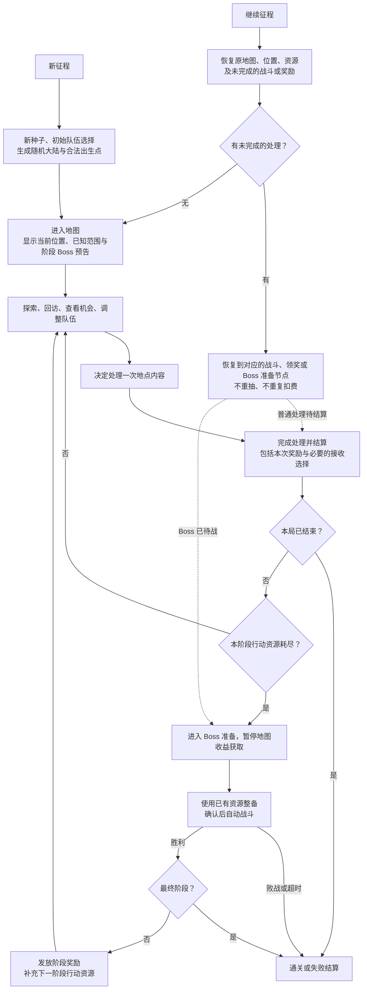
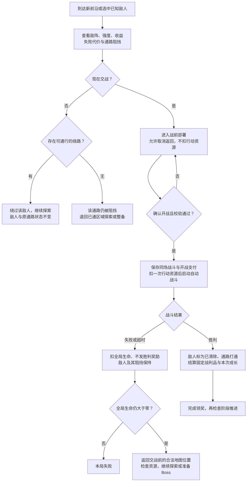
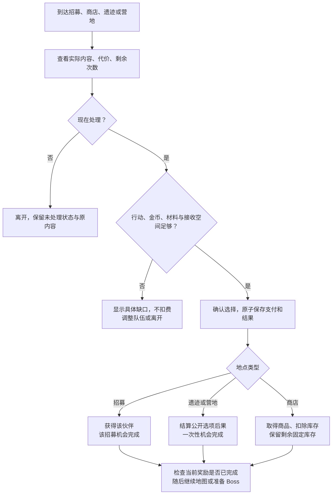
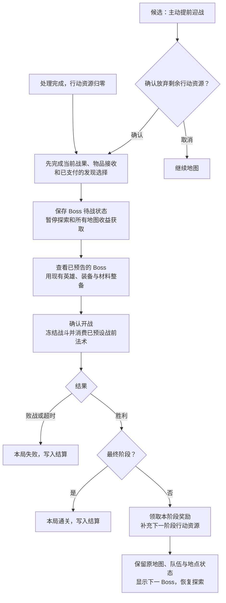
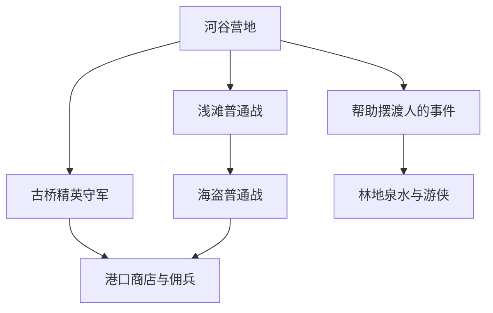
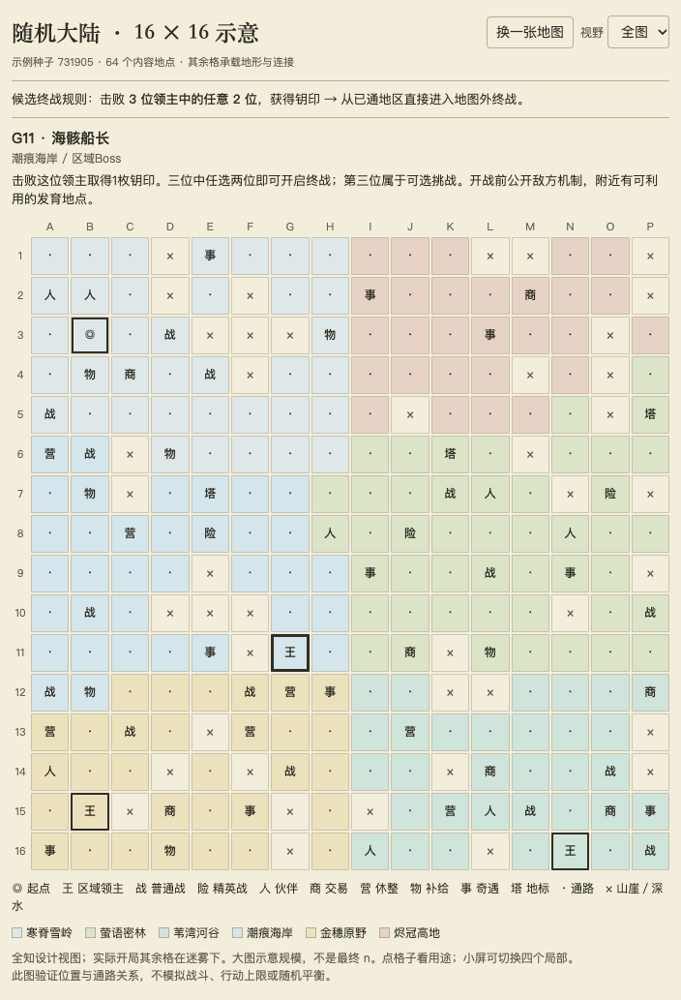
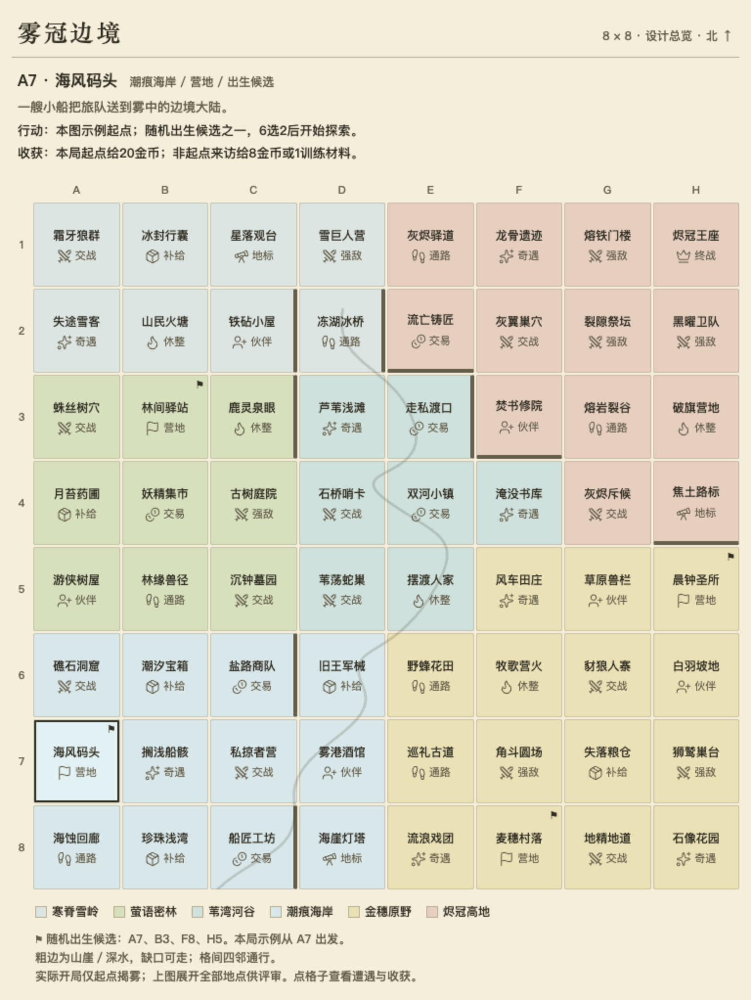

# R10 路线推进：开放方案

## R10-Q11：随机大陆替换爬塔的细节流程规划（2026-10-02）

承接 [D10／D11](decisions.md)。**这是本项目流程设计，不是 Castle Away 原作规则，也不是已经实施的系统。** 用户已认可下列流程，并委托 Agent 补齐实施设计和空上下文审查。原稿“候选”保留其提出时的来源，不再表示需要用户逐项重答；后续具体合同与首轮参数以[实施设计](artifacts/expedition-implementation-design.md)为准。地图 n、阶段数量和行动额度不由旧 15 层倒推，当前选择及校准边界在实施设计中记录。

### 主流程与地图状态

- 已认可的开局选队沿用；当前成长模式确认后进入选路，并非自动首战。本方案将其去向改为地图。每次新征程重新随机；继续只恢复当前有效状态。沿用单活动槽：新征程草稿保存成功即替换上一局，失败保留上一局；之后确认选队时生成并校验完整地图，失败保留本次草稿与已选英雄，成功才发布地图。不能将后一步失败解释为还能恢复已经主动替换的上一局。
- 候选采用一个贯穿整局的 n×n 大陆，四邻通行。阶段 Boss 不占地图格，也不要求玩家沿唯一通路抵达。阶段切换保留位置、已知信息、已清敌人和库存，不重刷地图；阶段奖励与具体阶段数待配置。
- 信息分为未探索、已知未处理、已完成；道路是否通行和地点是否还有内容单独记录。起点及移动后的近邻显露，远处保留迷雾；地貌和少量痕迹提供方向，不做扫雷数字推断。不根据玩家临时阵容重抽未看见的内容。
- 候选让走动、揭示近邻、查看敌情与安全旧路回访不消耗行动资源。地图中的阻挡与局部开路使部分未知仍需经历遭遇才能抵达；不保证所有内容都能先免费扫完，也不为每个服务强加一场守关。
- 点击远处已知格只读信息；前往沿合法已知通路进行，不瞬移、不穿越敌人格或未探索区域。遇到新前沿或障碍先停下；可取消行走，不因动画多扣资源。

### 探索与敌人：愿不愿打、能不能绕过分别判断

- 首版通行候选：敌人占据其所在格，未胜利不可穿过；能否绕过来自其他实际可通行路径。守桥、狭口和支路敌人可用同一规则，不先建立复杂巡逻／追击／潜行系统。不把“可以关闭详情”解释为“已经通过敌人”。
- 远处看到敌人可以读取资料；发起战斗要先到合法相邻位置。查看、进入部署、取消均不推进，确认开战的保存成功才支付；保存失败停在部署，原状态不变。
- 普通／精英失败沿用全局生命代价，但将旧的“无论输赢都前进一层”改为“无胜利收益，回地图，敌人未解决”。每次重新挑战是新的付费尝试；敌人不保留上次被打掉的血，玩家单位仍每战满血。普通失败也可能耗尽最后一点行动资源，须在败战结算后进入 Boss 准备。
- 每个敌人的阵容、强度、战场和奖励身份由地图种子及地点确定，不因往返、查看、换阵容或重载变化。已清敌人不重生供刷奖励；失败重试不改变遭遇内容。

### 非战斗地点：先看条件，再决定支付

候选统一使用一种“行动资源”承担阶段节奏，不另加旅行粮食、揭雾体力或现实时间倒计时。金币／材料承担买卖和培养费用，原全局生命承担败战容错；三者不混用。

| 行为 | 候选行动消耗 | 内容与重复规则 |
|---|---:|---|
| 行走、邻近揭示、查看、标记、已通路回访、战前部署后取消 | 0 | 不触发生产、材料或入场收益 |
| 确认开始一场普通／精英战斗 | 1 | 成败均已消耗；重试另算一次，断线恢复同次不重扣 |
| 成功接受一次招募、确认一次遗迹事件或营地服务 | 1 | 与实际费用、结果同次保存；随机事件失败仍是已处理，不退行动、不重抽 |
| 商店本局第一次成功交易 | 1 | **新增候选：** 同时扣金币、交付商品并保存该店交易资格 |
| 同一商店后续购买、离开后回访购买剩余库存 | 0 | 只扣金币；库存不刷新，不重复产生节点成长；Boss 待战时停止地图交易 |
| 领取已经挣得的战利品、完成已支付的接收选择 | 0 | 不能在领奖时再扣一次行动；同一奖励只领取一次 |
| 消费已拥有材料培养、调整阵容或装备 | 0 | 支付其本身费用；不凭此推进阶段或刷新地图 |

- 招募内容在地点固定；已拥有身份、人口／后备不足要在支付前处理或明确禁用，不能因反复打开重抽。满血恢复等无效服务不扣费。
- 商店第一次交易消耗最后一点行动时，该笔商品完整交付，然后准备 Boss；不能用“同次到访未结束”为理由继续买完整商店。剩余库存下阶段再买。
- 战后允许内容确有需要的奖励选择，但取消“每次推进都必须弹同一种三选一”的外层结构。一次普通战、招募、营地或遗迹应有各自实际收益；既有材料升阶发现不在本次被擅自删除。
- 现有工坊生产／固定材料由“楼层 +1”驱动，替换时改为每个已提交、消耗行动的有效处理在非终局结算一次。查看、走格、空取消、同店后续购买、补领和恢复不重复触发；是否保留原量属初值校准。普通失败仍按既有非终局生产边界处理，不能发胜利战利品。Boss 胜利的成长并入阶段奖励配方，不能普通结算和阶段奖励重复发。

### Boss：最后一次处理结清，再转入准备

- 候选在每阶段开始就能查看该阶段 Boss 的主要机制与失败后果，不到归零时才首次透题；无实时催促。
- 行动归零不能打断当前动作或把已支付收益吞掉。已结束战斗和领奖都以稳定处理 ID 串联，全部结清才进入 Boss 准备。
- Boss 待战允许使用已经拥有的资源调整、升阶与配置战前法术；不允许回地图拿新收益，也不能借已访问商店零行动购买继续发育。准备不另扣探索行动，开战法术保持真实开战只消费一次。
- **主动提前迎战是新增候选，不是用户已决定或原作已核实功能。** 只在无待处理／待领奖时可用，确认后放弃本阶段剩余行动，且不把放弃点数换成材料／生产。用于玩家已准备好或不愿处理剩余机会的出口，防止必须点完无用地点才能见 Boss。不开启该出口的替代是生成严格保障始终有合法可支付的阶段推进行为，两者需评审后选定。
- 候选不强制收集钥匙或清除每个地图精英；普通地图地点不是通关全清清单。终战是最终阶段 Boss，胜利结束本局；不先增加复杂结局分支。

### 随机生成、保存与实施边界

随机生成按“地形与连接 → 出生与地域 → 地点及敌阵 → 可达和供给验证”组织，失败按确定的生成尝试序列重试。每局随机布局、起点与内容分布，不能只换事件文字。至少检查：起点合法且可整备；有可承担的早期发育；有真实可绕路和需要开路的局部例子；可处理机会总量足够覆盖阶段预算并留选择；不同构筑有基础供给；晚到伙伴可实际使用；原地图不因继续／阶段切换变样。轻线索由真实内容派生，不保证每个方向都是最优收益。

存档至少保存：生成版本／种子与完整地图事实、当前位置和已知状态、地点剩余内容／库存、敌人清除状态、阶段及行动资源、队伍与物资、正在处理的机会／冻结战斗／未领奖内容，以及结算身份。主菜单“继续”优先恢复未完成动作，再返回其正确阶段；不能无条件落到地图。中断战斗按现有冻结协议恢复同次战斗，不宣称已有逐帧续战支持。写入失败保留原有效状态，不重复扣费或发奖。

恢复按实际状态分派：终局待保存 → 重试同一终局结算；未确认开局 → 原选人草稿；已提交战斗 → 原冻结战斗；待领取 → 原奖励／发现选择；Boss 待战 → Boss 整备；无待处理 → 原位置地图。Boss 战结果及阶段领奖恢复直接回到相应 Boss 分支，不经过普通地点结算或重复补充行动。

旧线性存档没有可靠的地图历史，**候选保留旧档按旧流程继续完成，新征程使用新地图**；不凭空补地图探索和过去奖励，不静默删除。默认新局入口替换，旧入口仅承担兼容，避免长期双主模式。具体保存命名空间／版本在接口设计中确定，不改玩家真实存档做测试。

工程先完成以下边界，再接正式画面：

1. 地图状态、揭示与通行服务拥有探索；阶段服务拥有行动额度、Boss 待战与阶段切换。`RunApplication` 协调命令，不能由界面关闭或动画结束推进。
2. 每次实际处理使用独立身份和状态：预览 → 已提交／待完成 → 待领奖 → 已结算。战斗准备继续向既有模拟提交不可变配置，战斗不认识格子地图、迷雾或阶段预算。
3. 解绑 `TowerGenerator`／`FloorIndex` 对地图机会、敌阵强度、供给、人口里程碑、生产和终局的隐式控制。用地点、遭遇及阶段上下文逐项替代，不能把移动步数伪装成旧楼层。
4. 遗物“进入节点”、成长生产、随机奖励在有效处理事务中触发；打开详情和反复进店没有这项权限。原购物触发仍对应真实购买，不能遗漏合法内容效果。
5. 地图界面使用预制棋盘格／标记／详情组件；中心地图承载探索、顶部显示资源及阶段、侧边显示所选内容和明确代价。背景天气只读表现信息，不参与迷雾、随机、通行、扣费或 Boss 条件。

验证计划：确定性地图与可达保障；敌人绕行／受阻／胜败；取消与真实提交边界；商店固定库存与重访；最后一点资源、未领奖和 Boss 准备；新局随机与继续恢复；保存失败、重复提交、旧档兼容；生产／材料／人口／遗物不会因走格多触发。用真实预制界面与正式战斗做一条代表性隔离输入路径，覆盖绕路、一次败战、一次回访和阶段推进；生成规则另作多种子检查。无需先跑全套旧功能或多分辨率遍历，平衡和最终观感由用户评审。

当前仅核对入口、`TowerGenerator`、节点结算、成长冻结和存档职责，并形成本规划；未建图、改代码、改正式规则、启动引擎或操作玩家存档。建议细节评审重点：免费揭示与探索、商店只收一次行动、耗尽后地图锁定、主动提前 Boss、普通失败不清怪，以及 n／阶段数／预算的初版配置。

## R10-Q10：发现主导的探索循环完整设计（2026-10-01）

承接[D09](decisions.md)。**已确认的是发现主导、局部规划为辅的体验方向；以下为可评审的完整细则提案，不是已实施规则。** 本稿集中解决翻开前的依据、值得改变计划的发现、发现后的调整空间；终战位置／准入、总局长和正式n另行衔接，不把Q08整套机制带入。

### 参考流程纠偏与计费重审（2026-10-02）

用户观看《城堡漂流记》流程后指出：没有提前规划这一步，走哪看哪、可以反复跑，靠消耗特定资源推进到下一阶段打 Boss。[观察来源与未核实项](evidence.md#城堡漂流记地图探索定向调研2026-10-02)单独记录。Agent 撤回将通路阻挡进一步解释为提前规划整条路线的核心循环；下文 5×5 双路图仅是本项目可选通路设计，不能当作原作流程复刻，也不再作为地图必须成立的骨架。

依照该观察，接下来应优先比较“边走边发现 → 判断眼前机会 → 处理或暂留 → 获得成长并推进阶段 → 回访或继续发现 → 阶段挑战”的循环。取舍可以发生在有限阶段资源用于哪些机会，而不必靠不可逆选路产生；可抵达和可回访不等于所有收益都可免费取得。资源既限制本阶段可兑现的机会，也推动冒险进入下一阶段，不只解释为追兵惩罚。

**计费候选重审：** DC03 原来的未知探查收费、回访另计，以及后文依赖它的到访规则和纸面账本，保留供历史比较，撤下作为当前默认工作方案的推荐。新候选优先让单纯移动、查看已知信息和安全旧路往返不因往返本身收费；将阶段资源消耗放在明确标示的内容处理上。仍需确定哪些处理消耗、消耗多少、如何防止只为扫全图而空跑，以及 Boss 的触发与准备窗口；不直接认定所有翻格、进店或招募都应扣费。强制探查费和普遍守关不是先验答案，迷雾／轻提示与地图每局随机方向保持。以上是 Agent 对候选方案的修正，用户尚未采用这套具体计费或授权实施。

**2026-10-02 参考对象适配补充：** 用户追问《城堡漂流记》是否与本项目很对口。Agent 判断其整局结构高度相关，建议作为接下来路线推进的首要具体参照：区域开路使位置有意义，已通道路回访保留选择，遭遇压力限制机会全收，敌人类型影响供给，探索所得进入自动战斗构筑。原作事实与缺口见[定向证据](evidence.md#城堡漂流记地图探索定向调研2026-10-02)。本项目仍以发现推动伙伴队伍与旅程为目标，需要自行完成英雄招募、晚到伙伴可用性、有限后备和转型成本；不把建筑替换直接等同换英雄，也不认定原作已验证本项目的迷雾／轻线索体验。该参考优先级是 Agent 建议，用户问句未记作整套采用；Q10 探查收费、回访收费和同次处理规则继续待评审，不为维护旧提案而排斥原作更合适的做法。没有新增调研、试玩或运行修改。

### n×n 方格承载地图机制（2026-10-02，可行性与候选映射）

用户询问能否用 n×n 格子复现 Castle Away 的地图机制。判断是可以承载已核实的空间与决策关系；不代表原作全部隐藏规则已查明、体验相同或已授权实施。继续复用本日原作证据，不新增用户决定，不固定 n。

**后续纠偏：** 以下通路布局与生成建议保留为可选设计；不再要求每张地图都围绕强制关口与替代路线组织，也不据此解释原作的主要体验。当前比较顺序以[参考流程纠偏](#参考流程纠偏与计费重审2026-10-02)为准。

- 方格承载地点或连接地形，若干相连格子组成一个区域。先以四邻通行说明；山河等障碍格和占据窄口的守关格即可形成开路代价，逻辑上需要区分相邻与可通行，不要求首版另做复杂边事件系统。
- 地点内容、迷雾信息、通行条件、是否已领取／仍可交易分别记录。揭示敌人只提供判断窗口，确认交战才开始自动战斗；商店已发现、尚未购买时仍可按其通行规则经过，守关敌人未解决则不能穿过。具体计数归进程，不由格子移动动画或天气决定。
- 遭遇推进独立于位移格数：候选允许已通路往返不额外扣行动且不重生奖励，前沿揭示与通路突破限制未探索内容的可见范围。处理遭遇可推进 Boss 压力，不必为此放置一个必须走到的 Boss 格。探查／调查／退出及交易的准确扣费仍需比较，不把 Q10 原计费或原作推定直接变成正式规则。
- 以下只是大地图中的 5×5 局部、设计者全知视角，不是缩小整局规模或要求玩家提前看到所有内容。`山`不可通行，`路`可通行，`营`为当前位置；`精`和两个`敌`为未解决的守关格，`遗`和`商`可先经过再决定是否处理。

|   | A | B | C | D | E |
|---|---|---|---|---|---|
| 1 | 山 | 山 | 山 | 商 | 山 |
| 2 | 营 | 路 | 精 | 路 | 遗 |
| 3 | 路 | 山 | 山 | 山 | 路 |
| 4 | 路 | 敌 | 路 | 敌 | 路 |
| 5 | 山 | 山 | 山 | 山 | 山 |

从 A2 到 D1，上路经 C2 精英，下路经 B4、D4 两个普通敌人，并可经过 E2 遗迹。假设每场战斗计一次，上路开路 1 次但风险高，下路开路 2 次且普通敌人各有收益；地理更长本身不额外加价。不能据普通敌人名称就保证整条路更安全，其总损耗与奖励需内容平衡。拿遗迹和购买商店各自代价另外公开，不假设同一次访问全部免费。若该目的地尚未发现，只给适用的前沿提示，不能用这张全知图证明玩家实际有充分规划信息。纸面四邻路径核对不等于生成或试玩验证。

随机地图需先形成可达区域、连接和适量环路，再安排关口与内容；检查替代路线是否真实存在、关口是否被空地免费绕过、起点是否有可承担的发育机会、探索是否仍有未知。不能向每格独立随机填事件就期待自动出现有效取舍。方格和美术地形可分开呈现，逻辑有格子不要求满屏突出格线。

### 一段探索的基本过程

**看到少量线索 → 选择一个想探查的地点 → 揭示具体人物／机会／危险 → 决定现在处理、先调整、暂留或放弃 → 获得内容与新的局部信息 → 更新队伍或下一步目标。**

地图至少区分未踏足、可探查前沿、已探明、已处理四种信息状态；是否通行、是否还能交易和奖励是否领取独立表达。未处理的地点不会因为有标记就自动解决，已完成的敌人不会刷新供玩家刷奖励。没有统一的“每次发现之后固定三选一”；仅在确有不同后果时提供选择。

#### DC01：信息逐步变具体

| 阶段 | 玩家看得到 | 仍然保留的未知 | 玩家可做什么 |
|---|---|---|---|
| 远方迷雾 | 粗略地貌轮廓、极少数远景地标；不显示整张功能图 | 精确地点、人物、敌人和奖励 | 形成大致方向，不可远程购物或开战 |
| 可探查前沿 | 相邻地貌、一个主要活动线索；显著危险另行标记 | 谁在那里、具体提供什么、要如何处理 | 比较几个方向，选择一次探查 |
| 探明地点 | 人物能力与招募条件、实际商品与价格；或敌方组成／机制／胜负与失败后果；或事件选项的关键代价 | 少量无关紧要的叙事细节；不隐瞒决定成败的承诺后果 | 调整、交易、交战、选择事件处理方式，或离开 |
| 留存／完成 | 地点与承诺条件保存在地图上，明确未处理／尚可购买／已完成 | 尚未继续探索的周边 | 回访、回看、比较已知目标，继续寻找未知 |

新局内容及其线索由种子固定。重读存档、换阵容或来回查看不重抽；不在玩家作决定后偷偷补出专门迎合或克制阵容的地点。

### 问题一：翻开之前，玩家凭什么选择

#### DC02：三种轻量信息足够支持初版

1. **地貌提供倾向。** 林地更可能遇见兽群、游侠和自然遗迹，河岸更可能有人活动、交易与渡口。这只是题材和供给偏好，基础职责不可被一个地域垄断；不要求玩家背概率表。
2. **活动痕迹说明值得调查的原因。** 同一个前沿地点最多一个主要线索，显著危险可额外占一个提示。不层叠数字，不让玩家交叉排除十几个格子。
3. **偶尔获得可信的具体消息。** 例如救下旅人后得知“河湾有个愿意同行的药师”，标出一个小范围，或在靠近后定位一个格子。它给出可追寻的局部目标，不直接展开整片区域和后续奖励链。

| 线索例子 | 玩家能够合理理解的内容 | 不能暗示的错误保证 |
|---|---|---|
| 炊烟／近期营火 | 有人近期在此停留；可能是旅人、商队或营地 | 不等于一定有商店或免费回血 |
| 药草气味／采集痕迹 | 有药草、采药活动或相关人物 | 不保证必得治疗英雄；若已明确说“可招募药师”则必须兑现该身份机会 |
| 箭痕／修整过的猎径 | 有猎人或射手相关活动 | 不预告具体伙伴和全部战斗奖励 |
| 巨大足迹／密集军旗 | 存在明显强敌或精英活动 | 不能让这种等级的危险伪装成普通无异常地点 |
| 古老符文／异常光芒 | 存在值得调查的遗迹或异象 | 不承诺都是正面效果；确认触碰前公开关键代价 |
| 一句具体传闻 | 提供它实际说出的身份、功能或目标事实 | 不随机变成目标从未存在的假消息；默认没有谣言系统 |

同一种痕迹可以对应少数不同内容，但必须满足共同语义。不是每条消息都能精确满足当前构筑；判断偏差主要来自对用途的期待不同，而非提示说谎。若地点状态因玩家行为变化，相应标记也要更新并保留变化原因。

显著危险说明遭遇类别和风险，不显示一个假装精确的胜率；具体能否应对在探明后看敌情。关键威胁和最终挑战条件不能藏到最后一次可调整机会之后。普通探查不会直接发起战斗、扣全局生命或永久损失伙伴。

地图表现采用可识别地貌、痕迹图形和短标签，悬停／点选可读完整事实，不能只靠颜色或动画判断。线索来自已经生成的真实内容；环境雨雪、云影等只表现氛围，不生成或遮改玩法信息。

#### DC03：每次出发处理一个地点，避免免费先扫完全图

**历史候选，已撤下默认推荐（2026-10-02）：** 以下计费表及同次到访、离开、回访的推导保留供比较；当前须与[资源推进阶段的候选](#参考流程纠偏与计费重审2026-10-02)重新评审，不是已确认规则。后文 DC05 的回访计费与六次遭遇账本也沿用这一旧假设，不作为新循环的依据。

本稿建议保留**有限遭遇机会**作为工作方案，但将Q08“只在领奖／交战时计数”改为**一次有效地点探查或回访处理算一次遭遇**。这是为闭合本稿而提出的新细则，未因D09自动获确认；总额度与耗尽后的终局仍归整局进程。

| 操作 | 本稿计费语义 |
|---|---|
| 看线索、看已知资料、标记、读文本、配装备、换上场／后备、调整站位 | 不消耗遭遇，不计现实时间 |
| 在已通安全区域移动；自动展开连续无交互地貌 | 不消耗；不借此揭开所有内容地点的身份和收益 |
| 确认探查一个未知的有效地点 | 消耗1次，揭示完整遭遇；本次到访内的一个完整处理流程包含在其中 |
| 在同次探查中战斗并领奖，或招募，或购物 | 不再追加次数；金币／材料等实际费用照常支付 |
| 探明后暂离、不买或不打 | 已花的这1次保留，获得了信息与回访目标；不额外扣血或处罚 |
| 后来回到已知地点并重新开始处理 | 消耗1次；单纯回看或路过不消耗。当前地点的原库存／敌人／奖励不重抽 |
| 普通战失败后重新尝试 | 是一次新处理，消耗1次；失败损耗遵循R11，无奖励、无敌人永久削血累积 |

一次到访允许不限现实时间地看资料和整备。商店可以在该次到访中购买多件原有库存，不按每次点击扣次数；若开始另一处遭遇，本次到访结束，再回来购物就是回访处理。普通营地只选择一个服务，地点明确设计为组合处理时才允许在一次遭遇中连结；不能把多个独立地点包装成免费批处理。嵌在营救事件中的一场战斗算同次遭遇，战后接收伙伴不重复扣费。

点击先展示线索与“探查将使用1次机会”，确认后才揭示并记账；探明后不会再次扣一份入场费。玩家不能免费先看结果、再取消这次探查。最后一次可用机会仍可完整处理本次遭遇，不在揭示与结算之间提前中断。阅读和界面误触不推进规则。

这个代价使“继续寻找未知”与“回去处理一个确定目标”形成不同价值。它也会增加试探的代价，故生成保障必须与之配套：没有内容的空格不能收费；新手起步不能连续只能看见不可支付、无法应对、又无替代收益的地点。不宣称所有探查都保证赚取同额资源，也不另外增加见闻经验、食物或第二套探索体力。

纯地貌沿已通前沿自动展开至新的有效地点或不可通行边界，未知有效地点需单独探查；未探明格不能作为穿越新区域的免费跳板。山水与局部敌人可以限制真实可达性，但不在全图固定铺设“每种服务前都必须打一场”的守关模板。空间承载扩展中的探索前沿、地域与局部关系，不要求每个空格都是一次决策。

### 问题二：什么发现值得改变计划

#### DC04：发现至少提供一种能落地的后续价值

| 内容类别 | 具体发现例子 | 能改变什么 | 初版限制 |
|---|---|---|---|
| 新伙伴 | 受袭商队中的游侠；可以付出资源邀请的药师 | 阵容角色、配套需求、下一处目的地 | 基础能力取得即有效；先看能力和条件，不设置额外人物好感养成 |
| 可形成新配合的装备／遗物 | 适合连续攻击者的装备，或改变前排分工的护具 | 当前成员的装备分配，是否寻找另一个使用者 | 不能每件都要求未出现的唯一英雄；用不上时可暂存或按物品规则出售 |
| 关键培养资源 | 足以接近一次升阶的通用／类别材料 | 继续培养已有核心，或把资源留给新伙伴 | 沿R02材料升阶，不新增经验／等级；升阶奖励的新英雄可再次打开队伍方向 |
| 有用的服务 | 恢复、招募、改装、有限回退机会 | 把此前暂留的目标变为可以处理的目标 | 服务、价格及适用范围公开，不因发现就免费把全部缺口补齐 |
| 改变对地图的理解 | 从旧瞭望台看见一片此前未知的聚落方向 | 从漫无目的探索转为追寻一个新目标 | 只给局部新事实，不揭整张收益表、不做重线索收集链 |
| 地方关系与后果 | 村庄的失踪商队位于附近；清除威胁后恢复当地交易 | 连接两个原本孤立的地点，产生短期自选目标 | 2–3处地点构成的小关系；无须先接任务，任意发现顺序可成立 |

既有培养回报和探索中的发现都能引发转向，不能为了突出新伙伴而让旧核心的加强失去价值。一次发现可以让玩家坚持原方向，也可以让其产生新目标；不要求每隔几步强制换核心。

日常发现负责稳定成长和短期决策，少量重要发现负责改变方向。首版内容库可以从旅人／商队、营地／服务、遗迹／物件、普通威胁、强敌／领主、地标／消息六类模板起步；重复使用交互结构，变化人物、阵容、收益和地方关系。每个地点不必都写成大支线，更不引入整套实时城镇生态。

每份重要内容设计都要同时写出：现在怎么用、暂时用不了怎么办、以后还有没有使用窗口。不能只写一个稀有度和奖励名。第一批可行候选：救人后提供招募或明确的替代感谢；遗迹提供适合当前使用者的物件选择或基础材料；已知强敌保持坐标与敌情，允许准备后回来。替代回报仍有差异，不保证任何选项总有同等价值，不把所有事件统一成三选一。

不以无提示陷阱消耗队伍资源来营造惊喜。叙事可以有意外身份和态度，触碰遗物、接受交易等会影响玩法的选择，确认前必须说明支付、战斗、失去或获得的关键后果。可以保留范围内的随机收益，但要说清随机范围；不把未说明的永久损失藏在普通选项里。

### 问题三：发现之后，玩家怎样调整

#### DC05：发现后有完整的决定窗口

1. **先看清。** 显示发现的英雄能力、当前可用性、招募条件；商品实际词条和价格；敌方组成、胜利条件、关键机制和失败后果。只在剧情上藏信息，不把必须应对的战斗机制藏在付费确认之后。
2. **在本次到访内整备。** 免费调整既有英雄的部署、装备、站位及已有合法战前资源；不通过动画或现实倒计时催促。可以先算一算，整备不会重新随机地点。
3. **现在处理。** 确认支付或开战才执行对应承诺；发现敌人本身不触发自动战斗。付款与接收都成功后才结算完成；满员时先处理合法空间。
4. **暂留。** 地图保留“未处理”状态、条件与一条可选短备注，正常地点默认不会因离开而消失。以后重新开始处理需一次回访遭遇；内容固定，不能反复刷奖励或货物。
5. **明确放弃。** 可隐藏关注标记但不抹掉地图事实。不是每个发现都必须变成任务，不因没接支线而默认失去终战资格。

初版不为普通伙伴／商店设置暗中到期；若将来制作限时营救等特殊内容，须在承诺前公开进程期限与后果，另行评审。这样暂留是可信的选择，而不是玩家以为能回来、实际已经失去机会。

#### DC06：浅调整随时可做，大转向有实际渠道

| 调整层次 | 可用手段 | 要承担的代价 |
|---|---|---|
| 用现有队伍解决新问题 | 战前调站位、装备和上场／后备，选择已有合法用品 | 不额外扣遭遇；用品及实际支付仍消耗，不增加战中手动操作 |
| 加入新发现的伙伴或配件 | 明确招募／购买，留用旧核心并调整一两席 | 金币、人口／后备和装备槽的机会成本；无空位先处理，不赠无限仓库 |
| 改变主要培养对象 | 通过有限营地服务或物品整体回退，再按原材料类型投入 | 遵循R03门槛及回收语义，不默认无损或随时免费换整队；返还比例沿既有专题校准 |

本稿建议在初始已知营地提供**一次可返回使用的培养回退服务**作为首版适应保障，回访使用算一次遭遇；它是对R03服务供给的具体候选，不是现有规则。不能重复使用、不能退回未实际支付的培养资源，不新发已结算的一次性升阶奖励。深度转型有成本，玩家也可以保留旧队，将新内容作为小幅补强。

新伙伴的基础功能应当在入队后即可发挥，不要求先补一条单位经验等级。所处内容档位应有可上场的基础强度，不能在很晚才投放只有开局价值的普通伙伴；不自动复制原核心全部培养。地域提供适配的材料／服务倾向，通用资源保留跨方向使用空间。新内容是否真的值得替换，需要与已有投入、后备空间、后续战斗数量一起核对。

普通／精英败战沿R11消耗全局生命，有余量可继续；本图适配建议退回已通区域，敌人保持未完成，补强后可再次尝试，不能用多次失败永久磨掉敌人血量。所有Boss仍遵循现有败战终局边界，因此Boss身份与后果必须在开战前显著可见，不能把“可暂留”写成“开打后随时无损撤退”。新遇见的伙伴默认不遭受永久伤病或死亡惩罚。

### 一段实际账本：先找补给，后来组成远程队伍

以下为内容与价格均虚构的纸面例子。起始有盾卫和近战输出，另有一个上阵空位与一个后备空位；示例12金币。本段用6次遭遇说明规则，不代表每段固定6次或正式总额度。

| 步骤 | 作决定前的信息 | 揭示及处理 | 变化／代价 |
|---|---|---|---|
| 探查1 | 山脚炊烟，附近散落箭矢 | 受袭商队；完成普通营救战可邀请游侠。看清敌情后认为队伍续航不足，暂留 | 用1次获得一个具体目标；未交战，不扣血、不拿战利品 |
| 探查2 | 河湾药草气味与人迹 | 药师驿站，展示一名支援者，招募价8；邀请加入 | 再用1次，金币12→4；补上第三席，不要求另练等级 |
| 回访3 | 商队及敌情已知 | 免费调整站位，确认普通战。假设胜利后得6金币，并选择邀请游侠 | 本次含战斗、领奖、接收共1次，金币4→10；不是三次计费 |
| 免费整备 | 现有四名伙伴及其能力已知 | 近战输出进后备，游侠上阵，转移合用的已有装备 | 0次；原核心仍保留，不发生自动培养退款 |
| 探查4 | 游侠提供林地猎径方向，但不知道具体宝物 | 古树遗迹，发现远程配件与基础培养材料的取舍，选择配件 | 用1次；原本寻找补给的计划转为完善新配合 |
| 探查5 | 深处巨大足迹，明确强敌信号 | 看见一处强敌与奖励，判断尚不适合，标记离开 | 用1次换取确定敌情；没有强制交战或不可逆扣血 |
| 探查6 | 另一前沿有旧塔轮廓 | 塔中发现可即时取得的培养资源及一个新地区的局部消息 | 用1次；玩家可继续培养旧盾卫，或转向新目标，不必立刻重打强敌 |

有意把一次未交战探查和一次回访写进账本，检查试探是否能换来有用信息，而不是只展示一路成功的幸运流程。药师不是营救战的唯一解：该具体战斗还须能由装备、不同组合或合法战前资源应对。若其实只有某一英雄能过，就不符合这里的适应目标。

发现顺序也应可交换：先去药师、先遇游侠、先到古树都能独立处理；线索指向已知地点时更新关联，不重发奖励、不要求先接任务。商队被解决后现场变化，之后回访保留这段经历；背景和伙伴短句可以表现事实，不额外创建好感系统。

### 随机生成、内容节奏与验证条件

1. **固定世界，提示从事实派生。** 地点、库存、敌包及2–3地点的局部关系在开局生成并保存；提示随事实生成与更新。玩家改变队伍不改写未见答案。
2. **起步有可信的选择。** 每个合法起点有至少两个可探查方向；在可达的早期内容中提供买得起或可通过普通挑战得到的基础补强、伙伴机会和继续探索空间。沿可走发现序列检查，不仅检查半径内摆了几个商店。不把任何一种起始组合交给唯一的专属克制。
3. **防止收费空转。** 无内容地貌不收费，纯氛围文本附着在有行动价值的地点；早期不连续投放无法使用／无法购买／无法应对又没有替代价值的目标。内容组合在生成时校验，不在玩家连续失望后暗中重抽已承诺地点。
4. **给发现留兑现时间。** 重要伙伴、机制配件和培养机会应有后续战斗或目标可用；很晚出现时提供即战功能或对当前目标有价值的选项，不能只投需要再等很久才能发挥的内容。也不保证每种指定构筑都能拿齐最优配套。
5. **保证主线可知。** 开局明确最终目标及已确定的挑战规则；若后来采用钥印门槛，必须早于终局窗口明确，不把通关条件伪装成可忽略背景故事。Q08的终战方案仍未选定。
6. **首版控制制作量。** 复用六类地点交互、少量痕迹语义与短地方关系；战斗以已有纯自动权限设计，营救主要改变来历与战后结果，不偷带战中护送或新手控。具体美术、数量与生产名单需另定，不从现有临时单位反推内容。

后续实际体验检查：玩家能否用一句话解释为什么选该方向；线索是否可信但未揭完内容；重要发现是否改变过下一步；是否能在发现后调整而非只看奖励；一次暂留与一次回访是否觉得值得；是否出现开局先扫全图、未知全避开、每次都按同一清单走或反复回营地洗培养的策略；已知和未知机会之间是否有真实选择。预算过紧／过松、回访收费过重及新伙伴不值得投入都应当允许推翻本稿参数或细则，不能记为玩家玩错。

### 依据与整合边界

- [Mobius创意总监2016年开发访谈](https://www.mobiusdigitalgames.com/news/the-intentionality-of-wandering)说明用远景与路标让玩家有意地选择方向，同时保留抵达后的未知。只参考信息组织，不复制其手工宇宙、知识谜题或时间循环。
- [Against the Storm官方Wiki的Glades页](https://wiki.hoodedhorse.com/Against_the_Storm/Glades)区分不同危险标记与尚未揭示的林地内容，并介绍揭示后的处理条件／多种方案。它是官方托管规则资料，非作者设计访谈；不移植实时事件倒计时或开林地后必须立即承担威胁。
- 当前R02无等级／同名合并、材料培养；R03受限整体回退；R04有限后备；R11全局生命及Boss例外均已回读。这里给出具体供给适配，但不擅自更改既有回退比例、容量或自动战斗权限。
- DC01–DC06是本轮完整工作方案。用户已确认体验方向，未确认这些细则；总遭遇额度、终局耗尽处理与正式地图规模需要在整局设计中衔接，不宣称本次已解决。没有新运行代码、交互原型、正式规则合并或试玩验证。

## R10-Q09：先确定探索与规划的体验主次（2026-10-01）

**后续状态：D09已确认发现主导的倾向；三项问题的完整细则进入Q10。本节保留EX01／EX02比较，不再把主体验写作尚未选择。**

承接[D08](decisions.md)。用户没有在暗牌探索和明牌规划之间作最终选择；本节先重建体验问题，不新增倒计时、钥印、关口或生成器组合。Q08／PA01–PA05保留为结构工具，暂时撤下PA01作为下一稿默认主轴的推荐。

### 前轮推演的偏差

从“自由跑图可能让地图成为负担”直接转向“怎样设置守关和绑定路径”，隐含地把地图的主要价值设为比较已知机会的访问成本。这个标准适合检验路线规划，却没有充分覆盖未知世界的发现、线索关系、空间记忆和改变目标的过程。

Q08的全知图只能检查内容和连通。它提前展示了设计者知道的一切，无法证明玩家揭雾的好奇心与惊喜，也容易让评审自然偏向最优路线。下一步若做体验例子，应呈现每次选择前玩家实际知道的信息，不以全知布局代替探索体验。

### 两种主体验的差异

| 比较维度 | EX01 发现主导 | EX02 规划主导 |
|---|---|---|
| 选择前知道什么 | 局部已知地点、地貌和少量可信线索；下一片具体内容仍未知 | 未来主要机会及连接大体已知；详细敌包、商品或事件仍可未知 |
| 玩家当前思考 | 哪边值得探、线索可能意味着什么、还要不要深入 | 当前阵容缺什么、怎样安排顺序、愿意为目标承担哪条路 |
| 新内容的作用 | 新发现可以产生原先没有的目标，并改变探索与队伍方向 | 新内容主要兑现或修正已有计划，局部随机保留应变 |
| 主要满足感 | 好奇被兑现、偶遇有用内容、读懂世界、临时改变计划后成功 | 预判有效、风险取舍合理、资源衔接顺畅、计划达成 |
| 熟练度表现 | 学会识别线索、评估未知、利用意外发现和保留转向空间 | 学会评估整段收益／成本、资源节奏与未来挑战 |
| 最容易失效的地方 | 没有可判断信息或适应空间，翻开只决定输赢；发现虽多却不能使用或改变决策 | 机会安排无实际区别、存在显然最优路线；额外跑图只增加点击 |

两者不是“有随机／没随机”或“有雾／没雾”的区别。明牌地图可以隐藏商店库存，暗牌地图也可以规划已探索区域；关键是主要决策发生在发现之前还是之后，以及新信息在多大程度上改写接下来的目标。不能用笼统“二者融合”跳过主次。

### 同一片大陆的两段假设过程

**EX01：** 初始需要补强队伍，能看见山脚烟迹和一条通往树林的兽径。烟迹提示有人活动，但尚不知道具体地点；前去后发现受袭商队，得知有一位可招募的游侠。玩家因此临时把寻找补给改成营救与招募，再根据新伙伴决定是否深入森林寻找配套。惊喜来自这段本不在计划中的变化。烟迹、事件、伙伴与配套均为虚构例子，不是待直接实施的固定链条。

**EX02：** 初始已经知道北边是工坊、东边是游侠营地、两条路线的主要风险与消耗。玩家结合已有阵容，决定先取得装备还是先招募游侠，并估算后续恢复和挑战机会。具体商品可以未知，但本段的主要乐趣是选择并兑现发育计划。

即使两段使用相同内容池，呈现的信息和承诺时机不同，玩到的体验也会不同。当前例子只用于比较，不宣称已证明哪种更好或更适合市场。

### 若以探索为主，需要先回答的体验问题

- **发现应该改变什么？** 伙伴、可用成长、地方目标、地图理解或之后的方向，至少应有真实影响。不能只显示地点，然后继续执行完全相同的领奖循环。
- **线索帮助到什么程度？** 可提示地貌、活动类型、机会倾向和危险迹象，给玩家选择依据，同时保留具体发现；不默认数字推理，也不把完整最优路线预告完。
- **未知内容何时变成承诺？** 翻开地点、了解敌情和正式开战可分阶段。暗牌不自动意味着翻到强敌就不可撤回地败局；是否存在不可逆事件须另定，风险告知要对应承诺时点。
- **玩家发现后还有没有适应空间？** 新伙伴是否来得及使用、能否带着新信息调整目标、缺配套时是否有其他方向。不能为保留惊喜而在不可调整之后才暴露必需应对。
- **揭雾是否只是一次例行扫图？** 若可以免费且无条件揭开全图，所有重要决定都等全知后再做，体验会自然变成先扫图、后规划。需要保留逐步发现的节奏，但具体靠前沿、代价、承诺还是内容关系，应在体验主次明确后讨论，当前不预先选定。

遭遇次数在两种体验中的作用也不同：探索主导时，它可能使未知尝试更珍贵，也可能把合理试探惩罚成浪费；规划主导时，它较直接地限制已知机会取舍。不能因计数易实现就先固定它。Q08“只计领奖／交战而揭全图免费”的方案存在转向明牌规划的风险，保持待重审。

### 当前判断与下一步

按用户最初的迷雾逐格探索、轻提示和冒险招募描述，Agent目前更倾向以**发现改变队伍与旅程**为主要体验，让已探索区域承担局部发育规划；这是对早期意图的解释，不是新用户决定。它不是同等堆叠两套系统，仍需验证未知发现能否带来值得应对的变化。

下一步先围绕同一队伍、同一组内容，用玩家有限视角比较EX01／EX02最初数次选择：选择前知道什么、期待什么、揭示什么、因此下一步发生什么变化。评价重点是“还想翻下一格”或“还想把下一段安排好”的实际动机，再决定地图、信息、约束与规模；本轮不启动新原型或要求用户选机制套餐。

## R10-Q08：随机大陆、终战资格与行动限制（2026-10-01）

**D08修正：本节保留终战／次数／路线工具的分析，当前先回到Q09澄清探索与规划的主体验。PA01优先组合暂不作为继续细化的默认方案。**

承接[D06](decisions.md)。**每局地图随机、8×8偏小是用户要求；以下具体规模、钥印、数量、终战入口和压力结构均为Agent提案。** 本轮重构过程，不沿用当前临时节点和敌人名单推导。Q07的地点内容可复用，固定布局与无倒计时不再当作当前前提。

### D07补充：路线代价与空间作用

用户指出“限定遭遇次数＋全图自由访问”的缺陷。**遭遇预算限制取得多少机会；地点连接应当决定先付出什么，才能取得哪些机会。** 上一版主要解决了前一件事，散点图没有实现后一件事。撤回其足以形成路线取舍的推荐；保留下方历史稿以追踪推理，不把新关系冒充旧图已经具备。

以下五种约束有不同作用，可以局部组合，均为候选，不按字母套餐要求用户选定：

| 编号 | 具体过程 | 产生的取舍 | 代价与适用边界 |
|---|---|---|---|
| PA01 通路前置遭遇 | 山口、桥梁、地道连接不同地区；打通守军或完成渡河事件，才可进入后方。道路可串联多次遭遇，也可有不同代价的替代路线 | 为商店、特定招募或一组成长机会，承担沿途战斗、事件次数和风险；一次开路投资影响后续可选集合 | 当前优先候选；必须在真实通路上形成阻隔，不能绕着守军走一格就通过。基础成长不可全锁在开局打不过的敌人后 |
| PA02 行程本身有代价 | 新路、远行或跨区额外消耗行动／补给，旧路可采用较低代价；玩家考虑目的地距离与是否折返 | 即便都是无守卫地点，远近和串门顺序也影响能取得多少收益 | 能支持较开放地图，但容易变成算步数与供给管理；若已使用遭遇预算，应避免同时叠两套常驻计数；暂不优先 |
| PA03 明确互斥的通路 | 选择一班船离开、进入单向峡谷，或选一座遗迹入口后另一支无法访问 | 永久放弃另一条路线的内容，取舍最清楚 | 频繁使用会形成单向推进，削弱回访与大陆漫游；当前不建议全局化。不得无提示地封回头路 |
| PA04 机会有公开期限 | 商队在若干次遭遇后离开，营救会随进程结束，选择先救谁会让另一个机会消失 | 先后顺序成为成本，即使路已打通也不能全拿 | 适合少量地方事件；期限必须在作决定前知道并留可行余量，不惩罚尚不可知的必需信息，不引入后台现实倒计时 |
| PA05 玩家能改变连接 | 修桥、清除一处路障或打通侧门，打开捷径或第二入口，改变几个地点的后续访问条件 | 比较直接强化阵容与为未来机会开路；过去的行动使地图结构发生变化 | 可与PA01组合，具有局部世界后果；要验证捷径确实节省遭遇或打开新机会。若旧路完全免费且两端早已连通，单纯缩短空地距离没有玩法收益 |

PA01的成熟参考来自[《征服之歌》官方随机地图文档](https://www.songsofconquest.com/modding/rmg)：布局先定义地区和地区间连接，连接可画成道路并设置守军；内容蓝图再定义物件、数量与守护状态。这是已核实的生成结构，不等于本项目需要其城镇经营、多人对抗、移动点或相同战斗方式。PA02相邻参考《奇妙探险队》的作者介绍明确强调远征资源和理智管理，但本轮未核实逐格精确消耗，不能据此断言本项目需要其数值或生存系统。

#### 当前优先组合：有限遭遇＋有门槛的地区连接

采用PA01作为下一张设计图的主要结构候选，保留少量环路、侧路和局部开放空间。地区可以是山谷、河岸、森林盆地和港湾，不必每区都对应完整章节或一个Boss。某个地区内允许多个地点自由选择，关键连接承担开路代价；通往同一目的地也可以有一条短而危险、一条较长但单场较稳的路线。

**发现、可达、使用必须分开：** 瞭望能知道河对岸有商店，不会因此取得访问资格；能看见港口也不能远程购物。只能沿已通连接到达并揭示本地探索前沿。敌人占据关口或守护明确区域，不是仅把单个格子涂成敌人就宣称守住道路。守军胜利前不通行，侦察与查看后可以离开而不强制开战。

已通且实际相连的安全地区允许便捷回访，避免反复点击空地；回访不能穿过未打通的连接，也不能从一个远程情报标记直接进入未知地区。物件库存与重复收益继续按有限供给候选处理。新区域还没打开时，即使地图上知道它存在，也不计作可用商店／招募。

**一个局部例子：**

箭头表示首次打开方向，已通道路可回访。港口两种服务分别处理，林地两种机会也分别处理。示例假设每次战斗／事件／使用一个服务地点各消耗一次，纯赶路免费。到港口完成一次购物和一次招募：古桥路线消耗3次，浅滩路线消耗4次；进入林地并使用泉水、招募游侠消耗3次。守军和普通战都有成长奖励，不能把沿途内容当纯税，也不能仅因精英一场就预设它一定值得。

若这段玩家只愿投入4次遭遇，走古桥可保留一次机会但承担更高单战风险；走浅滩会拿两场普通成长并更晚取得商店；选择林地则先改善续航和伙伴，暂缓港口装备路线。两边全取至少需要6次，通过预算形成机会成本。这里的“4次”是局部比较账本，**不是新增区域配额或正式总上限**；精英真实风险、商品价格、已有资源及战后需不需要额外恢复，都可能改变选择。

可以以后回来开另一条路，已经花掉的遭遇与错过的成长时点不会退回。因此不需要把所有分叉都做成永久互斥，仍能形成取舍。若预算宽到两边总能拿完，这个例子的选择就会消失，需在整个主线／资格预算里检查，不靠文字宣称有代价。

#### 生成与信息需要同步修正

- 先生成地区连接和前置遭遇，再铺入n×n地形及地点；随机发生在连接、区域位置、内容组合和威胁变体，不能先散点后用无作用山石装饰。
- 低成本起步区域要提供足够的组队与基础补强；至少两个不同的后续方向可以在合理准备后推进。不等于所有高级服务都必须无战斗可达，也不等于每位Boss旁边固定配送全套商店／营地。
- 阻挡强度、前置成本与后方机会一起配。高价值区域可以更难访问，但允许不同性质的路线，不把一个不可靠的专属克制当唯一钥匙。
- 检查实际格子上的所有绕路，不能让设计图的“唯一桥梁”在地形中可从侧面跨过去；环路可绕过某个守军，但替代路线必须有明确代价或前置条件。
- 开路前至少知道一个值得前进的方向、主要阻碍和目标类型；轻线索可以是“桥对面有集市”“林中能找到游侠”。精确商品可以保留未知，不能先付出多场战斗后才发现所谓商店并不存在或必需功能无法兑现。
- 仍按不同初始队伍检查能买到、用得上和来得及培养的供给。地图守关不会增加战中操作权限，也不自动改变普通败战／Boss败战边界。
- n只决定空间承载。可合并连续安全地貌的揭雾与移动，保留有意义的探索前沿；不用大量空格点击证明地图足够大。

设计走查应回答：去掉连接关系只保留地点清单后，关键决策是否仍完全相同？更换出生或打开一条侧路后，实际可行计划是否变化？不同阵容能否合理偏好不同通路？是否存在有预算拿一边、无法把两边都拿全的具体状态？这些是后续核验条件，不是本轮已通过的结果。

本轮仅补充讨论和静态关系例子。旧16×16交互图继续作为历史内容落点示意，**不代表PA01已经实现**；尚未生成带上述约束的新地图或验证平衡。三选二和地图外终战仍是原候选，不因这次路线纠偏自动获采纳。

### 当前建议与随机地图示意

以下保留Q08初稿；路线结构与自由访问范围以本节上方D07补充为当前推荐。旧图尚未表达必要的通路前置关系。

建议先比较这一套完整组合：**随机迷雾大陆 → 自选发育方向 → 击败三个区域Boss中的任意两个 → 获得终战资格 → 从已通地区进入地图外终战。** 不要求唯一空间路线，也不要求按固定顺序打区域Boss。加入按实质遭遇计算的有限远征行动是当前倾向，须与无上限版本比较；具体上限尚未确定，不把倒计时作为已确认产品方向。

图示用16×16表达空间关系，点格子可读用途，换图会改变区域位置、地形、出生、Boss和内容地点。正式n未定；256格不代表必须处理256次遭遇。本图64个内容地点，其余承载地貌和通路；玩家预期只处理其中一部分。密度、空地连揭、有效探索次数和目标局长要一起验证，不能靠增加空白点击营造大地图。图示展示全图便于评审，实际开局其余格应在迷雾下。没有强制把六个示例地貌每局全部投放。

当前图可验证位置与可达性，不能验证战斗平衡或有效路线取舍。实际量产应按下述区域结构生成，不能把这张图中的随机散点算法直接当成生产规则。

### 路径不必成线，成长仍需要门槛

区分两件事：**通往一个地点的道路**与**允许进入终战的资格**。玩家可以走环路、横向转区、回访旧路；钥印只决定何时能够终战，不决定必须从A走到B再到C。

- 区域之间至少存在多条可行发育方向；普通战斗可以守桥、堵近路或保护资源。允许局部要道，不让整局全部供给都挂在同一个必胜Boss后面。
- 区域Boss使用独立巢穴或支路，不能成为通往其他所有区域的必经节点。挑战前可看敌情并离开；只有正式开战才承诺风险。
- 三个Boss各有同等的资格价值与不同的战斗机制。选择依据是当前阵容、可获得的补强、收益及行动代价，不只是到起点的距离。
- 不建议首版要求全清三个Boss：那会把选路退化为安排清图顺序。第三个Boss仍可提供明确、可选的战利品，但不能藏必需的终战克制品。
- 三选二是易评审的初始组合，五选三等是后续规模候选，不预先扩大内容生产量。可让一个小Boss内容池每局抽三个合法目标，不需要每局全图都出现所有Boss。
- 不按当前阵容临时生成专克Boss；开局生成并保存本局敌人与供给。地域倾向不排除基础功能，不把唯一有效对策锁在被克制Boss身后。

### 最终Boss放在哪里

| 方案 | 过程与价值 | 要处理的代价 | 当前判断 |
|---|---|---|---|
| 地图上、自由可挑战 | 找到终点后可直接挑战，熟练玩家能够提前结束 | 近出生可能直接速通或把探索变成战力门槛外的装饰，需额外调校 | 暂不作为首版建议 |
| 地图上、条件解封 | 王城可以就在出生附近；靠其他区域取得资格，后来回来打开入口 | 若回程花行动，随机出生会改变到期难度；须有旧路快速返回或解封后直达 | 可行的空间叙事方案 |
| 地图外、条件解锁 | 收齐资格后从任一已通安全地点发起最终远征，进入独立终战场景 | 单独按钮可能像又回到菜单，需持续的世界存在感和明确过渡 | 当前优先建议 |

“开局Boss离玩家很近”完全可以成立：一座封印王城、沉睡巨兽或浮空堡垒就是长期目标，地理距离不承担成长门槛。封印状态、所需钥印和来源要从开局明确，避免玩家徒劳寻路或以为还没找到入口。

地图外不代表故事上不存在。可以始终看见远方悬城、知道正在蔓延的风暴来自哪里；击败领主后对应方向的光柱熄灭，取得资格时远征入口出现。动画读取已发生的进程事实，雨雪、光柱或云影自身不计时、不发钥匙、不决定入场。省去的是最终一段随机赶路，不是世界上的目标。

### 钥印与中段里程碑

1. 本局目标预先固定：三位区域领主，每位首胜给一枚通用钥印。两枚即可终战；钥印自动记入进程，不占装备槽、不需要手动装配、不能卖掉或反复刷取。
2. 初期给领主的大致方向和所处地貌，探索接近时揭示精确巢穴；不靠重推理寻找必需目标。若最终采用严格行动上限，至少应保证足够早知道两个可行目标及其代价，必要时开局直接标出巢穴坐标。情报不揭开沿路所有奖励。
3. 第一枚钥印既是实力里程碑，也给成长回报；不得只给门票。可以增加新的供给机会，但首版不同时加入全世界刷新、所有敌人统一涨级或一整套第二阶段地图。
4. 第二枚到手开放终战。玩家可立即挑战，也可利用剩余行动修补阵容。终战机制应在有时间准备时公开，不能在按下进入后才告知只有某种技能才能过。
5. 第三位属于额外风险；胜利给可选回报，不决定基础结局完整性，不使“任意两位”成为虚假的选择。

当前R11-D02规定区域Boss败战即终局。Q08暂按这一边界描述：因此必须提前看见危险和可获得的应对；若希望区域Boss可以败后再试，应另行明确调整该规则，不能一边称Boss一边默认套普通败战容错。普通败战保留Q07“扣全局生命、退回已通区、未打通地点可再挑战”的地图适配候选，未实施。

### 怎样随机，又保证有地方发育

生成顺序建议为：**区域与连通结构 → 合法出生区 → Boss分布 → 发育机会与关键通路 → 地域内容和地方关系 → 校验 → 固定种子保存。** 验证失败重抽；进入一局后不随玩家决策改写未知答案。

| 需要保证的关系 | 可检验条件，而非只看直线距离 |
|---|---|
| 出生可启动 | 不先打Boss就能获得可购买的招募、装备和恢复机会，初始资源实际买得起一种补强；附近有适合起步阵容的普通战斗 |
| 出生有选择 | 可向至少两个方向取得不同成长机会，不能只有一条被精英堵住的出口；两个方向不能立即合流到同一强制难战 |
| Boss分布有意义 | 按可通行路径和途中遭遇成本控制距离，分散到不同地区；不允许三个门票Boss紧挨一起，也不把一个孤立到远超正常行动预算 |
| 无Boss循环依赖 | 不要求先打A才能准备B，又要求先打B才能准备A；基础供给和至少两条可行资格路线不能被任一单个Boss支配 |
| 第二个Boss前能补强 | 第一战后仍有可利用的培养、恢复、招募／换装窗口；不是地理上放了商店，却没金币、没有合适商品或必须先越过第二个Boss |
| 随机有冗余 | 基础职责和关键应对有替代来源，不只靠一个随机英雄／神器；保证功能机会，不保证每个玩家都拿到最想要的成品阵容 |
| 路线不要求扫全图 | 生成时找得到两位Boss资格路线及合理补强与失利修复余量，同时保留有诱惑的绕路；额外第三目标也要能在高效率路径下尝试 |

“通路连通”只能证明走得到，不能证明打得过。首版需把已验证的起步战斗组合、阶段威胁和功能供给做成可重组的小模板，随机交换地域、位置、内容变体和连接。避免先独立随机所有敌人，再靠动态削弱补救。世界可以丰富，结构模板不必无限多。

本轮图示实际保证：地形连通；三个不同地区的Boss距出生至少7格、相互至少8格；出生四格内有2伙伴／商店／营地／2普通战／补给；两伙伴、商店、营地和补给可不经任何战斗到达；每个Boss周边2–4格有一组发育地点；删除三个Boss格后其余可走地形仍连通。上述7／8／4只为示意图避免明显挤堆，不是生产参数。尚未验证价格可负担、角色与敌人能力、资格路线行动上界、区域出口的独立性及战斗守路价值；不据此声称随机公平已解决。

### 是否加行动限制

| 压力方式 | 适合的体验 | 主要问题 |
|---|---|---|
| 没有上限，有限资源 | 随意漫游，找到满意阵容再终战 | 安全收益全收可能成为默认最优；一次性资源仍不能阻止清图拖长 |
| 每走一格扣一次 | 旅行距离本身就是策略 | 大图、随机山路和回访会吞掉发育量；轻提示变成算步数的高压力谜题 |
| 完成实质遭遇消耗行动 | 比较“下一次成长机会选哪个”，旧路来回自由 | 仍需要明确每种交互的计费边界；地图侦察可较充分，不能宣称保留所有探险风险 |
| 危机随行动逐渐变强 | 软压力、允许硬顶或晚打 | 可能让成长被涨怪抵消、越探索越受罚；比一个公开预算更难理解和调校 |

**当前更倾向于第三种公开远征行动预算，作为待比较候选。** 玩家仍有阅读、布阵、查地图与反复思考的自由。它衡量获得／尝试机会，不等于现实时间，也不建议包装成每过一步一天的写实日历。天气变化可以表达阶段氛围，不能作为规则计数器。

为了使此候选可评审，暂作如下完整语义，不表示已采用：

| 行为 | 行动消耗 |
|---|---|
| 走已通区域、观察地图、查看人物商品／敌情、整备 | 0 |
| 揭示可达迷雾、发现普通地貌通路 | 0；但仍受邻接、地形和未打通战斗阻隔，可连续揭示无交互地貌，避免逐空格点击 |
| 确认一次战斗尝试，包括区域Boss | 1；胜败都消耗，战利品与钥印不再重复计费；取消战前预览不消耗 |
| 首次领取一个补给、结算一个奇遇、使用一次营地 | 各1；若事件包含战斗，整个事件尝试合计1，不重复计算事件和战斗 |
| 在一个招募／商店地点首次实际取得商品或伙伴 | 该地点1；查看不计，同一固定库存后续补购不重复计行动，金币照常消耗，不刷新货物 |
| 开始最终战 | 不额外占探索预算；进入前保留不限现实时间的整备 |

允许较充分地侦察后决定买哪次机会，是这个候选的主动取舍；若目标变为“翻每块迷雾都紧张”，就应改成探索计费而重新设计信息与随机公平，不能两种收益都声称得到。

行动上限从开局就存在，不在拿第二枚钥印时才突然开始，否则最优策略会是故意拖着第二位Boss先清图。上限不是看16×16就拍出30／50次，而应先估计一条合理资格路线的战斗、招募、培养、恢复和两次Boss成本，再留下路线替换、一次普通失利与修补、少量可选遭遇的余量。当前局长问题尚未收到答复，45–60分钟只可作估算假设，不能作为用户选择。

### 到期怎么处理，不能留下规则漏洞

若采用上述“钥印门槛＋行动上限”的候选，建议确定为：

- **有两枚钥印且还有行动：** 可以随时终战，也可以继续补强或挑战第三位。
- **最后一次行动得到第二枚：** 先完整结算胜利和钥印，再检查上限，算取得资格；不能同一结算先判失败。
- **上限到达且已具资格：** 结束探索，给一次无现实倒计时的最终整备，然后进入终战；不要求再从当前位置走去王城。
- **上限到达仍无资格：** 本次远征失败。开局、目标页与临近末段均明确提示，不能届时忽然放开封印自动送入终战，否则钥印门槛失去意义。
- 若认为无资格到期失败过重，可改成“到期必战，击败区域Boss用于削弱最终Boss”。这是另一个完整方案：钥印变成优势，终战不再有硬门槛。当前不与前方案混用，也不默认Boss弱化数量或强度。

后一个替代方案保留最后搏命的戏剧性，但允许完全绕过区域Boss，且要调平满状态／削弱状态的最终敌人。对首版而言，明确的资格门槛更易解释；强制终战是否太紧张仍需体验比较，不能只凭工程简单就定。

### 玩家会经历什么

例如一局在海岸出生：先从酒馆找能扛伤害的伙伴，在浅滩打蟹群取得培养资源；路标让玩家知道西南有狮鹫领主、内陆有海骸船长，远处河谷还有蛇母。当前队伍擅长处理召唤物，因此选择海骸船长，暂缓需要持续解毒的蛇母。第一枚钥印到手后，通过河谷小镇补齐防护，再转向狮鹫领主。两枚钥印齐备时，玩家可以立即终战，或用剩余行动找一件装备、去营地恢复。去第三位领主需要明确的额外收益与足够预算，不能默认顺便全清。

这段旅程的名字和能力关系是内容示例，不声称已存在可用英雄或可靠克制。不是固定“先海岸、再草原”的关卡；另一种子可能在森林起步，或先拿另两个目标的资格。伙伴来处、解决过的地方威胁、领主倒下后的景象构成软故事；主线所需信息保持直接可读。

### 边界、依据与后续缺口

- [开发者置顶FAQ](https://steamcommunity.com/app/1940340/discussions/1/3757726797848424320/?l=ukrainian)明确《Darkest Dungeon II》忏悔2–5需要击败巢穴Boss并装备其战利品才能进入山峰，第一章例外；支持把“准备过程”和“终点准入”分开的参考。本文不复制其装备门票操作或线性区域流程。来源最后编辑于2024-07-16，不把页面中旧平台信息当作现状。
- [证据记录](evidence.md)区分已查一手来源、社区线索与图示检查。本轮未试玩参考游戏，也未完成本项目随机战力与供给验证。
- G03回接局长、回访与压力，R06–R09回接地域供给及实际支付，R11处理失败和Boss边界，R12衔接终战资格，P01只表现进程事实。地图种子、揭雾、资格、行动和一次性收益属于进程状态，不写入天气或背景组件。
- 下一轮先评价非线性资格过程、地图内／外终战与是否接受有限机会；再据目标局长定n、密度、生成约束、预算和内容配比。不得在这些未定时把16×16、三选二或具体行动费自动并入正式规则。

## R10-Q07：雾冠边境——8×8奇幻大陆完整地图稿（2026-10-01）

**历史范围修正：D06明确8×8偏小且每局地图必须随机。固定布局不再作为当前方案；保留本节的地点与地方关系例子。无倒计时、终点位置等均未获采用，当前讨论以Q08为准。**

承接[R10-D05](decisions.md)。用户要求画出完整地图、逐格明确用途，并提醒线索不必承担太重的推理。**本稿把地点、探索动作、供给、失败、终点和地方故事接成完整纸面方案。地点、敌人、伙伴与示例数值均为Agent提案；尚未获采用，未授权接入运行时。** 不从目前临时区域／单位／菜单倒推。

### 全图与世界身份

图为设计者全知视角，不是玩家开局视野。坐标为列A–H、行1–8。64格均已填写具体地点；交互图可以查看每格的行动与收获，[地图数据](artifacts/fog-continent-20261001/map-data.json)还保留场景描述与完成后的变化。图片与交互图由同一份数据生成。

假设世界：旧王国崩解后，边境仍有村落、商人、游侠和各族旅人生活；暮冠巫王据守东北方仍在燃烧的王都。玩家带着小队进入大陆，寻找同伴和装备，最后选择时机攻入王都。短开场和地点痕迹足以传达背景，理解故事不是通关前提。名称和设定仅服务本稿，不作为已定世界观。

| 地貌 | 位置与生活感 | 敌人与成长倾向 |
|---|---|---|
| 寒脊雪岭 | 西北山脉、冰湖、火塘、矮人工坊 | 狼群、投石山民、雪巨人；盾卫、防护与训练 |
| 萤语密林 | 西侧森林、泉眼、妖精集市、游侠树屋 | 巨蛛、失控古树、墓园死灵；游侠、自然主题遗物 |
| 苇湾河谷 | 中部桥梁、浅滩、渡口、水淹书库与小镇 | 桥头匪徒、毒蛇和泥甲蜥；用品、装备与恢复 |
| 潮痕海岸 | 西南码头、船骸、盐路和灯塔 | 岩甲蟹、潮汐小妖、私掠者；决斗家与基础补给 |
| 金穗原野 | 东南田庄、兽栏、圣所、村落和古道 | 豺狼人、地精、狮鹫、角斗队；兽骑、医师与地方援助 |
| 烬冠高地 | 东北裂谷、修院、军营与王都 | 幼龙、斥候、卫队、守门人与巫王；成型考验 |

地区提供风味与供给倾向，不独占基础职业，不要求特定地区英雄才能通过。连续地貌、河流、道路和远景负责大陆感；地图仍是格子地点，不引入实时大世界移动。地图粗边明确表示不可跨越的山崖／深水，缺口可以通行。边界随相邻地形可见，不需要解谜或特殊英雄开锁。

### 一局的完整操作规则

1. **出生。** 样板在A7海风码头、B3林间驿站、F8麦穗村落、H5晨钟圣所中等概率选择起点。只揭示起点，其余格为迷雾。沿用已确认的随机6选2与普通英雄身份唯一规则；示例起步20金币、100全局生命。其余三处营地只提供一次普通补给，不能重复领取开局英雄。四处候选是本稿的控制范围，不永远限定未来地图。
2. **探索。** 可以选择与“起点连通且可通行区域”四邻接、且连接处没有山崖／深水粗边的迷雾格。点击后揭示地点，内容生成时已固定，不按当前阵容临时改写。已通地区之间回访直接完成，不逐格消耗操作；不能斜走或跨越边界。
3. **发现。** 非战斗地点发现后即可作为继续探索的支点，领取和购买可以稍后进行。敌人格只揭示敌情，主动确认才开战；胜利前不能从敌人格向后探索。远程情报标记也不能绕过连通要求。G7粮仓是一个公开的局部例外：可以经过，但打通G6后才可领取奖励。
4. **处理。** 通路直接揭雾，不弹奖励菜单；人物、商店、事件和补给说明行动与收益后再选择。地图不把每个发现都变成相同的三选一。需要取舍的遗物或事件，仍可保留简短选择。
5. **战斗。** 查看敌方组成、特殊目标与奖励，调整阵容、装备、站位及合法战前用品，确认后进入独立自动战斗。探索格不作为战斗部署格，不增加战中手动移动、打断或解谜。
6. **胜利。** 结算一次奖励，敌人格变为可通行，回到原图继续探索。敌人不刷新，休整不反复产出，普通事件只结算一次。
7. **失利。** 普通败战扣20全局生命、精英扣30，英雄下一场恢复战斗生命。本图提议退回已通区域，敌人格保留为已知且未打通，允许补强后再挑战；失败不发胜利奖励，已消费战前用品不返还。这是对现行“进入下一层”的地图适配提案，尚未实施。
8. **结束与存档。** 全局生命归零失败，H1巫王战败直接失败；击败巫王通关，无需清图或完成所有地方事件。进入终战前可继续准备，也可主动放弃本局。退出应用后继续原存档；地图、库存、已领取奖励和事件选择不重抽。

状态分别记录“是否揭示”“是否可通行”“奖励／购买是否完成”。未购物的商店不堵路，已远程得知的敌人不算打通，未完成支线不强制封锁终点。

### 轻提示与节奏

**本稿不使用邻格数量、加减排除或必须阅读的怪物规律图鉴。** 揭雾后直接看到地点类型和用途，已知战斗提供必要敌情。此前Q06的数量推断保留为历史候选，不成为本图基础负担。

提示只在少数地方出现：C1观台标王座与正门，D8灯塔标酒馆与小镇，H4路标说明两条入城路，A2测绘师可售卖两处实用坐标。F5农户讲附近粮食被抢，对应G6与G7。没有线索栏、集齐提示的任务或必须猜对的入口。忽略这些情报点也能靠探索完成游戏。

本图共19处战斗（11普通、7精英、1终战），其余45格为营地、通路、人物、交易、休整、补给或短事件。无需全打。通常旅程暂以约6–10场含终战的战斗、30–45分钟作为待测试目标，不是实测结果；清图游玩会更长。

**这一稿选择无探索体力、无饥饿、无追赶倒计时，允许清图。** 取舍来自战斗的全局生命风险、金币用途和想挑战的目标。它偏向轻探索与队伍成长，不宣称已解决“安全资源全拿最优”的问题。若实际游玩拖沓，先调整免费供给密度、揭雾操作量和战斗时长，再评价是否需要探索成本，不在本轮悄悄加入压力系统。

### 供给、伙伴与成长

- **纸面账本：** 起步20金币；普通胜利8金币＋1训练材料；精英胜利15金币＋2训练材料＋1件遗物；伙伴12金币；常规装备10金币；训练材料6金币；单场用品4金币。特殊收益写在逐格表。只检查支付关系一致，未验证平衡。
- 初始金币足以邀请一个找到的伙伴并留下8金币，或先购买装备与用品。金币不能重复支出，地点库存固定且有限；回访不会重抽商品或刷新敌人。
- 六个直接伙伴点各有明确角色，H8石像是第七种取得机会。开局候选按出生区域提供风味，同时保留基础功能交叉。地图不重设上阵容量、培养档位或羁绊；训练材料连接独立成长规则，不增加一套探索等级。
- 开局池与地图伙伴共同排除重复身份，领取时再次检查普通唯一。示意角色池不足时用同职能合法伙伴替代；名册满时先处理空位，不先扣款吞人。显示身份和能力在付款之前。
- 固定未购库存允许回访；这是本稿明确提出的回访方案，与旧G03-T05需在整合时显式处理，不视为已经修改正式规则。
- 休整每处一次，恢复25全局生命或取1训练材料；旅途药剂地图上使用恢复20。恢复封顶100，满血不消费药剂，也不能误选无收益恢复。战斗治疗不自动恢复全局生命；没有永久伤、工资或个人饥饿。

### 战斗如何体现不同遭遇

常规战斗由组合形成差异：厚甲蟹配脆弱法师、巨蛛配孵化物、死灵师配骨卫、豺狼人群配鼓手、雪巨人配投石手、狮鹫扑袭、门楼重甲配术士。后续需要验证不同合法阵容的应对手段，不能只调血量就声称敌人各异。

少量目标变化仍全自动：D4击败匪首即结束；G8存活25秒即结束；G2摧毁前场可攻击的裂隙柱即结束。多数营救／助农在战前战后表达，不添加战中护送路径系统。F7切磋仅改变来历和呈现，仍按精英胜负和损耗结算。

新目标需要明确结束判断与可预测自动行为，后续按G01-Q04检查；此处未证明现有系统已经支持。H1暂用“击败巫王、半血增援一次”的纸面终战；两支门卫都按精英结算，不触发Boss败战即死例外。

### 地方故事与可走路线

**秋粮：** F5农户、G6寨子、G7粮仓是同一事件的三个地点。先遇见谁都可以；不用先接任务，击败G6自动改变其他两格。粮仓开锁、风车恢复、农户赠药，通过小范围因果留下记忆，不要求任务日志或终战资格。

**同行：** C2盾卫、D7决斗家、H6医师的入队地点记入简短履历。难战后在F6休整，伙伴可对已发生的经历回应一句；不添加全员好感条或长任务链。

三条路线按四邻接逐格列出，旨在比较选择，未模拟胜率；可中途回访未购库存：

- **海岸出发、穿林过桥、正门终战（9战）：** A7 → A6 → A5 → B5 → C5 → D5 → D4 → E4 → F4 → G4 → G3 → F3 → F2 → G2 → G1 → H1。招游侠和学者，以普通遭遇积累成长，经斥候打开高地，再挑战精英。G2不是钥匙，可以绕行跳过。
- **村落出发、帮助田庄、侧门终战（5战）：** F8 → E8 → E7 → E6 → F6 → F5 → G5 → G6 → G7 → H7 → H6 → H5 → G5 → G4 → H4 → H3 → H2 → H1。依赖更多物资与招募，通过G4斥候打开高地入口；也可从G7回G6再到H6，跳过狮鹫。少战准备能否胜过终敌待平衡验证。
- **林地出发、北上雪岭、正门终战（5战）：** B3 → C3 → C2 → C1 → D1 → E1 → E2 → F2 → G2 → G1 → H1。提早知道终点、招盾卫，选择较多精英成长。不能假设初期就能打过D1，可先返回寻找普通遭遇。

H1仅有G1和H2两个四邻入口，均为可预览的精英战；只需打通其一。没有三钥匙、四神殿或跑遍六区前置。出生离王都近不代表已具备终战实力。

西部与中部之间保留北方巨人山口、林中庭院桥头、墓园苇荡与海岸私掠营四个可选缺口；进入高地则可经北方巨人山口或南方灰烬斥候。其余边界用九段明确粗边表达，不引入地形伤害或移动点数。初版纸面核对发现四个起点都能不战走到43个地点，因此补入这些地形边界，让开路战确实有空间价值；修后结果见一致性记录，不把修正前的自由资源扫图宣称为已验证玩法。

### 随机化、制作和验证边界

这是一张固定示例种子的完整展开，尚未制作随机生成器。建议按连续地貌和少量关系模板改变起点、同类遭遇、伙伴与商品、地方布局位置。F5–G6–G7这类关系一起移动，线索从放置后的事实生成，不能64格独立掷骰后再补解释。

生成约束至少包括：起点附近存在不经精英的补强路径；基础伙伴与装备可取得；终点有可达路线；关系对象齐全且不循环锁；内容身份和一次性状态可保存。实际战斗难度与随机候选阵容仍需测试。

地点复用营地、交战、伙伴、补给、交易、休整、奇遇、地标、通路模板，不做64套独立系统。地貌底图和小景表达地点；雨雪、光束、音景从公开地域／事件事实单向读取。战争迷雾的可见状态属于进程规则，背景云雾不改变探索、属性或结算。

当前检查范围为64格数据、坐标唯一性、数量、四邻路线／守门关系和交互图选格。图片是设计示意，不是Godot截图；可玩性、局长与敌人强度尚未试玩，不记作用户认可。

### 64格用途总表

| 格 | 地点与类型 | 能做什么 | 收获与完成后的变化 |
|---|---|---|---|
| A1 | **霜牙狼群** · 普通 | 击败狼群；可先查看双翼扑袭与前排冰牙兽的配置。 | 8 金币、1 训练材料。 猎棚恢复通行，雪地留下本次战斗的痕迹。 |
| B1 | **冰封行囊** · 补给 | 免费取走一份保存完好的补给。 | 8 金币或1训练材料，二选一。 行囊留在原地，标记为已取。 |
| C1 | **星落观台** · 地标 | 登台远望，不收费，也不解谜。 | 标出H1王座与G1门楼的位置；不会直接开放通路。 远景中出现烬冠王都的轮廓。 |
| D1 | **雪巨人营** · 精英 | 挑战慢速重击与后排投石的组合；随时可在开战前离开。 | 15金币、2训练材料、1件防护遗物。 营地成为已打通地点；不会升级为第二个必打Boss。 |
| E1 | **灰烬驿道** · 通路 | 直接通过。 | 连接雪岭与高地，不追加奖励弹窗。 地图上保留队伍经过的路迹。 |
| F1 | **龙骨遗迹** · 奇遇 | 只可带走一种遗留物：龙骨护符或祭火余烬。 | 防护或输出方向的一件遗物；具体效果在选择前公开。 留下被取走物品的空位；无需收集另一半。 |
| G1 | **熔铁门楼** · 精英 | 突破正门；前排承伤与后排持续施法是明确的战前考验。 | 15金币、2训练材料、1件遗物，并打开接近H1的西侧入口。 门楼熄火，正门开放。 |
| H1 | **烬冠王座** · Boss | 抵达后主动确认终战；击败巫王即胜利，半血时追加一次卫士增援。 | 本局通关，展示出发地、同行者和完成的地方事件。 王都余火熄灭，本局结束；失败也直接终局。 |
| A2 | **失途雪客** · 奇遇 | 支付4金币买下他的测绘稿，或直接告别。 | 购买后标出B2火塘和C2铁砧小屋；不消费就没有收益。 测绘师沿安全旧路离去，不开启护送任务链。 |
| B2 | **山民火塘** · 休整 | 一次免费休整：恢复或整理战斗心得。 | 全局生命恢复25，或1训练材料。 火塘仍可路过，休整收益仅领取一次。 |
| C2 | **铁砧小屋** · 伙伴 | 花12金币邀请布洛；也可先记下位置。 | 一名擅长正面承伤的伙伴。 加入后小屋挂起远行牌；持有同身份时不重复招募。 |
| D2 | **冻湖冰桥** · 通路 | 直接通过；冰面是本格固定地貌。 | 通向河谷的近路。 不会因下雪、晴天或天气动画临时断路。 |
| E2 | **流亡铸匠** · 交易 | 购买装备或训练材料；库存本局固定。 | 两件公开装备各10金币，1训练材料6金币；各限一次。 未买库存保留，可沿已通道路回来购买。 |
| F2 | **灰翼巢穴** · 普通 | 击败敌群；敌方会灼烧前排并用扑袭威胁后排。 | 8金币、1训练材料。 塔楼上的飞影消失。 |
| G2 | **裂隙祭坛** · 精英·破坏 | 摧毁作为敌方目标单位的裂隙柱即成功；战前可预览位置和增援节奏。 | 15金币、2训练材料、1件遗物。 裂隙关闭；终战的增援机制仍保留，不把本格变成必做削弱项。 |
| H2 | **黑曜卫队** · 精英 | 突破侧门，作为G1正门的另一条进攻路径。 | 15金币、2训练材料、1件遗物，打开H1南侧入口。 天桥上的军旗倒下；两支门卫不要求都击败。 |
| A3 | **蛛丝树穴** · 普通 | 击败巨蛛；脆弱蛛卵会孵化幼蛛，近远程配置都能选择处理。 | 8金币、1训练材料。 蛛网褪去，穴口成为可通行格。 |
| B3 | **林间驿站** · 营地／出生候选 | 随机出生候选；若在此开局，先进行6选2并领取起步物资。其他起点来访可补给一次。 | 本局起点给20金币；非起点来访给8金币或1训练材料。 起点只用一次；不会在四处营地重复获得免费开局英雄。 |
| C3 | **鹿灵泉眼** · 休整 | 恢复旅队状态，或带走泉边的古老训诫。 | 全局生命恢复25，或1训练材料，一次二选一。 白鹿消失在林中，泉水仍流淌。 |
| D3 | **芦苇浅滩** · 奇遇 | 帮他辨认后选择分得钱币，或保留匣内旧兵书。 | 8金币或1训练材料。 渔童把空匣做成船灯，后续路过能看见。 |
| E3 | **走私渡口** · 交易 | 购买单场用品，不进行掷骰或真假货猜测。 | 两份单场战前用品，各4金币；一次性库存。 买走的货箱从船上消失。 |
| F3 | **焚书修院** · 伙伴 | 花12金币邀请伊莱。 | 一名擅长群体法术的伙伴；能力在付款前可看。 修院留下他收起的行李架。 |
| G3 | **熔岩裂谷** · 通路 | 沿石梁直接通过，不额外收过路费。 | 连接高地中段与两座门卫。 熔岩与热浪仅作环境表现。 |
| H3 | **破旗营地** · 休整 | 在终战前休整，或训练一名伙伴。 | 全局生命恢复25，或1训练材料，一次二选一。 灯火变得明亮，不产生持续资源。 |
| A4 | **月苔药圃** · 补给 | 采集一次，不要求队伍拥有采药职业。 | 1瓶旅途药剂；地图上使用恢复20全局生命。 药圃显示采过的空缺，不随走动刷新。 |
| B4 | **妖精集市** · 交易 | 从公开的装备与训练材料中购买。 | 两件装备各10金币，1训练材料6金币；固定有限库存。 保留未购买物，不进行反复随机刷新。 |
| C4 | **古树庭院** · 精英 | 挑战治疗与厚重前排的组合；胜利后古树平静。 | 15金币、2训练材料、1件自然主题遗物。 庭院长出新叶，中央道路开放。 |
| D4 | **石桥哨卡** · 普通·斩首 | 击败匪首即成功，剩余匪徒溃散；无需追杀所有弩手。 | 8金币、1训练材料，打通石桥格。 收费木栏被移走。 |
| E4 | **双河小镇** · 交易 | 补装备或购买一瓶旅途药剂。 | 两件装备各10金币，旅途药剂6金币；各限一次。 镇民逐渐谈起队伍经过的地方，不新增声望数值。 |
| F4 | **淹没书库** · 奇遇 | 选择战技手稿或失落秘术。 | 2训练材料，或1件法术主题遗物。 获救书籍出现在岸边；没有第二次领取。 |
| G4 | **灰烬斥候** · 普通 | 对抗远程弩手与快速近战单位；敌情预览标为进阶遭遇。 | 8金币、1训练材料。 巡逻旗熄灭，不自动产生下一波地图敌人。 |
| H4 | **焦土路标** · 地标 | 读一次便获得情报，无需解题。 | 标出H1终点、G1正门和H2侧门；三格都仍需实际抵达。 地图保存标记。 |
| A5 | **游侠树屋** · 伙伴 | 花12金币邀请芮拉。 | 一名持续远程输出伙伴。 加入后，她的弓架空出来，角色履历记下树屋。 |
| B5 | **林缘兽径** · 通路 | 直接通过。 | 连接密林与海岸；没有额外奖励选择。 路迹与脚印保留。 |
| C5 | **沉钟墓园** · 普通 | 击败敌群；死灵师脆弱但躲在骨卫身后。 | 8金币、1训练材料。 钟声停止，墓碑恢复安静。 |
| D5 | **苇荡蛇巢** · 普通 | 应对前排持续中毒和一只高护甲蜥蜴。 | 8金币、1训练材料。 苇荡重新出现蛙鸣。 |
| E5 | **摆渡人家** · 休整 | 恢复状态或整理训练心得；是否下雨不改变收益。 | 全局生命恢复25，或1训练材料，一次二选一。 渡棚升起炊烟。 |
| F5 | **风车田庄** · 奇遇 | 可直接离开；也可听取一句关于G6寨子的描述。若已击败G6，再来领取谢礼。 | 完成G6后在此取得1瓶旅途药剂；对话自动记录，无需接取任务。 G6获胜后风车重新转动，农户恢复工作。 |
| G5 | **草原兽栏** · 伙伴 | 花12金币邀请珂娅。 | 一名能抗能打的近战伙伴，兼顾开局补位。 兽栏留下一串出发的蹄印。 |
| H5 | **晨钟圣所** · 营地／出生候选 | 随机出生候选；本格为起点时6选2并领取起步物资。其他起点来访可补给一次。 | 本局起点给20金币；非起点来访给8金币或1训练材料。 钟楼的灯成为这一角地图的安全锚点。 |
| A6 | **礁石洞窟** · 普通 | 击败敌群；厚甲前排搭配脆弱施法者。 | 8金币、1训练材料。 洞口碎石被清开。 |
| B6 | **潮汐宝箱** · 补给 | 直接打开；没有未预告的宝箱怪。 | 1件防护装备，或8金币。 空箱留在沙滩上。 |
| C6 | **盐路商队** · 交易 | 购买公开装备或单场用品。 | 两件装备各10金币，两份战前用品各4金币；固定库存。 商队本局留在这里，不模拟移动和抢购。 |
| D6 | **旧王军械** · 补给 | 只能从武器架或训练记录中选一项。 | 1件输出装备，或2训练材料。 封条被撕下，已领取状态可见。 |
| E6 | **野蜂花田** · 通路 | 直接通过，无战斗或采集弹窗。 | 连接河谷、海岸与草原。 花田随风摆动，纯展示。 |
| F6 | **牧歌营火** · 休整 | 选择恢复或训练。 | 全局生命恢复25，或1训练材料，一次二选一。 同伴可以有一句可跳过的回应。 |
| G6 | **豺狼人寨** · 普通 | 击败营寨敌群；鼓手强化群体，战前能看出其作用。 | 8金币、1训练材料；同时解锁G7粮仓补给与F5谢礼。 营火熄灭，G7门锁打开，F5风车恢复。 |
| H6 | **白羽坡地** · 伙伴 | 花12金币邀请瑟芙。 | 一名战斗治疗伙伴；不自动恢复全局生命。 医药箱被带走，留下扎好的绷带。 |
| A7 | **海风码头** · 营地／出生候选 | 本图示例起点；随机出生候选之一，6选2后开始探索。 | 本局起点给20金币；非起点来访给8金币或1训练材料。 码头插上本局起点的小旗。 |
| B7 | **搁浅船骸** · 奇遇 | 帮他搬出船板，选择零钱谢礼或带走旧罗盘。 | 8金币，或1件探险主题遗物；效果先展示。 船长在岸边升起小火，没有后续必做任务。 |
| C7 | **私掠者营** · 普通 | 击败敌群；敌方有一次隐蔽后排的技能，预览会公开。 | 8金币、1训练材料。 破帆落下，盐路恢复通行。 |
| D7 | **雾港酒馆** · 伙伴 | 花12金币邀请维恩。 | 一名单体爆发伙伴。 杯子留下，剑被带走；来历记入角色卡。 |
| E7 | **巡礼古道** · 通路 | 直接通过。 | 一条安静的南北通路。 远处可听见圣所的钟声，没有隐藏数值要求。 |
| F7 | **角斗圆场** · 精英·切磋 | 进行自动切磋；沿用普通精英败战损耗，不增加永久伤亡。 | 15金币、2训练材料、1件决斗主题遗物。 看台升起喝彩，冠军不重复发奖。 |
| G7 | **失落粮仓** · 补给 | 可先发现并经过；击败G6后才可领取。 | 12金币或2训练材料。 开仓后粮车回到F5；奖励仅一次。 |
| H7 | **狮鹫巢台** · 精英 | 挑战会扑向后排的精英；部署分散与后排保护有价值。 | 15金币、2训练材料、1件机动主题遗物。 巢台安静下来，不开放飞行世界系统。 |
| A8 | **海蚀回廊** · 通路 | 直接通过。 | 起点附近的一条安全探索方向。 潮声和脚步回响随画面呈现。 |
| B8 | **珍珠浅湾** · 补给 | 拾取一次珍珠。 | 8金币。 贝壳仍在，但不会再次产出珍珠。 |
| C8 | **船匠工坊** · 交易 | 购买一件护具或一份训练材料。 | 防护装备10金币，训练材料6金币；各限一次。 不新增修船、造船或航海系统。 |
| D8 | **海崖灯塔** · 地标 | 登塔远望，不收费。 | 标出D7酒馆与E4小镇的具体位置；不会打通中间敌人格。 灯塔亮起，图标永久留在地图上。 |
| E8 | **流浪戏团** · 奇遇 | 免费选择带走一份鼓舞乐谱，或收下演出的零钱分成。 | 一份公开效果的单场战前用品，或8金币。 下次路过时他们会演唱本局某次已完成的事迹。 |
| F8 | **麦穗村落** · 营地／出生候选 | 随机出生候选；在此开局6选2并领取起步物资。其他起点来访可补给一次。 | 本局起点给20金币；非起点来访给8金币或1训练材料。 村口留下出发队伍的旗帜。 |
| G8 | **地精地道** · 普通·坚守 | 战斗自动进行；存活25秒即完成，末尾不要求清完剩余敌人。 | 8金币、1训练材料。 机关关闭，地道不再刷新地精。 |
| H8 | **石像花园** · 奇遇 | 花12金币唤醒石卫欧姆并招募，或免费取走花园的训练石。 | 石卫伙伴，或1训练材料；只能选一次。 石像离开底座，或闭眼继续沉睡。 |

## R10-Q06：有提示的迷雾棋盘探索（2026-10-01）

承接[R10-D04](decisions.md)。用户提出的当前方向是单局 `n×n` 迷雾棋盘、随机起点、逐格探索和辅助推断的提示；以下是Agent的规则建议与假设，尚未采用。当前世界／英雄／节点内容不作为设计前提。

### 核心过程与棋盘的价值

候选循环：观察已知线索 → 选择探索方向 → 发现地点／遭遇 → 决定处理或暂留 → 自动战斗、招募或取得其他收获 → 获得新通路与信息 → 调整下一步计划，最终达成结束条件。

比菜单多出的价值应来自地点会留下、邻接有意义、已知信息能改变下一次选择，以及可以先记住目标、补强后回来；仅把原有菜单随机藏进格子不会自动产生这些价值。战斗仍是独立的自走棋场景，探索棋盘不等于战斗站位格。

### 收敛后的六个设计点

| 编号 | Agent建议与具体例子 | 范围与待验证问题 |
|---|---|---|
| FG01 | **发现与打通分开。** 翻开敌人格可查看公开敌情、标记并暂留；解决阻挡后才从这里继续向后探索。优先比较从与起点连通的已打通区域边缘开新格，旧路快速通行。 | 防止盲翻即被迫致死，也避免看见敌人就能穿过去扫完整图。任何边缘可探索还是必须移动到当前队伍邻格，四邻还是八邻仍未定；不默认侦察全免费或必收体力。 |
| FG02 | **提示同时服务寻物和判断风险。** 已探地点可给出附近敌人数、某个明确范围内有招募机会、守卫后方有补给等信息。数量、方向／范围、地点关系为可组合的少数提示形式。 | 提示须定义计算范围和含义。可信线索必须兑现；若只给概率，应明确不确定性。多线索允许交叉排除，不要求每格一个数字或所有未知都有唯一解。 |
| FG03 | **让队伍需要改变路线价值。** 阵容缺前排时优先探索有招募线索的方向；有把握突破守卫时，可以提早开通其后方的情报点或资源。 | 危险格既可能有收益又可能开路，不把敌人统一视为应避开的雷；不以单一战力分数保证胜负。线索取得时机必须早于它想帮助的决定。 |
| FG04 | **用局部关系组织内容。** 例如巡逻营地守着牢房、瞭望塔揭示一片区域、断桥两端构成捷径。先手工设计少量小布局，随机放置与连接，再由真实内容生成提示。 | 关系模板是生成建议，不承诺任意拼接都平衡。检查连通、起点功能、奖励可达和线索一致；不独立乱投全部格子，再用文案事后解释。 |
| FG05 | **有限地图承担一局节奏。** 空地／痕迹可快速经过，情报点、招募、少量战斗和终点各有职责；打通地点只结算有限收益。起点随机但附近有可行的成长和不止一个有效方向。 | `n²`不等于战斗次数；避免空地逐格点击劳作或每格都进长战斗。无尽刷取不应默认进入。最终目标和探索成本需联合决定，不能凭有限地图就断言已有充分取舍。 |
| FG06 | **地图留下软叙事的结果。** 发现破损车轮，得到商队位置线索；打通守卫，找到可招募人物；完成后营地恢复灯火、人物留下短句。 | 先用地点状态、少量关系与短反馈传达经历，不扩成派系模拟或长任务链。线索承诺是玩法事实；雨雪／光影只呈现环境，不决定招募、可见性或通行。 |

### 提示怎样形成推断

纸面例子：一个观测点明确指出“标出的两个未探格中恰有一处敌营”。另一条可靠线索把其中一格确认为可通行营地，玩家就能推断另一格是敌营；此时可绕开，也可为了敌营后方的招募机会主动准备。标出的范围、敌营与营地互斥等规则必须清楚。此例只说明信息交叉的价值，不是采用二选一结构、固定邻接计数或无风险全解。

提示还可以只把搜索范围从很多格缩至几格，保留发现具体人物／奖励的惊喜。应区分可推断的空间信息与仍未知的收获细节，不能把全部信息藏尽，也不需要解题后才允许正常游玩。

### 初步范围与体验验证

建议先在纸面用一张小棋盘、少数地点类型（通路、战斗、招募、补给、情报、终点）与两三种提示关系走完整局；这是讨论素材范围，不是实施批次或批准原型。故事和机制可复用关系模板，不先加入跨地区旅行、工资、派系、日历等外部系统。旧O03的局部线索可供回看，但其挖掘工具／坍塌，以及O18的探索预算均不自动继承。

需要检验的重点：玩家能否解释为何选这格；一次揭露是否改变计划；是否存在全程盲点或唯一固定扫图顺序；暂留敌人是否真的有可用的补强路线；准备成熟后是否还有不机械清全图的收束。终点可沿前轮Boss方向讨论，但定位／解锁、是否允许提前挑战、额外探索的机会成本尚未决定。

地图载体的范围较容易控制，但成本将集中在线索正确、随机图可玩和战斗密度上。上面六项不构成已完成的玩法设计或已证明的趣味性。

## R10-Q05：世界旅行、地域招募与伙伴冒险（2026-10-01）

**后续状态：用户在D04认为整体范围过大，当前转向Q06迷雾棋盘。本节保留为历史发散，下面的“当前优先级”仅指Q05当轮建议，不再是恢复入口。**

承接[R10-D03](decisions.md)。用户设想是一张可往返的世界地图、随机起点、地域单位分布、结识伙伴、自动战斗与成长，以及击败世界Boss结束。本节为Agent发散，不是采纳清单；借用伙伴冒险的体验结构，不沿用现有地区／单位，也不要求海洋、船只或某个固定主角。局长与存档尺度仍待定，不能默认为无限期沙盒。

值得检验的核心关系：去哪里影响遇见谁；新伙伴及实际收获改变下一站的价值；当地问题决定本次行动和战斗目的；行动结果改变可见的世界与后续机会；队伍逐渐具备主动结束旅程的能力。此关系若成立，阵容同时记录本局的路线与经历。

### 地图与旅行：J01–J08

编号在本题内使用，跨专题引用R10-Q05-Jxx。例子均为假设，不是原作规则或正式内容。

| 编号 | 可设计点与玩家过程 | 价值、代价与需要防止的问题 |
|---|---|---|
| J01 | **有地域规律的随机世界。** 地貌、文化与供给特色保持可学习的联系，每局改变具体连接、人物、局势或事件。 | 世界知识可以指导路线，微观变化保留探索；固定大地图／模块拼接／整图生成均可承载，不先定技术形式。不能把全图每项都随机到无法规划。 |
| J02 | **随机出生地改变最初经历。** 从若干有不同本地伙伴和近期机会的起点开始，之后可以去其他地区。 | 起点改变路径，不锁定最终流派；须检查每个起点有可行的基础功能、资源与离开方式，不能因离关键供给太远而形成劣等种子。出生地点、初始人物和原候选开局是否一起变更仍待讨论。 |
| J03 | **地域招募有倾向且有交叉。** 假设港城偏射手／游侠、山地偏守卫／兽群、遗迹偏术士／构装；同一职责可在不同地区找到不同解法。 | 为缺口主动旅行，但不变成每种体系必须跑同一条毕业路线。地域不等于羁绊整套打包；本地常见、异乡来客和游荡人物可分别组织供给。精确保底及数量未定。 |
| J04 | **传闻让寻找伙伴可规划。** 先得到职业／能力／活动区域线索，再决定是否绕路；到达后解决实际条件。 | 在全图点名册与纯盲找之间提供情报。可有酒馆消息、旅人目击或任务指向；收费、有效期及移动规则若采用应可理解，不能支付远行成本后才发现关键条件已失效。 |
| J05 | **路线变化与有理由的回访。** 新伙伴带来旧地线索，解决当地问题开放山道、渡口或新招募；已安全通路可快速通行。 | 让往返形成新决策，减少重复杂战与空走。专长、当地关系、物资或战斗应有替代通路，避免缺指定英雄永久锁路。回访不自动等于免费刷新商店。 |
| J06 | **地区局势产生机会。** 同一地点可能正被围困、准备远征、出现争夺或恢复秩序；参与或放弃改变后来见到的内容。 | 战斗具有地方原因，地图可以留下后果。局势可以由关键行动更新，不必模拟所有势力；世界变化与菜单停留时间分开，不默认现实倒计时。 |
| J07 | **选择去冒险，也能选择离开。** 绕路取得伙伴／装备，继续处理当地问题，或直接准备终点；危险与预期所得提前可辨。 | 机会、旅行资源或外部进程可限制全拿，但先分别比较，不叠加食物、工资、疲劳和危机条。回低难地区仍应感到变强；一次性关键收益／减少重复奖励可避免无尽刷取，具体方案未定。 |
| J08 | **当地篇章有不同结构。** 地区可能围绕营救、守卫、讨伐、竞赛、调查或政治选择展开；结果可能是同伴、通路、服务或终局情报。 | 让每段冒险有可记忆的目的，不统一成“若干小怪＋区Boss＋领奖”。允许非战斗处理和未完成即离开，避免必须清空每个地区。 |

### 同伴与成长：C01–C05

| 编号 | 可设计点与具体例子 | 取舍与边界 |
|---|---|---|
| C01 | **入队方式体现身份。** 普通雇佣、从困境救出、共同完成任务、切磋后认可、声名吸引主动投奔。 | 招募过程让人有来历；普通补位仍应直接，不能每名角色都拖一条长任务。加入条件、能力和替换成本应可判断，不拿隐藏对白选项永久封死基本功能。 |
| C02 | **先共同行动，再决定邀请。** 候选伙伴在一段任务中以临时身份参战，玩家看到实际配合后选择是否留下。 | 帮助理解角色，临时身份要显式处理部署／容量／收益，不默认免费额外战力或复制正式唯一英雄。普通窗口结束与立即踢人冲突要另定。 |
| C03 | **个人目标带来下一站。** 伙伴想解救故人、拜访导师或寻找失落物，产生路线线索和可选成长机会。 | 人物主动为旅程提供理由；不要求全部个人任务才能毕业，也不把每个成长档都绑长剧情。具体目标需要与其他行程机会竞争。 |
| C04 | **早期伙伴与后来者都有位置。** 元老能持续成长，后来者有当期贡献；可保留后备、换人或在适当场合再合作。 | 感情与构筑调整兼容。追赶机制、人口、后备、离队去向和专属成长都需设计，不默认永久锁队／无限后备／数值继承；也不统一要求高阶替换低阶。 |
| C05 | **记录共同经历。** 招募地点、共同抵御的危机、曾经保护的队友，成为角色卡上的短记录或低频营地回应。 | 先提供软的记忆，不必立即做全员好感数值和CP羁绊。若加入实际配合收益，必须独立说明；不用无来源的“救命”事件补造履历。营地回应可跳过。 |

### 世界Boss与收束：F01–F04

| 编号 | 候选过程 | 设计检查 |
|---|---|---|
| F01 | **终点提前具有存在感。** 大目标／威胁方向早期可见，途中的人物与事件逐步透露具体考验，玩家选择何时准备挑战。 | 不能到终局才公开要求跨地图补人的硬机制；可知目标不等于全部剧情揭底。Boss固定、每局变体或随机终敌均未选定。 |
| F02 | **有替代的抵达方式。** 线索可以来自探索、击败重要敌人、结交势力或完成伙伴目标，不必扫完所有地区。 | 区分抵达资格与战力准备，不能把所有来源都叠为必修清单。总进程约束、是否能过早挑战及失败能否继续仍待设计；不默改R11-Boss失败终局。 |
| F03 | **沿途行动改变终战准备。** 摧毁增援来源、得到攻入路径、取得一次明确支援，改变将面对的局面。 | 应有机会成本及不同解法；不以清支线把终战所有特色删除，也不能一律变成百分比削弱或要求每项全做。旅程不必每个行为都影响最终数值。 |
| F04 | **结尾回应本局的人和事。** 帮过的势力在远景支援，招募过的同伴有短回应，地图与队伍履历组成可跳过的结尾。 | 纯展示与有规则的援军分开。击败世界Boss是用户提出的结束设想，不默认追加后半局、无限模式、局外永久战力或数小时收集要求。 |

### 战斗如何承接冒险

具体候选统一归[G01-Q04／BT01–BT10](../../../01-global-boundaries/battlefield-experience/proposals.md#g01-q04伙伴冒险中的自动战斗目标2026-10-01)，分别为切磋／降服、斩首溃散、守时、守护、破坏、拦截、救援、护送、突围、占点。奖励、波次和人数变体可组合，但不能只换文案却仍要求杀光全部敌人。常规歼灭也可保留，特殊目标比重待设计。

目标行为需要公开可预测。摆好位置后自动追离守护点，不是玩家可控的“保护”；自动AI必须有正确的任务行为。新护卫／目标优先可用少数场景预设或任务标记，不默认一整套全员脚本编辑器，更不偷换为战中点击指挥。战前准备可不限时，场内计时是任务规则，两者分开。

### 一条示意旅程与主动选择

假设玩家从一处边境聚落起步，手里缺少远程支援。传闻指出附近林地有一名猎手，玩家选择替当地人守住撤离点，与猎手共同作战后邀其加入。另一条有效路线可以是前往港城直接雇佣射手，把时间留给后面的高收益挑战。

猎手提供旧堡中有人被囚的线索，玩家觉得对方的能力适合本局，才决定绕路营救；营救成功以“人到达出口”为结束，不必击杀守卫统领。获救者带来一条抵达终点的情报，同时地图上的旧堡局势改变。玩家也可以不去旧堡，通过重要敌人或势力关系获得另一条终点路径。

中期玩家因新的装备／伙伴而改变原计划，回到旧地完成一场切磋或取得有用服务；安全道路不重复塞入无价值遭遇。临近终局时，可以继续招人补短板，也可以用成型队伍夺取一次支援后挑战世界Boss。结尾显示本局从哪里出发、哪些人加入、经过哪些关键事件。

这是示意过程，所有地点、人物、解法与所得均未采用。尚无随机供给／预算／时间验证，不能保证例子中的每个组件都会出现。失败、错过招募和中途换人的轨迹也需要一起推演，不能仅展示顺利全收集。

### Agent当前优先级与保持开放的点

优先深入J02／J03／J04的起点与地域寻人、C01／C03的招募来历与伙伴目标、J05的有意义回访、F01／F02的可规划终点，再用BT03守时、BT05破坏、BT07救援比较同一队伍在不同任务中的价值。这个组合只作为下一份连续纸面稿的建议，不是砍掉其他点，也不是实施批次。

空间可用连通地区图、地图上的可访问地点或自由移动世界表达；由所需判断决定，不先追求地图面积。船只、营地、竞争冒险团、阵营关系、多队并行与完整补给经济都仍可发散，但各自需要独立贡献，不能因冒险题材一次性全加。世界Boss终点与自由往返同时存在时，需要明确重复收益、旅行负担和足够成长后的结束动力；不默认通过整体追平等级或严厉追赶时钟处理。

环境仍是独立展示：地图地区与已发生事件可选择背景／声音／光照，普通雨雪不自行决定出生、掉落、单位属性或世界推进。如将来设计季节封路等玩法，应作为新的世界规则明确讨论，而非让天气特效组件暗中承担。

## R10-Q04：从一次选择推进到一段有后果的旅程（2026-10-01）

依据[R10-D02](decisions.md)恢复讨论。以下为Agent的新分析与纸面假设，没有采用或制作授权。旧O／NL／X编号保留；先前优先搭塔、优先NL02／NL03等建议不会因恢复自动生效。世界／进程共同构思，不从现有地区、敌人、节点数量或背景推导。

### 当前需要补的设计层

“战斗—奖励—再战斗”提供了基本循环，但完整旅程还需要说明：我为什么投入这一次、接下来期待什么、哪些机会会被放弃、先前投入何时改变后面的判断，以及何时让已经形成的力量充分发挥。三选一可以继续存在；缺口应通过实际过程判断，而不是仅改变选项数量或增加菜单。

建议同时看三种时间尺度：单次遭遇中的准备与兑现；若干行动之间的目标、投入、变化和阶段收获；整局从试探到逐渐定向、再到成熟发挥和结束。中间一层值得重点检查：每次都只比较眼前奖品，会削弱前后关联；但加入任务链也不自动产生更好的选择。

G03关于早期探索、开放推荐、自由整备和成型后关键战斗作为有来源的体验要求；它们不固定章节数和时长。R11采用最新D02，不沿用下方旧提案的败即终局。规则若需重议须说明原因，不能由新叙事悄悄更改。

### 回接既有机制：分别改变什么判断

下表按本轮“进程与旅程共同成立”的问题选取相关关系，保留已有编号，不把它们压成互斥套餐。具体方案与数值均未选定。

| 既有机制 | 一段过程中玩家实际判断什么 | 可以自然连接的环境／故事表达 | 要验证的代价和失败形式 |
|---|---|---|---|
| O15 多步路线规划 | 为稍后的招募／改造机会，现在放弃一个更好的即时奖励；中途收获变化后重新选后续分支。 | 远方目的地、道路连接、沿途场景逐渐接近同一目标。 | 路线需要公开足够信息；只有最近一步三选且后续独立，就没有建立该层规划。 |
| O16 阶段挑战与服务分支 | 知道下一次重要考验后，安排一组补强机会；考验后获得重新组织的窗口。 | 进入、深入、抵达落脚点，声音与光线形成连续变化。 | 不能全局固定同一种节奏、用强制等待制造休息，或成型立即结束。 |
| O18 有预算的探索／NL06 成长与推进 | 继续寻找当前需要的资源，还是以现有阵容推进；剩余机会影响收益是否来得及兑现。 | 绕路、接近出口、旅程消耗与空间推进可被看见。 | 两者不完全相同，前者包含导航预算，后者不一定有探索地图；均须防止刷取占优、实时催促与盲猜。 |
| O11 目标之间的前置关系 | 为一个明确机会完成若干准备；途中可改目标或用新收获改变准备方式。 | 有用途的地点与重复出现的人物，让玩家理解行动为何发生。 | 只允许唯一顺序和唯一答案时易成待办清单；不把护送等叙事直接变成新战斗胜负规则。 |
| NL01 建立后续成长渠道 | 为未来取得能力付出眼前资源，之后还要判断何时使用、服务谁。 | 支援据点或旅途中逐渐出现的服务，让投入有可见承载。 | 渠道若只是换名的延迟领奖，需准确描述；不能把每局都先建经济设施变成必修。 |
| NL02 行为改变后续机会 | 选择帮助谁、取得哪种联系后，后面出现的机会发生变化；阵容新需求促使重新安排。 | 先前见过的人、修复的道路或改变的驻地再次出现。 | 保持其他可行方向，避免隐性永久锁死；不是必须增加声望条或关系数值。 |
| NL03／NL04 已有投入重新组织 | 为新计划调整已有资产用途，或为暂时无用的资源建立替代用途。 | 原有设备／同伴在新的场合重新发挥作用。 | 两者分别是资产分流与资源转用途；须说明具体对象、成本，不能覆盖既定回退规则或增加无脑整理。 |
| O05／NL09 主动塑造重复环境 | 为之后的再次经过安排挑战与收益，并随队伍变化调整。 | 地图变化本身记录本局经历，世界的循环与玩法相互解释。 | 官方仅补足基础结构；收益滚雪球、重复劳动和终局压力仍需验证，不因Loop Hero存在就默认适用。 |
| O08／O09／O10／O14 外部进程 | 分别是行动日程、赛事安排、其他队伍争抢机会、多地未处理后果；各自改变投入时点和优先级。 | 世界其他对象也在变化，玩家能感到自己的行动有位置。 | 机制并不等同；可能引入期限焦虑、响应AI或救火负担，不能一口气全加。 |
| X01／X02 终点的额外承诺 | 分别为收集后保留特殊终点／变现，以及接受收益伴随压力开启额外挑战。 | 沿途线索与终点呼应，使一局形成可回想的经历。 | 必须分别核对规则；不能靠隐藏剧情替代必要战斗信息，也不默认常规成长增加危险。 |

O01／O02／O03的创造、重排、揭露空间，O04的随机行动分配，O06移动据点、O07控制区域、O12生产、O13改变未来内容，以及O17／O19的面板／固定序列仍保留前文完整候选。需要它们时应解释额外操作具体服务什么判断，不能以画面新奇或管理对象更多优先。此表既不穷尽所有机制，也不宣称全表应同时加入。

### 一个连续片段，用来检验前后关系

以下“封锁、工匠、驻地”均为说明假设，不是新世界观或制作名单；没有从现有地名／敌人选取。片段只检验O11／NL02的一种关系，不定义整局必须以任务为主。

1. 玩家知道前方有一处需要突破的封锁，也看得到途中几种补强机会；关键战斗要求清楚，具体故事可以忽略。
2. 当前可清理据点取得即时装备，或帮助一支工匠队，换取之后在驻地使用改造服务的机会。两条路都占有限行程，不能默认全部取得；服务作用与等待成本在选择前说明。
3. 玩家为了后续改造放弃即时装备，途中有一次用当前阵容解决问题的战斗，让这项选择真正承担代价。这里的战斗继续是普通遭遇，不凭“帮助”一词增加护送AI。
4. 途中取得意外组件后，原本计划强化前排的玩家，可以将服务用于新核心，也可以维持原计划。奖励缺席时同样要有可行准备路线，不能假定必然抽中关键件。
5. 抵达驻地时，先前帮助的人已在场；服务可用，画面和一句可跳过的话回应经历。雨声从开阔路段转为檐外，提供时间与空间连续性，本身不改变服务、战力或资源。
6. 玩家经过下一次考验，用结果判断原投入是否值得，再面对新的目标和机会。不要刚获得决定性能力就立刻终局，也不保证该片段每局总以同一顺序出现。

即时装备路线也必须完整推演：提前的战力能争取另一项机会，不能只是“没拿工匠所以少一个奖励”。这条分支若无法成立，说明示例的取舍尚未设计好。若改造始终用于唯一最佳对象，延迟与故事也救不了单一答案；连续后果不等于已证明非线性运营或乐趣。

### 整局体验的第一版骨架

以下是Agent建议的体验职责，不是固定六章或每局照表出现的节点序列。先给一局完整的变化，再检验实际行动如何分叉与交错；不能把此表宣称为已经实现非线性运营。

| 一局中的体验职责 | 玩家主要在做什么 | 进程设计需要提供什么 | 环境与软叙事的共同作用 |
|---|---|---|---|
| 出发与试探 | 用起始阵容尝试配合，理解此行的大目标，保留数种发展可能。 | 可理解的近期机会，容许潜力投入的压力；不要求开局选定毕业阵容。 | 建立出发地点、目标方向与同行者身份，短信息即可开始。 |
| 形成自己的计划 | 一项实际收获使某条路线更值得投入，决定接下来要取得什么。 | 能提前判断用途的补强／目标机会，以及不同代价的取得方式。 | 玩家知道自己为何去某处；地点用途与目标有关，不只是随机背景。 |
| 承担与修正 | 为未来机会放弃即时收益；根据战果、新收获或缺席组件继续、调整或转向。 | 清楚的机会成本、可行替代与足够准备时间，不只连续增加敌人数值。 | 先前行动留下痕迹，途中发现能改变对目标或地方的认识。 |
| 阶段收获与重整 | 集中使用一段行程取得的资源／服务，比较旧投入和新机会，决定下一段。 | 有分量的整备窗口；已有装备／阵容随时调整的权限不被窗口限制。 | 抵达感、熟人／地点回应、安静的音景；不强制等待或阅读对白。 |
| 成熟发挥与补短板 | 已形成的队伍有多次实际用途，选择额外风险，针对已知终点完善。 | 让主配合可见地占优势的战斗，穿插仍有不同考验的关键战；晚来收获仍有用途。 | 显示与出发时的变化，逐渐接近终点；高潮不靠整屏更亮或天气更猛烈代替。 |
| 终局与余韵 | 完成公开目标或承受失败，理解哪些选择造成了这次经历。 | 清楚的终局条件，结算重点突出本局构筑与路线变化；不默认无限拖延或追加账号战力。 | 简短回应旅程中的人物／地方／选择，允许跳过；不要求读懂故事才能理解胜负。 |

两种同起点的纸面对照应能成立：选择即时装备的玩家更早尝试高收益挑战，用战利品继续强化；选择后续服务的玩家先走可承受的机会，等待资源与服务配合，中途因新收获改变投资对象。两条路径都必须支付放弃另一项机会的成本，且都能通向主目标；不能把后者写成“正确剧情线”、前者写成少领奖的错误路线。现阶段只有关系假设，没有证明哪条更强、概率是否足够或玩家是否愿意这样走。

另需比较阶段怎样收束：固定门槛挑战支持可预告准备；行动预算使额外准备有明确代价；目标达成后开放下一段让玩家安排先后；外部事件推进则令未处理机会发生变化。这些分别回到O16、O18／O08、O11和O10／O14，不在体验骨架里暗选某一种。天气不承担这个推进时钟。

### 当前建议与下一份产出

推荐先把“一段行程”做成可比较的设计单位：进入时看见什么目标／机会，怎样投入，哪些新信息会令计划改变，什么结果留下来，何时整备与兑现。常规O15／O16可作对照，O11／NL02等只在确实改变后续判断时加入；不先选搭塔、世界地图、日历或派系系统。

完整纸面稿应从开局到终局写玩家实际做什么，并覆盖至少两条合理路线、关键件缺席／晚来、一次挫败后的调整，以及成熟阵容的使用空间。每段并排记录玩法目标、公开信息、投入／放弃、成长来源、后续变化、场景声音及可忽略故事；这是一份联合流程稿，不要求先写完世界百科，也不固定战斗／商店／事件数量。

检查标准：没有背景文字时，过程是否仍有有趣且不同的选择；加上环境表达后，是否能看出位置、经历和结果；换一批随机所得后，合理的行动顺序／投资是否会改变；外层是否造成与阵容无关的重复操作。当前已有研究、整局体验骨架与说明片段，尚未闭合到每次选择和预算的完整方案，也没有概率／预算验证、原型或体验结论。

进程规则与展示职责分开：若未来采用目标、关系或行动预算，它们属于新的玩法设计；雨雪、光照、音景只由展示装配层接收已发生／可公开的事实，不负责推进、计费或决定事件。情绪演出不能替代对玩家必要的规则预告。

## R10-Q01：保持战斗不变，重新理解“塔”和“爬”

日期：2026-09-08。状态：开放讨论，所有 O 编号均为候选，未采用。用户希望探索可一眼辨认的外层差异，不以内部联动品质替代这个问题。原作局部事实与本次设计推演分开，见 [证据与范围](evidence.md)。

### 本轮边界

- 保持当前战斗环节。候选只改变怎样安排战前机会、产生下一场遭遇、获取成长以及怎样推进整局；既有战斗输入、英雄名册和战斗胜负不因设想自动修改。
- 战前思考不限时，已有装备与部署可自由调整。日历、追击、坍塌等如果采用，以明确的游戏行动推进，不借现实阅读时间施压。
- G03 前期容错、关键收获逐渐定向、开放供给和成型后关键战斗继续作为适配目标。R02 类别材料可成为定向行动的理由，但不提前固定来源、数量和掉落保底。
- G03 不采用回访旧商店集中采购。探索、循环地图、经营不自动恢复此规则；若将来某个具体方案确实依赖它，再明确提出冲突。
- 不修改玩法／系统权威、Web、代码、图片或运行状态。同步讨论记录不意味着任何玩法被确认。

### 底层拆解

传统节点爬塔把几种作用捆在同一条向前路线里：呈现当前进度；分配可选择的战斗、招募和补给；用分叉与单向离场制造机会成本；安排随机性与预告；累积整局后果；分阶段提高考验并指向终局。楼层、向上、固定分叉和每走一步打一战都只是这些作用的一种表达。

“塔”可理解为承载本局机会、限制和历史的对象；“爬”是玩家消耗有限机会，改变可达内容、队伍能力和终局距离的操作。玩家并不需要先接受这一定义，它是分析工具。

判断外层方案时，分别看：截图可见的对象是什么；短视频里玩家在做什么；操作怎样改变下一段成长和挑战；行动有什么放弃；为什么不会无限刷资源；什么时候形成终局。若只把节点画成海岛而仍然逐项三选一，视觉主题变化可能有价值，但进程机制的差异较小。

### 开放机制 O01–O14

编号跨题使用 R10-Oxx；下列编号不与历史十方案的编号互换。每条是可展开的主机制，不是必须一起制作的功能清单。

| 编号／结合形式 | 玩家看见与操作的对象 | 怎样接上现有战斗与成长 | 代价、终局及主要风险 |
| --- | --- | --- | --- |
| O01 拼接塔／板块铺设 | 一座逐渐搭出的剖面塔；战后获得房间或通道板块，旋转、选择连接位置，改变前方分支。 | 房间决定可到达的遭遇和服务；连接关系改变奖励渠道与进入次序，进入敌房后照常布阵、自走战斗。 | 板块有通路与内容取舍，连接高价值房间也可能接入强敌；有限铺设／章节额度后连接顶层核心。需避免唯一拼法、堵死主线或安全资源无限复制。 |
| O02 旋转机关塔／空间重组 | 若干环形或可滑动的层段；玩家转动一层，同时移动这一层的多个入口和房间。 | 一次调整让目标服务接近，也可能让某强敌成为必经；战斗本身不转盘、不手动介入。 | 旋转有有限行动成本，不能试到所有好处兼得；对齐关键入口后挑战核心。风险是出现固定解、把构筑游戏变成繁琐迷宫题。 |
| O03 地层勘探／挖掘 | 有局部可靠线索的封闭遗迹剖面；侦察、破壁、开通道，地图由行动逐渐显露。 | 玩家按类别材料／招募／遗物线索定向探索，揭露敌巢后进入既有战斗。 | 工具、开挖行动或行动驱动的坍塌限制全扫；集齐线索抵达核心。风险是盲猜，必须有可理解但不必精确揭底的信息。 |
| O04 巡回棋盘／骰子分配 | 队伍棋子、可变化格子和骰子；玩家把结果分给移动、改点或地图操作。 | 骰子组合决定实际可达的奖励／敌人，而非直接给战内伤害；到敌格后照常准备与战斗。 | 把点数用于移动就失去其他用途；有限回合或阶段目标进入终战。风险是运气夺走方向权，需有提前规划和有限纠偏。 |
| O05 循环路线／路线经营 | 一条多次经过的路线；两战之间放置、调整有限补给点和敌营，为下一圈做安排。 | 路线是逐渐搭起的供给环境；玩家按队伍能力制造可承受的挑战，战斗供给新的地图组件。 | 加入收益也安排危险，随圈数／操作推进压力，设置明确阶段与终局；避免刷低危无限成长。Loop Hero 仅有发现层线索，具体项目规则是推演。 |
| O06 移动据点／远征 | 一艘飞艇、列车或其他移动载体；选择航段、停靠目标与有限功能模块。 | 载体影响可达区域、补给和战前成长机会，抵达遭遇调用原有战斗。 | 航程／补给与绕路机会竞争，阶段旅程抵达终点。若只有节点地图外观变化，机制差异小；不采用旧方案中设施直接参战等越出本轮边界的部分。 |
| O07 领土攻伐／轻量版图经营 | 势力版图；攻占某区域后取得有归属的供给点，并选择下一处扩张。 | 占领改变后续招募／材料来源与可达地区，战斗结果持续写入版图。 | 进攻机会和边界承担成本，区域目标解锁最终据点；警惕资源雪球和大量无意义守城，不默认上驻军／人力系统。 |
| O08 限期日程／行动安排 | 一张逐渐填满的日历，若干有期限的战斗、商队和培养机会。 | 玩家排成长与挑战的先后，某项投入会挤掉另一项机会；战斗按原规则进行。 | 只由行动推进天数，到期进入阶段／终局考验；风险是排表劳动和错过关键件，保留前期探索与成型后的时间。 |
| O09 竞技赛季／赛事经营 | 对手名册、赛程、奖品与晋级关系；侦察、选赛、训练、招募。 | 选择对手也选择成长收益与备战需求，参赛进入既有战斗。 | 有限比赛机会、对手成长和晋级条件决定终局；若固定逐场比赛则只是连续关卡。仅单人 AI 赛事，不扩大为 PvP 或改变现行单场败北契约。 |
| O10 竞争冒险队／目标竞逐 | 其他队伍在地图上接近同一批一次性目标，意图有可读线索。 | 抢先取得组件、放弃竞争或选择拦截，分别改变本局供给与遭遇对象。 | 玩家推进时对手也行动，机会会被取走；终局资格来自明确目标。风险是 AI 黑箱、过强竞速压力；对手不需隐藏作弊成长，早期不逼玩家逐步最优。 |
| O11 委托网络／目标组合 | 少量公开收益和前置条件的合同、关系线与分支；选择接取、推进或放弃。 | 玩家提前知道一种构筑收益需要哪些行动，普通战斗完成任务条件并改变后续机会。 | 有限承诺、互斥分支或机会期限制造取舍；阶段合同完成后进入终局。风险是清单劳动和文字量大，不默认剧情角色扮演。 |
| O12 局内据点／轻量生产连接 | 一处有有限房间或连接关系的据点，战利品可用于升级／替换少量成长设施。 | 战斗取得输入，设施使其形成后续招募、培养或整备能力，再支持下一次出击。 | 当前战力与未来产出争同一资源、空间和行动，阶段工程／敌方进度触发终局；避免工厂成为主游戏。不同于 ShapeHero 原作，不让产线直接生成战内英雄或改变部署频率。 |
| O13 世界规则选秀／环境构筑 | 玩家选取并把规则板块放入逐步成形的区域图；能直观看到区域与供给变化。 | 选择接下来出现哪些敌群、成长渠道和合法遭遇包，使队伍与未来环境共同形成。 | 收益与挑战绑定、选择占用有限章节机会，最终区域由选择生成；只用已有战斗规则可承载的遭遇，不借此添加新战斗机制。风险是退化为抽象百分比菜单。 |
| O14 多处危机／战役救援 | 数处持续变化的外层区域；每个行动选择亲赴何处，并看见未处理地区的后果。 | 保住某地保留其成长渠道，战斗后更新其进程；全部具体战斗仍串行使用原有队伍规则。 | 机会冲突使玩家无法都处理，以区域进程进入终局；不可把旧“必定全救不了”当已定规则，也不另造战内多线控制。风险是重复救火与长期惩罚。 |

### 可组合关系与差异

2026-09-08 用户要求重新完整查看可能方案。本轮沿用 O01–O14，完整呈现每项的“塔是什么／爬是什么”、玩家过程、成长与战斗连接、进程终点及主要取舍。共同逻辑作为解释：O01 通路与内容组合，O02 多处机会的联动重排，O03 信息与探索投入，O04 随机结果分配，O05 周期投入与重复回报，O06 可达性与移动供给，O07 控制权与持续收益，O08 机会排程，O09 对手选择与备战，O10 有限目标竞争，O11 有前置条件的定向投入，O12 当前投入与后续生产，O13 后续内容分布的主动塑造，O14 多处后果的优先级。以上并非新增全局规则或互斥套餐，不以 LoL／炉石例子筛选候选，未新增玩法决定。

O01／O02／O03 分别改变创造空间、重排已有空间、发现隐藏空间，不能只因为都是塔图合并成一种机制。O04 改变行动结果的分配；O05 改变地图内容被重复兑现的关系。O06／O07／O12 的持续对象分别是移动载体、区域控制、生产设施，维护负担与收益范围不同。

O08 可安排 O09 的赛季窗口，但有日历不必有赛事；O10 竞争的是机会，O14 危机强调未处理区域的后果。O11 可为 O03 提供定向探索目标。O13 可通过 O01 的板块呈现。可以组合，但每加入一个系统都应解释它独自贡献的决策，不能把所有候选叠成一整套。

### 一个说明性的 O01 片段

例如一次战后得到三种候选房间：可提供类别培养材料的矿室、提供成长服务的工坊、提供特殊奖励的敌巢。矿室适合当前英雄，但需要通路连接；工坊近，却会用掉通向另一支线的接口；敌巢奖励有吸引力，不过必须先用现有阵容打过。玩家的铺设改变后面几步可达的资源，取得成长后又可能愿意连接之前避开的敌巢。

这些房间、连接规则、奖励与敌人均是解释假设，不是已选正式内容。具体战斗依然按当前方式部署和自动结算。要检验的是玩家是否在安排自己的成长旅程，而非多做一道与阵容无关的拼图。

### 当前判断与待讨论

以“一眼可见的物件＋可描述的操作”为目标，Agent 倾向先深入 O01、O02、O03：搭塔、转塔、挖遗迹容易用画面和动作说明；O04／O05 也有强动作辨识度；O06 具有明确题材形象但要避免只换载具皮肤。这是讨论优先级建议，不是创新程度、市场成功或制作成本的证明，也不是用户采用。

上述为首轮基于可见对象的建议。用户后续用 LoL／炉石举例，讨论进一步转向下面的共同决策结构；不能仅因 O01–O03 画面容易辨认就优先锁定它们。O01–O14 全部保留，未确认整体改造、原型、生成图像、实现或合并。R03 另有进行中的恢复点，不能被本题文档覆盖。

### 用户例子后的进一步拆解：B01–B05

用户随后澄清：“我只是举个例子，来告诉你游戏底层逻辑可能存在的共同性，做个参考。”因此下列分析仅作为 Agent 对参考例子的展开，不是用户指定的研究主轴。后续继续围绕“塔／爬”的底层作用开放寻找跨形式连接，不优先锁定资源置换、反制、威慑或响应式对手，也不把先前 O 方案或 B 分析当作已确认方向。

用户的例子说明：形式不同，资源保留、投入时机与对方应对之间仍可形成相似因果。下面是 Agent 对其例子的分析，不是用户逐条采纳的新玩法。

| 编号 | 共通关系 | LoL 例子 | 炉石例子 |
| --- | --- | --- | --- |
| B01 保留后手的价值 | 可用的反制会降低对方某种投入的预期收益，未使用的资源也能产生影响。 | 卢锡安有 E 时，扎克直接 E 进场的命中与安全撤出更不确定。 | 骑士相信法师有可用 AOE 时，会评估一次大量铺场的风险；并不默认看得到法师手牌。 |
| B02 投入后的暴露 | 一次行动获得眼前收益，同时缩减后续可选动作。 | 先交位移／进场，可能失去应对下一步的手段。 | 把多个随从投入场面获得压力，也让更多手牌价值暴露给一次清场。 |
| B03 用有限投入施压 | 以较小承诺创造对方不能长期忽略的局势，争取让其先消耗关键应对。 | 接近、持续伤害、兵线或目标压力可促使对方先位移；具体能否成立依对局条件。 | 用足够施压但不过量的随从逼解，保留再次铺场的手牌。 |
| B04 时间与场面决定等待成本 | 双方若保留所有资源都不吃亏，容易僵持；当前局势必须让等待的代价不同。 | 站位、血量与地图目标影响谁能继续等冷却、谁必须行动。 | 已有场面的伤害迫使法师权衡现在清场与继续掉血；少铺也可能错失进攻窗口。 |
| B05 二次应对与兑现窗口 | 第一次交换改变下一次投入的价值，资源层次使博弈继续。 | 扎克闪现跟进与卢锡安闪现回避构成后续应对，不代表必然同时交出。 | 清场后预留随从能够再铺；保护／其他后手的存在依具体卡组，不能把每张补牌机械对应闪现。 |

共同关系可表述为“保留应对 → 有限施压 → 对方承诺／消耗 → 窗口出现 → 投入兑现”，实际可能跳步、交换角色或因其他资源而中止。这里的收益不只来自消耗数量，也来自消耗发生的顺序、对未来动作的限制，以及谁在承担等待成本。

两个例子并不完全同构：技能主要按时间恢复，卡牌通常有不同的补充机制；实时空间与回合场面承载不同窗口；手牌与冷却的信息可见性也不同。迁移时需保留想要的判断关系，再为新载体选择合适的恢复与信息规则，不能只把技能重命名为卡牌。

### 对 R10 的方法修正

先提取“玩家要判断什么、什么投入可以延后、怎样施压、谁来响应、窗口何时关闭”，再找能让这些关系可见和可操作的外层形式。O01–O14 只提供候选载体，没有证明都承载这些关系。

普通有限资源规划也可以有保留选择的价值，但“我未使用的资源使对方改变策略”的威慑额外需要能响应、能感知或推测相关资源的对手／规则。静态关卡不因玩家留了一把钥匙就自动产生威慑；没有响应者时，应准确称为风险管理或机会保留。是否引入响应者仍未决定，不从这个例子推定必须做竞争冒险队或完整战略 AI。

下一步仍开放分析爬塔自身的底层作用及与其他形式的共同性。具体拆解和比较方法由 Agent 提出供讨论，不能把用户举例记为已采纳某套分析框架；资源置换／反制只保留为参考。保持战斗当前不变、讨论不自动实现的边界。

## R10-Q02：先确定初期外层主循环

日期：2026-09-11。用户要求在第二大步之前先把 R10 定下来，随后要求继续。此为讨论顺序调整，未采用具体外层方案。原 Q01 的 O01–O14、B01–B05 及其来源／限制完整保留；本题补全成熟基线，以“战斗之间玩家通过什么主要操作取得成长机会、选择下一场并推进整局”为当前子问题。外层可辨识度仍是此前提出的目标，没有因要求收口而取消。

### 已有方向对本题的影响

- G02／G03：初期自动战斗，战前自由思考与调整，前期容错、关键收获逐渐定向、允许持续培养与换核，成型后留关键战斗。日历等只能讨论行动推进，不附带现实阅读倒计时。
- R11：普通胜后满血、倒地者下场可用，普通败／超时终局保持。原作靠残血决定绕路或休息的过程不能直接移植；本项目路线取舍要落到可承受敌人、取得机会、资源投入和错过的路径上，具体关卡仍须检验。
- R02／R03／R05–R09：成长材料可支持定向路线，普通队伍通过节点取得英雄而增长；付费刷新有次数上限，取得不等于无限搜索。商店、招募、回退服务是外层要承载的机会，不能从载体重写支付、回收、普通唯一或容量规则。
- R12／R13／R14：Boss 预告需与实际准备机会相接；自愿加码与普通推进分开；失败仍按实际推进取得局外进度。特殊终点可设计，但不得以其替代普通流程或把所有成长投入变成危险增长。
- G03 不采用回访旧商店集中采购，O05／O07／O12 等循环与经营不能自动恢复该行为；具体依赖若确需改变旧决定，单独列冲突。

### 补齐成熟基线 O15–O19

O15–O19 接续既有编号，不替换或重编号 O01–O14。下表中原作事实与项目过程设想分开；所有项仍是候选。原 O01–O14 的完整操作、连接、代价和终局见本页前表，不因本轮新增基线删减其细节。

| 编号 | 主循环与具体过程 | 主要判断、项目适配与代价 | 既有研究依据 |
| --- | --- | --- | --- |
| O15 预生成分叉路线 | 看前方相连的战斗、招募、商店、事件等机会，选择一条可达路线；完成遭遇取得成长，继续沿连接前进，阶段末进入关键战斗。 | 选当前收益也选后面能接到的机会，天然承接类别材料与 Boss 准备。需要路线和内容生成，但外层额外操作少；常规选路本身的动作辨识度较低。原作生命损耗和营火用途不随之采用。 | Slay the Spire、Astronarch、The Last Flame 的既有规则与实践，见本轮 evidence。 |
| O16 固定战斗阶段＋服务分支 | 关键战斗按既定阶段到来，阶段间从互斥服务路径／组合中选择下一次补强，再进入后续战斗。 | 决策集中在这段怎样成长，较容易安排成型后考验；前方探索与自定行程空间较少。服务包的组成和是否能看远期另定，不从原作推定固定两选一或复制相同 Rings 数量。 | Monster Train 档案支持固定 Rings 与分叉服务，未来可见性及所有阶段的精确选包流程未在本库完整核定。 |
| O17 下一战与成长共用机会面板 | 候选中同时出现英雄、装备和下一场敌人／关卡，玩家购买、选择下一战，原作可刷新或锁住候选；阶段条件触发精英／Boss。 | 比较眼下招募、物品与下一战收益，机会选择直接连到阵容；长线空间路径较弱，且需防搜索与战斗选择相互拖延。原作锁定、次数、价格及面板混刷不覆盖已定有限刷新。 | Magicbook AutoBattler: Contract，ev-mba-001-shared-offer-panel；名称不证明有 O11 委托网络。 |
| O18 有行动预算的楼层探索 | 在随机楼层中移动、探索岔路、选择敌点或资源，再决定何时走向出口；移动消耗探索资源。 | 为所需内容多绕路，还是保留预算推进；与 O03 的开挖／创造通路不同。新增的是导航、探索和预算，不要求工具／坍塌；未知信息过多可能变成碰运气。原作回访商人采购与 G03 冲突，不迁移。 | Vivid Knight，ev-vivid-001-mana-route-jeweler-loop，攻略期 v1.1.10–v1.2.3；揭示范围与精确消耗未核定。 |
| O19 连续战斗＋战间整备 | 系统按固定序列或阶段规则产生下一场，玩家在战斗间招募、装备与培养，准备好后进入下一战，直到终局。 | 注意力主要留给阵容，外层进程清楚；主动规划资源来源和不同旅程的空间较少。可用阶段安排补强，但不能因此套入每五回合奖励或现实倒计时。 | SAP Daily 的固定敌队包与 Slotbound 0.2.0 取消准备计时分别支持局部机制，不能拼成同一原作完整合同；Auto GUI 只作不足证据对照。 |

### 既有特色机制的当前比较范围

- O01／O02／O03 分别是玩家创造、重排、发现／开辟未来空间；O18 的已有空间探索另列。O01／O02 的完整机制在现库缺直接原作实践依据，保持项目推演。
- O04 分配随机行动结果，O05 建立会重复兑现的路线；O06 维护移动载体，O07 改变区域归属，O12 投资局内生产能力。它们对操作频率和长期收益的影响不同，不能只按地图外观归并。
- O08 组织机会期限，O09 组织对手与赛程，O10 引入争抢目标的响应者，O11 组织前置目标，O13 改变未来内容分布，O14 组织多地未处理后果。各自仍有独立机制意义，不能把它们作为“复杂方案”一并隐藏。
- 日程、委托、终点条件等可以附着在某种地图上；移动据点也可以使用分叉路线。选择主循环不要求所有项互斥，但首版组合需说清新增部分提供的判断、成本和被替代关系。

### 路线附加层：保留但不混作主循环

- **X01 沿途收集改变终点**：Astronarch v1.6.0 的三种每局各一次机会的 key item，集齐合成后替换普通最终 Boss，也可卖掉换金币。玩家在途中为特殊终点放弃其他即时收益。可以叠到 O15／O18 等形式，不是一套独立地图；新 Boss 实战未由旧攻略验证。
- **X02 主动加码达成额外终点**：Monster Train TLD 的 Pact Shards 带来强力收益与敌方压力，达到门槛后进入额外终战。与 X01 的收集承诺不同，但同样可以附加于既有阶段结构。只比较原作结构，未采用其数值，也不使本项目普通升级自动增长威胁。
- 目标型远征资料（Siralim Ultimate）可作 O11 相邻参照，现库不足以证明完整互斥委托网络与有限肉鸽终局；不补成新的已验证主循环。

### Q02 首轮 Agent 取舍（后续已撤回优先建议）

本段保留 2026-09-11 首轮推荐历史。用户随后明确创新目的，最新结论见 [R10-D01](decisions.md)；O01 当前不再优先。

O15 与已定随机起步、材料路线、有限补强和关键 Boss 准备直接衔接，是完整度较高的成熟对照。结合用户此前希望外层一眼可辨的目标，Agent 当前更倾向优先深入 **O01 拼接路线／塔**：玩家获得的房间／通路能改变下一段可达成长，队伍所需又影响怎样铺设，特色操作与英雄构筑有直接关系。这个倾向基于项目设计推演，没有用户采用或趣味验证；它要承担合法连接、可达性、避免必解拼图、信息展示和关卡内容的额外成本。不能仅凭搭塔的画面辨识度就认为值得做。

说明性比较：面对未来关键敌人，O15 是在现成路径中选择通向材料、招募或装备的支线；O01 是拿到这些房间候选后，决定怎样接入有限通路，使某些后续机会更容易抵达、另一些被放弃。两者都应允许根据本局实际收获改变判断；候选房间与连接规则尚未定案。

以上为 Q02 首轮讨论安排，当时没有具体方案采用。用户随后修正创新目的，当前继续方向以下方说明及总览为准。

### 用户修正：先判断非线性运营价值

2026-09-11 用户强调简单静态肉鸽地图能承载清晰、有价值的选择，复杂不等于好玩；希望探索整局非线性运营，若仍是线性推进则不必创新。明确原则记录在 [R10-D01](decisions.md)。Agent 撤回 O01 优先推荐，原方案与编号保留，不将该发言记为采用领土、基地、投资、生产或普通节点图。

Agent 随后用投资回报、多目标等描述分析方法，用户以“？”追问；本轮停止这种过早分类，只确认用户标准。后续需要通过具体过程说明什么运营内容值得做，不再以新的操作、截图辨识度或复杂程度作为推荐依据；也不先替用户给非线性下唯一的系统定义。没有新机制检索、具体方案选择或实施。

## R10-Q03：用具体过程讨论运营关系

日期：2026-09-11。用户在 D01 后要求继续。当前子问题是哪些战斗外的运营过程值得进入整局设计，先说明实际过程与选择的价值，不从地图形式、操作复杂或“有长期后果”直接判定符合非线性目标。NL 编号描述本轮运营关系，O 编号保留载体候选，X01／X02 保留终局附加层；它们不是互斥套餐或自动采用清单。

### 与已经确定内容的关系

G03 已允许省钱、打工单位过渡与关键节点换核；R03 有受限整体回退和再培养；R09 已允许装备变现、特定内容的存款收益／复利，但普通金币不生息。这些都能参与运营，不能重新包装成 R10 新系统要求用户再批。人口买级、普通同名合成、战中介入及旧店回访采购不因原作比较被恢复。固定阶段与简单静态地图也可能承载下列关系，具体适配才决定是否需要改变推进结构。

### NL01–NL09：过程、价值及成本

| 编号 | 可讨论的运营关系 | 原作具体过程 | 值得判断的收益与代价 | 适用边界与缺口 |
| --- | --- | --- | --- | --- |
| NL01 | 先建立可反复使用的成长渠道 | GGM 先投入建筑，开放特定招募、洗点、特质教学或装备升级；随后围绕锦标赛需要决定先建哪类设施、何时用其培养队伍。TFT 买经验改变未来商店供给可作相邻经营对照。 | 眼前战力与未来取得能力争同一份投入；建早会推迟当前补强，建晚可能没有兑现时间。若项目设施仅是一次付钱领升级，并未由此证明额外运营价值。 | 原作是长期公会／人口层级，不直接采用局内基地、人口买级、工资或普通利息；若适配，需具体说明后续可重复选择及有效局长。 |
| NL02 | 行动改变关系，关系改变后续机会 | GGM 做派系任务会改变声望，高声望可带来物品或高质量 Traits 单位，低声望可能引发抢劫／追击；下一次任务要同时考虑当次报酬与供给关系。可拒绝当前任务、等后续任务。 | 当前决定持续影响以后面对的机会，新的队伍需求又可能改变维护哪段关系的价值；任务不应只有一条明显最优声望线。关系状态会增加信息和任务内容成本。 | 未证明已接任务可无损暂停／转投，也没有自主竞逐 AI 的证据。本项目若采用需与随机组池、普通唯一及保留其他体系供给衔接，不直接让声望指定发核心。 |
| NL03 | 保留已投入资产，重新分配它们的用途 | ShapeHero Factory 用基础生产线维持战斗，取得高阶配方后调整哪些产量继续供应当前战斗、哪些送去合成。1.0 Statue／Tablet 的 replica 只能用于合成，玩家将它接入高阶线，普通低阶溢出仍可参战。 | 旧投入可以参与不同后续计划，转型是保留、分流和调整的过程。拆除会损失在途内容、Statue 移除需要 Pickaxe，研究并不普遍退款，调整有实际代价。 | 只借资产用途能重新组织的关系，不把工厂直接生成战斗单位移植进英雄名册；不能覆盖 R03 的整体回退门槛。是否存在适合本项目的战外资产尚未设计。 |
| NL04 | 为闲置资源建立另一条利用途径 | ShapeHero Factory 出现当前配方不需要的原料时，可投资 Recycle Tech，占用场地／设备将其转成经验、经济或部分材料；这与其他生产增强竞争研究和空间。 | 同一份随机资源在不同经营状态下有不同用途，可以主动为当前所得寻找出路；回收链本身有投入，不能把所有不利随机都免费纠正。缺关键前置配方仍可能无解。 | 原作回收收益含社区时期观察，不复制比例；本项目不能因此开放材料任意兑换、出售升级装备返材料或免费撤销投资。若只剩无脑卖垃圾，应归普通整理而非夸大创新。 |
| NL05 | 安排互相占用准备机会的目标 | PMM 的检查与任务有日期，训练、休息、招募和任务准备争用时间；目标接近达成后，玩家会改变训练、恢复和购买重点。短任务可能压缩训练周期，长准备又增加持有成本。 | 机会的先后与时长影响能完成什么，目标之间需要权衡；但若每次准备都存在固定最优排法，就容易成为重复劳动。开发者曾批评旧训练可由极简脚本代做，重做后也有信息负担分歧。 | 材料未证明多个已接任务可自由交错／暂停。仅比较准备关系，不采用三段日历、伤病、工资或现实倒计时；固定阶段里普通买物仍可能只需原有简单决策。 |
| NL06 | 自行决定继续取得成长，还是推进 | Skull Horde 继续探索／击杀能取得 Ducats、Corpuscles 并完善引擎，同时普通模式 Peril 持续增加敌压；玩家决定继续取资源或推进。Explorer 按楼层增长压力，须分开理解。 | 成长量与推进时点相互牵制，继续经营可能使队伍突破，也可能在突破前被压力追上。它是成长与推进关系的对照，不凭这一个取舍就断言达到用户所指的非线性。 | 普通模式含实时压力，不能移植为本项目战前阅读倒计时；若借用，哪些明确行动推动压力需另定。仅加一个更难战斗领奖仍沿 R13 原有范围。 |
| NL07 | 在可稳定取得收益的区域与推进前沿之间切换 | My Party Is Grinding 在前沿过不去时，可停止自动挑战，在能稳定清理的区域取得钱、经验和箱子，培养后再推进；稳定区可能不产所需品级装备。GGM 旧战役也可反复练兵、等下次比赛。 | 玩家判断清理效率、所需奖励来源与突破差距；不过重复经营可能把挑战磨平，GGM 后来以可选 Glory 限制比赛跳过／失败预算。 | 原作含放置与长期成长，不能直接承诺有限单局中无限刷取。本项目败即终局保持，不从原作败后回刷推导项目允许复活续关，也不恢复旧店回访采购。 |
| NL08 | 其他参与者的取得与退出改变机会环境 | Dota Underlords 的英雄来自共享有限池；其他玩家购买、出售或淘汰会改变剩余副本。玩家观察争抢情况，调整继续搜索、持有或转型的决定。 | 存在真实外部反馈，自己的最优计划会随他人行动变化；继续竞争占钱和后备，不能只看眼前候选。动态价格和囤牌强度未由这些资料证实。 | 这是 PvP／同名多副本机制，对单人、普通唯一的项目迁移距离大。没有直接证据证明本库存在同等的单人战略竞逐 AI，不能把 GGM 关系惩罚当这种对手。 |
| NL09 | 主动布置会反复兑现的挑战与收益环境 | Loop Hero 发现记录描述玩家放置敌人、建筑、地形，在循环经过时形成危险与成长；可启发玩家根据队伍能力经营未来环境。 | 一次布置有后续多次后果，经营对象可以随阵容改变；重复回报也容易产生无限增长或固定最优布局。单纯让路线首尾相连不足以说明运营价值。 | 当前仍只有 e087／e088 发现线索；完整规则、拆除／回收、循环限制与实践未核验。本项是待补证的方向，不作为已验证可玩方案，不能只因有循环就优先。 |

X01 收集关键物后保留特殊终点或卖掉变现、X02 取得强收益同时提高后续压力并开启额外终战，仍沿 Q02 与本轮证据保留。这两种附加关系各有价值，但简单收集链或单次加码本身也可能仍是线性选择，不独自证明应为 R10 增加新外层。

### Agent 当前判断

优先值得具体化的是 **NL02 改变后续机会**与 **NL03 重新组织已有投入**，分别画出少量连续决策作对照，不将二者默认合并成一整套。前者可以保留简单任务／地图界面，让本局行为改变后续机会；后者要求找出真正服务英雄构筑、可以在局内重新组织的对象，迁移与实现成本更高。NL01 也可能成立，但要分清持续可经营渠道与一次性购买升级；其余关系和弱证据方向均保持可见，不因推荐而排除。

例如 NL02 的项目说明可使用同一张简单地图：做甲方任务影响此后的类别材料机会，同时影响乙方的招募条件；后来拿到更适合乙方供给的英雄，玩家重新评估后续行动。这些具体关系与奖励仅为说明假设，原作未验证本项目流程，修复关系、派系互斥与材料类型也未采用。需要看玩家是否确有几种合理应对及可理解的后果，而非多一条必须刷满的声望条。

本轮只交付运营过程比较，不将所有 NL 都定义为用户所指的非线性，不以长线后果或持续收益替代乐趣判断。先接用户对这些过程的理解与兴趣，再展开相关方案的完整流程；不要求同时选择设施、日历、世界地图与竞争 AI。用户未新增采用，D01 与其他议题决定保持。

### 后续安排：暂缓 R10，继续独立内容规划

2026-09-11 用户表示暂未想明白，要求先继续后续设计。当前不再沿 Q03 优先展开 NL02／NL03，也不要求先选外层；已有分析、编号、弱证据与候选全部保留，未采用且未否定。暂缓理由与范围见 [讨论决定中的安排](decisions.md#暂缓安排2026-09-11)。

后续转入 [整局体验与首版内容规划草案](../../../04-content-validation/content-outline.md)，先串联已有体验目标，再整理构筑及内容配套；资源机会分布、推进约束与终局等依赖留待回接。此顺序调整不代表采用线性地图、完成整局收口或开放实施。
