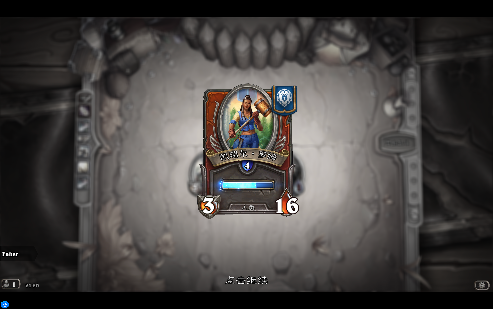
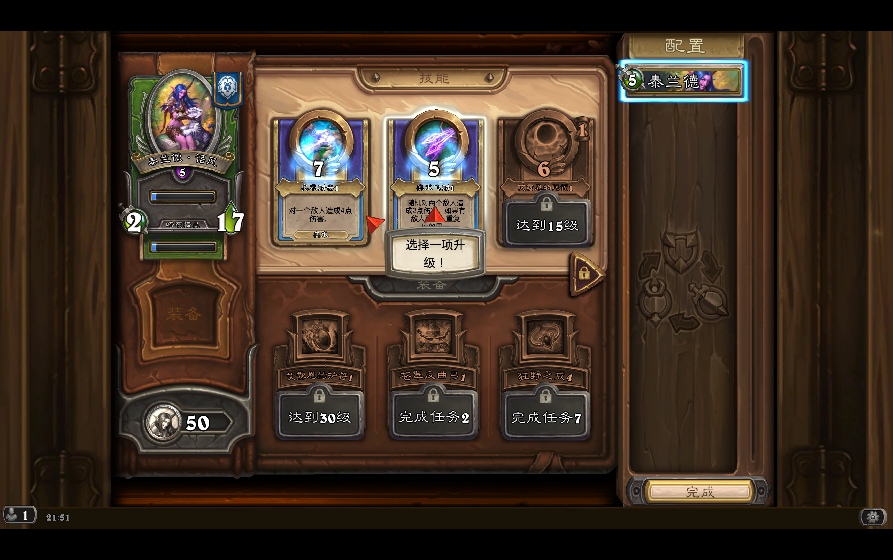
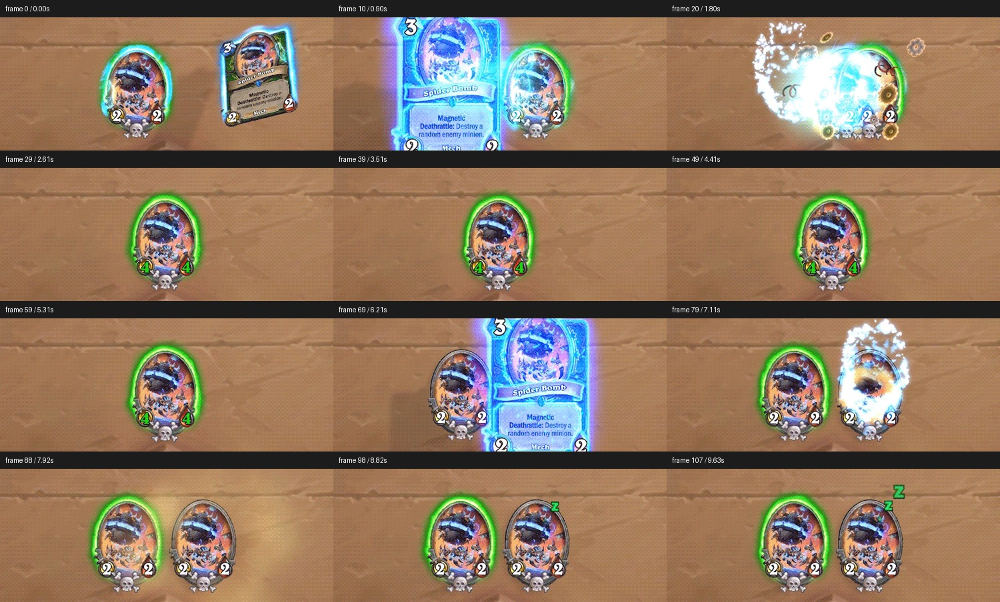
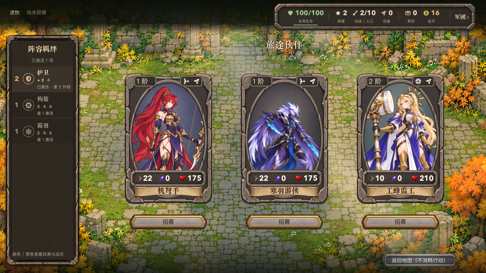

# 炉石界面再研究：结构、阅读、动作与光效手感

## 2026-10-06：普通招募的完整动作适配

接续 UI16 第 3 步。动作依据复用用户认可的本项目选人归队动作和本页磁力分层拆解；没有新增对炉石原作的观察结论。源头是玩家已选的实际候选肖像，终点为成功保存后新英雄 InstanceId 对应的队伍席位。所有时长为项目适配值，默认灰石构图和角色素材保持。

| 阶段 | 动作与光的配合 |
| --- | --- |
| 候选展开 | 三卡按 75ms 间隔入场，26px 抬升、0.95 → 1 缩放，340ms 落定；卡片光跟随真实石框，不照亮正文 |
| 比较与选择 | 整卡悬停上移5px、放大至1.018，200–220ms 收敛；可选状态低亮、悬停稍亮、选中暖光较强；检视不提交 |
| 成功提交 | 已保存的新英雄成为唯一接收目标，其他候选收暗并撤资格边光；队伍与羁绊读数绑定真实新状态 |
| 飞行与落定 | 从源肖像实际大小缩向88px队伍肖像，380ms短弧线；复用 OpeningSelectionLight 的随行柔光、实际轨迹粒子和落点散光，180ms回弹、140ms余辉后收回地点；起飞/落定接已有音效 |
| 中断与减弱 | 隐藏/退出清除残影与粒子且废弃旧回调；减弱动效直接呈现成功结果，不改变支付、归属或自动部署 |

图形与粒子均复用既有独立纹理、shader和预制组件，未新取外部素材。动态记录归[本轮招募证据](../../../../outputs/recruitment-motion-20261006/README.md)。

## 2026-10-06：地图光效的局部适配

用户认可本项目已展示 UI、选人光效及原有地图移动／揭雾／地点往返动作。本轮沿用已认可的运动轨迹，参考下方磁力拆解的“建立联系—局部提交—余辉交还持久状态”分层，以及用户地图节点和卡片截图；不声称观察了炉石的地图揭雾动画。以下半径和时长都是本项目适配值。

| 动作 | 空间与分层 | 时序与素材 |
| --- | --- | --- |
| 队伍行走 | 暖光中心随正式标记，MapCanvas 平面；光粒出生在实际经过的位置，之后留在地图坐标，各自微小漂移 | 保留原 .14s 逐格运动；16 个预制池，间距 .28 格、寿命 .24–.34s；复用 ElementDust／ElementGlint 小部件与独立柔光层，停下后 .22s 收光。 |
| 新区域揭雾 | 同次已提交揭示共享最远范围，前沿从队伍向新边界扩展；细亮边、弱肩光与少量碎点沿前沿分布 | 沿用 .34s 退雾，shader 只注入局部进度，既有纹理与程序边光组合；旧路不重播，不提前显示未知地点。 |
| 发现／查看地点 | 地点图标自身横向短掠光、5 个独立小光点；查看时仅地点格软白边，当前实际可交互点暖光 | 揭雾完成后 .38s 一次发现；现有小图、实例独立 shader。减少动效保留状态亮边，隐藏及换地图清理。 |
| 地点开合／返回 | 真实交互地点为来源，靠近来源的实际卡片或面板边缘承载窄亮芯与宽软晕；透明布局不承载边光 | 沿用 .32s 打开／.22s 收回，短高光沿边移动；返回原地点 .24s 短亮。原音效与时序保留。 |

正式内容与输入证据见 [地图光效记录](../../../../outputs/map-light-20261006/README.md)。这些新增光效未因既有选人认可而自动通过审美验收。

## 2026-10-04：已认可入槽动作的光效增强

用户认可 UI16 第 1、2 项的既有动效，指出选中单位飞入下方席位时缺少粒子和光效。此次局部授权保留轨迹及回弹，增加伴随光效；不等于整套 UI 美术或其他转场获认可。

参考复用下方官方磁力 GIF 的阶段拆解：接近时建立联系、提交时局部聚光和碎片、随后收净。已存在的 90ms 帧证据能支持空间归属与主次关系，不能推定原作精确曲线、粒子数量或声音。用户此前奖励袋实录支持“小物件周围有细点和柔晕”的静态分层，不作为飞行时序证据。

本项目适配（不是原作参数）：平面为 UI Canvas；中心取被选肖像的实际显示中心，沿已认可的 `.38s` 弧线移动，朝向由相邻采样的切线决定。起段 `.16s` 短亮点在起点消退，弱暖金柔光跟随肖像；途中每约 10px 路程留下小粒子，寿命 `.25–.32s`，出生后保留路径位置并缓慢外散；入槽到位回调触发 10 颗向外光点及 `.31s` 柔光，与原 `.18s` 回弹相配，总 `.72s` 内收净。姓名和角色图像仍是主视觉，取消不触发落槽光效。

素材与结构：复用 `scenes/vfx/ElementDust.tscn` / `ElementGlint.tscn` 的单光点／星芒着色器及 `surface.tres`，按小尺寸独立编排，不复制炉石美术。`OpeningSelectionLight.tscn` 预制柔光、起始星芒、落点柔光和 48 个光点槽；`OpeningHeroSeat` 提供移动采样、到位与取消，组件仅管理表现，不复制轨迹或选人数据。材质不写入动态参数，实例间仅改变节点颜色／位置；时钟采用和原 UI Tween 相同的忽略游戏倍率及暂停策略。

验收关注：同尺寸原速看光粒是否贴合肖像轨迹、旧尾迹是否留在经过的位置、落点是否只亮一次；真实点击补验中途取消、补位、减弱动效与页面退出，保留前后录像。新光效观感待用户确认。

日期：2026-10-03。归属 Q25／D53。当前只研究，不制作或接入新 UI。

用户否定最新招募界面“割裂、没有灵性”，提供 11 张佣兵战纪实录，并要求先学习。此前招募可读性／输入检查仍是各自范围的证据，不能作为这版美术被接受的依据。

随后补充 3 张单位筛选／三选一实录，累计 14 张。用户指出 Agent 将动效与光效过度收窄为操作语义，遗漏其直接带来的顺滑、Q 弹和交互愉悦；本次修正见下节。继续研究，不恢复制作。

再次补充设置菜单、商店静态图，累计 16 张。用户明确动态范围还包括场景间切换及各 UI 的打开／关闭，要求研究完整操作过程的连续性。

## 本轮到底看到了什么

| 证据 | 实际覆盖 | 不能据此声称 |
| --- | --- | --- |
| 用户提供的 11 张图 | 战斗技能、技能解锁、教学、悬赏地图、胜利、经验、地图结算、奖励袋、工坊、英雄管理；逐图静态分析 | 连续动画、精确时长、缓动曲线、声音、完整导航路径 |
| 用户补充的 3 张图 | 单位筛选前后状态、三选一卡牌；轮廓亮边、宽光晕、能量包络及阅读区分布 | 筛选切换的完整轨迹、按钮实际回弹曲线、闪光与动作的精确相位；用户关于手感的观察单独记录 |
| 用户再补充的 2 张图 | 覆盖于棋盘上的设置菜单、商人与货架组成的商店；逐图静态观察 | 设置开合、商店进入／返回的具体轨迹、速度和声音；本轮未采到这些转场 |
| 原生 Hearthstone 窗口 | 主菜单、Esc 游戏菜单、收藏列表、右键卡牌详情；截图可读取，键盘 Esc 生效 | 已遍历佣兵村庄或全部页面；鼠标坐标控制稳定；完整动态体验 |
| 官方磁力 GIF | 500×200、108 帧、文件时长 9.72 秒；保留原文件并提取 12 个时间点 | 当前版本实机时长、无损高帧率原片、听过音效、全套 UI 动效研究完成 |
| 暴雪开发者文章 | 特效信息传达、磁力关系表达、声音与操作节拍的作者说明 | 所有 UI 的内部实现细节、3D 节点结构、完整动画曲线 |

原生窗口操作中，几次点击未触发预期页面，坐标与实际被选对象未能稳定对应；继续盲试收益很低，因此收窄为实际读到的页面。截屏是离散图像，不是连续视频。原生截图已在会话工具输出展示，本文件不伪造其本地存档或录屏。

用户图按原文件复制到 `user-references/`，来源与顺序见 [source-index.json](source-index.json)。仅作研究，不进入游戏资源目录。项目对照图来自本日上一轮正式招募输入验证，复制时未改变内容。

## 逐图观察

| 图 | 具体看法 | 对项目的启示（分析，不是新方案采用） |
| --- | --- | --- |
| [01 战斗技能](user-references/01-combat-ability.png) | 战场中心是大块低细节地面，装饰集中在外沿；单位是紧凑椭圆棋子，技能使用圆章与共用托槽，长说明放进独立技能卡。 | 战场单位、候选卡和详情应按阅读任务分配信息密度，身份保持一致；不能要求一种大卡同时承担所有状态。 |
| [02 技能解锁](user-references/02-skill-unlock.png) | 角色卡和技能卡并排，背景退后，顶端红布横幅宣告事件；背光集中在这两个对象背后。 | 先让人看懂“谁获得了什么”，再用光庆祝这个关系。 |
| [03 教学](user-references/03-tutorial.png) | 一张完整纸面容纳图解与正文；标题卡在上沿，按钮卡在下沿。内文没有每段独立装饰框。 | 外轮廓负责物件身份，内文靠留白、对齐和分组组织。标题和按钮是框体的部件。 |
| [04 悬赏地图](user-references/04-bounty-map.png) | 地图是嵌进木框的纸张，节点像放在纸上的金币；完成标记附在金币上；右侧头像、名称、启动按钮属于同一竖向木板。 | 节点信息和行动应有共同的空间归属，避免地图、详情、按钮各自悬浮。 |
| [05 胜利](user-references/05-victory.png) | 奖章由盾牌、三种武器、红布和橙色横幅构成，整体有辨识轮廓；背景去色模糊。烤棉花糖让正式奖章带一点诙谐。 | “灵性”也来自物件的个性与小故事。每页都使用严肃石框会损失情绪变化。 |
| [06 经验](user-references/06-experience.png) | 熟悉的角色卡成为唯一主角，经验条在卡自身内部；数字、种族、阵营各有固定位置。 | 成长应发生在玩家认识的对象身上，不必每次另建一张统计表。 |
| [07 悬赏完成](user-references/07-bounty-complete.png) | 依旧是同一张地图，节点标记、宝箱与右栏状态发生变化；金色效果以宝箱附近为重心。 | 结果画面可以保留“我刚在哪、完成了什么”的空间记忆。 |
| [08 奖励袋](user-references/08-reward-bags.png)／[09 后续帧](user-references/09-reward-bags-later.png) | 三只袋子形成三角构图，各自略有倾角；背后的宝箱仍可识别，场景整体变暗；光在袋子周围。 | 奖励可以有来源、容器和揭示过程；这两张静态帧只能证明姿态／粒子有差别，不能推定完整弹出轨迹。 |
| [10 工坊](user-references/10-workshop.png) | 外层像木制托盘，内有三个槽；蓝图纸卷边落在一个槽中；两个空槽保持完整木面，不用文字填满。 | 槽、物品、纸页是不同层级；空白也能表达容量和期待，不需要补装饰。 |
| [11 英雄管理](user-references/11-hero-management.png) | 左边角色、中间技能／装备、右边名单各有职责；技能在纸面上，装备在下方深色台面；锁定用灰暗材质和锁牌共同表达。 | 用大承载面分区，给当前比较的对象最好的阅读环境；状态不只换颜色。 |

### 图解：角色卡的部件怎样成为一个整体

角色、名称布带、经验区、底部属性形成明确的垂直顺序。名称带横跨画像与信息区的接缝；攻击和生命的外轮廓在底角伸出，数字覆盖在各自稳定色块上。它们有局部体积，但与卡的外轮廓咬合。右上旗帜也有挂在卡边上的位置关系。

这些部件不都用同一种矩形框：旗帜表示身份，布带承载名字，角章承载读数，嵌槽表示进度。多种材质通过相近的画法、尺度、光源和接触阴影统一。这解释了为什么“给所有字段换成同款石框”仍然可能割裂。

不要机械照抄两角两数值。本项目有攻击、法强、生命三项核心读数，还要按需读其他属性；需要保留真实信息并重新组织其位置，不以模仿炉石为由删掉法强。

### 图解：复杂画面怎样留出清楚的阅读面

木材、皮革、纸张和金属很多，但每种材质各管一层。大块明亮纸面先确定技能的阅读区，边缘纹理与铆接负责“怎么装起来”；正文所在区域纹理弱、留白足。外沿和人物可以复杂，数字和规则所在位置保持稳定。

收藏页实机也出现这一关系：列表背后是完整纸页；右键后，原卡的轮廓与数字位置继续保留，背景模糊，补充故事说明放在旁边。这个观察支持“保留对象身份、按任务扩展信息”，不证明所有详情都必须模态化或模糊背景。

## 动态补证：磁力的反馈在表达关系

来源：[暴雪《Developer Insights: The Art Behind THE SCIENCE》](https://hearthstone.blizzard.com/en-us/news/22552047)，2018-10-26。开发者说明：磁力要解释合法目标、拖到哪里、是否附着及附着到谁；早期细箭头方案改成更大、更简单的连接形状，同时避免过强特效暗示合体一定更优。

原 GIF：[official-magnetic.gif](official-magnetic.gif)。文件信息与采样索引：[official-magnetic-source.json](official-magnetic-source.json)。下面是从原文件读取的时间，不是对当前客户端测出的参数。

| 文件时间 | 实际观察 | 反馈职责 |
| --- | --- | --- |
| 0.00–0.90 秒的采样 | 拖出的卡与场上对象靠近，蓝色联系围绕双方形成，已有对象仍可定位。 | 使预期作用对象清楚。 |
| 1.80 秒采样 | 亮光和机械零件集中在两者结合的位置。 | 强化提交／合并这一局部事件。 |
| 2.61–4.41 秒采样 | 强光消退，剩一个 4／4 单位。 | 把注意力交还给持久的结果。 |
| 6.21–7.11 秒采样 | 另一段演示中，新卡位于既有对象右侧，效果集中在新单位处。 | 明确独立放置的目标位置。 |
| 7.92–9.63 秒采样 | 留下两个 2／2，新单位随后显示休眠标记。 | 用对象数量、读数和状态证明操作后果。 |

两段演示之间有内容重置，不能把全文件当成一场连续对局。源 GIF 每帧约 90ms，只足以辨认阶段和空间关系，不足以精确拟合手感曲线，也没有声音。此例不是佣兵战纪的页面转场证据。

由此得到的项目分析：动态反馈要回答“哪个对象受到了哪个操作、结果去了哪里”。拿起、临近目标、提交、落定分别有职责；永久状态要在粒子结束后仍然读得出。此前“单独加弹跳、飘浮或发光，只能增加活动量”的判断过于绝对，现按用户反馈撤回：动作与光效也直接塑造弹性、活力和愉悦感，有独立的审美价值，不能要求每层效果都承担新增规则信息。

声音补充依据：[暴雪音效团队访谈](https://news.blizzard.com/en-us/article/23964694/inside-battle-net-meet-the-sound-team-behind-hearthstones-harmonic-design)说明，其声音按打牌等操作的固定节拍设计，并考虑施放、命中等关键节点与情绪影响。本文未收听该客户端音频，不虚构按钮音色或音画同步精度。

[Derek Sakamoto 的 GDC 2015 演讲](https://www.gdcvault.com/play/1022036/Hearthstone-How-to-Create-an)本轮只确认了介绍页和视频入口，没有完整观看；不把网上转述中的观点或数字写成此次直接证据。

## 对我们最新招募页的具体诊断

1. **整页没有共同的承载结构。** 三张卡、各自下方按钮、左侧羁绊栏和右上资源栏分别立在繁密庭院上。相同材质让颜色接近，却没有解释它们怎样共同组成这个招募场景。地面石缝与树叶一直穿过控件间隙，和卡边争夺注意力。
2. **局部修补改变了原卡的节奏。** 新增长属性牌在底部硬切画像，与原有弯曲姓名纸带上下叠放，形成两个同样强的横向结尾。左上阶位、右上角色又各加一个小矩形牌，读起来像在旧卡上安装了一组仪表。
3. **每层的重量接近。** 左侧长栏、顶部横栏、卡的外框、属性条、确认按钮都用了显眼框体。玩家同时看到很多边缘，却缺少明确的主次；把它们一起压暗也不会自动解决结构问题。
4. **阅读与角色展示互相抢位置。** [当前展开态](project-current-expanded.png)把大量属性铺到人物所在区域。清楚的数字与完整立绘各自有价值，但需要先明确当前是在比较候选，还是专注检视一个角色，再决定展开怎样让位。
5. **物件个性不足。** 两角小牌除了图标内容几乎同形；核心读数也装进同一水平仪表条。角色身份、等级、生命等原本不同的含义，没有像旗帜、徽章、嵌槽那样在结构上形成区分。这里不是要求新增更多容器，而是要求少数部件的形体确实承担含义。

这是基于当前图和参考图的分析，不等于用户已经确认某个替代设计。也不据此恢复之前被否定的逐字段底板、重新开放换卡框或删除羁绊／法强等内容。

## 下一次设计必须回答的具体问题

### 场景切换与界面开合（2026-10-03，用户补充）

用户强调动态不仅包含页面闲置时的效果，还包含场景切换与不同 UI 的打开／关闭。研究单位扩展为一段完整操作旅程，覆盖进入、浏览、展开、返回及离开，避免只研究单页里的循环发光或单个按钮。

用户随后给出具体菜单例子：“音效配合放大再稍微回缩的动画变化就很 q 弹”。这是用户对原作的观察及期望，本轮未自行录制或收听验证。它明确了一个简单的基础组合：快速放大到略超最终尺寸，轻轻回缩并停稳，音效配合弹出的主要节拍。手感价值可由这样短小的组合成立，不必为每次打开设计复杂轨迹、粒子或额外物件叙事；光效按需要协同，不能遮蔽缩放与声音本身的作用。具体过冲幅度、时长、声音起点待后续动态样板调校，不冒充实测参数。

用户进一步限定：并非所有场景切换都采用该菜单效果，应依据动线与轨迹处理，也可以使用书本翻页、开门等定制动画。菜单例子只说明一种局部手感，不是统一转场模板。场景转场须先明确来源、目的地与空间关系，再选择动作；翻书可围绕书脊转动、页面弯曲与前后遮挡编排，开门可围绕门轴、门后场景露出及光线变化编排。这些是可实现的候选方向，尚未选定项目具体页面、素材方案或制作范围。程序可控制轨迹、遮挡、投影、光效、音效及内容交接，但最终材质与动态品质仍需实际样板检验，不能直接承诺参考作品的完成度。本次仍是能力与方法讨论，不解除研究阶段的制作暂停。

静态参考观察：

- [15 设置菜单](user-references/15-options-menu.png)：菜单是一块独立厚框面板，覆盖在仍可辨认的棋盘上；大块统一底面容纳左右分组，标题附于上沿，下拉框、滑条、按钮按各自职责成形。这是设置／选项浮层，不是主菜单截图。画面说明前后层级，不证明原作采用何种弹入或关闭动作。
- [16 商店](user-references/16-shop.png)：左侧商人和对话、中间六个货架格及各自价签、右侧独立纸面区域共同组成店铺；商品按自身轮廓陈列，架格负责统一摆放。右侧当前有大块留白，不据此断言未截图的交互内容；不把图中限时活动、货币和涨跌价格引入本项目规则。

后续应同时规划四类动态：

| 范围 | 设计内容 | 项目候选与检查点 |
| --- | --- | --- |
| 待机氛围 | 呼吸、微浮动、光晕及少量环境细节 | 页面有活力，阅读与选择仍稳定；这只占完整动态的一部分 |
| 控件操作 | 悬停、按压、拖动、选择、切换筛选 | 即时响应、弹性收稳、光影配合及中途打断 |
| 界面开合 | 设置、单位详情、筛选面板的进入／退出，后层明暗与焦点交接 | 面板进入时背景同步退后，关闭时背景恢复；返回原选择和滚动位置；打开可强调出现，关闭宜利落，不强制同一动画倒放 |
| 页面／场景切换 | 地图到商店／招募、准备到战斗、结果返回地图 | 旧页面退出与新页面进入共用节奏；方向、公共背景与持久对象有连续性；避免旧页清空后的无意空帧、闪白或两页抢焦点 |

每次转场要说明旧内容何时让位、新内容从哪里进入、光影何时交接、什么时候可操作、返回时恢复哪里。入场与离场可以短暂重叠，读数和关键目标稳定后尽早可操作；连续开关、返回和跳过从当前表现状态接续，不堆积动画。后台加载完成或业务确认决定实际页面／结果，表现层承接它，不用固定动画延迟伪造完成。暂停、减弱动效及生命周期处理沿现有界面组件职责设计，不在本轮另造架构。

候选样板的评价范围相应调整为：地图 → 招募／商店 → 展开详情 → 关闭详情 → 选择／操作反馈 → 返回地图。第一次样板就覆盖入口、页面内操作和出口，用正常速度完整过程判断顺滑及节奏；不以几个孤立静态状态或单段循环替代。以上为项目建议，并非已观察到的炉石转场；继续研究，未制作样板。

### 优化方向的系统性收敛（2026-10-03，Agent 建议）

用户要求简洁说明学到什么、准备怎样优化。本轮复用以上证据，没有增加实机覆盖或制作授权。核心认识：把界面当作可操作的物件，形体、信息与动作共同设计。

| 层面 | 拟采取的优化 |
| --- | --- |
| 整页空间 | 探索／战斗由环境主导，招募／整备由当前角色与操作主导。保留满屏世界环境，在阅读区域降低背景对比和动态干扰；候选卡、确认区和辅助信息组成明确布局。共同承载不等于每页增加一个巨型重框。 |
| 卡片形体 | 保留已认可灰石框和人物，重新组织等级、职业、核心读数与姓名的接合。三项数值及姓名区一起构图，处理横向铭牌硬切立绘的问题；附属部件有用途与位置归属。 |
| 阅读层级 | 常态服务并排比较，检视服务完整阅读，选中服务确认。等级、身份与攻击／法强／生命稳定可读；完整信息按需展开，避免直接铺满人物。 |
| 动作关系 | 拿起表现离开原位，临近目标显示落点，确认后落定或归入队伍；取消回到来源。操作结果由业务确认，表现层据此呈现，精确时序不从静态图猜测。 |
| 情绪节奏 | 高频按钮／悬停反馈短促；招募成功、升级、稀有奖励有针对具体对象的短演出。探索、管理与庆祝采用各自合适的构图，统一画法、光源和图标语义。 |

原建议先静态确认、再补动作；用户随后指出动效与光效的重要性被低估。修订后的建议：第一份招募页样板同时设计构图、动作、光效与投影，包含常态、悬停／焦点、按压、检视、选中、确认和取消；用一个完整交互过程评估手感，再推广组件家族。此为待制作建议，当前继续保持研究阶段。

### 动效与光效是独立的交互品质（2026-10-03，用户纠偏）

用户明确指出，无论 UI 风格如何，动效与光效都能让交互更顺滑、Q 弹。Agent 接受这一纠偏：材质、布局、动作、光效应从首轮样板一起考虑；“先结构后强化”不能成为持续推迟手感设计的理由。这里的弹性是按下、释放、加速、过冲与衰减带来的感受，厚重石框也可通过整体位移、尺度及投影变化表现，文字保持清晰。

补充截图的实际观察：

- [12 筛选总览](user-references/12-unit-filter-overview.png)与[13 等级筛选](user-references/13-unit-filter-tier.png)：左右筛选架及中央紫色承载面保持一致，结果数量和排列变化；徽章／类别按钮有亮边，部分单位外围有蓝色或金色的宽包络，另有盾形轮廓。没有新查证每种包络的规则含义，不将它们一概称作悬停光。
- [14 三选一](user-references/14-three-choice-lighting.png)：三张大卡外侧有高亮绿色轮廓和更宽、更淡的外光；标题与底部按钮有蓝白发光区，亮点和细节集中于外缘，卡牌正文面仍清楚。可见较强光效与石／金属框并存，不能将“统一材质”误解为所有高亮都要低调或无色。
- 三图能直接支持光效的空间层次、聚焦位置及两种信息密度，不能量出回弹和过渡时长。用户对顺滑、Q 弹的体验作为设计目标保留，具体原作时序仍待连续素材；下列动作是项目候选，不冒充逐帧复刻。

项目候选的动作与光效配合：

| 操作 | 动作与节奏 | 同步光影 |
| --- | --- | --- |
| 悬停／焦点 | 迅速抬起或略放大，轻微过冲后收稳；离开时从当前姿态平滑退回 | 贴边亮核与宽柔光建立层次，投影随抬高变宽、变软；文字区不被光覆盖 |
| 按压／释放 | 按下立即下沉或轻压缩，释放回弹，振幅逐次减小 | 按下投影收紧，释放出现短促亮峰，柔光尾部稍后消散；从输入到形变及时反馈 |
| 筛选 | 框架保持位置，结果换位或替换采用短过渡；高频切换从当前状态接续 | 当前筛选项亮边响应，结果区避免整面闪白；不能为播完装饰阻塞下一次输入 |
| 三选一进入 | 三张卡可以短暂错峰进入并各自收稳，尽快可读可选 | 外光随进入展开，收稳后回落到待选亮度，形成有起落的节拍 |
| 选中／确认／取消 | 选中卡前抬，其他候选退后；业务确认成功后才展示加入结果，取消返回来源 | 确认时局部聚光、亮峰与短尾配合；取消时光随动作退出，不硬切 |

“丝滑”还包括过渡可被打断、快速扫过／连续点击没有跳回起点和动画积压；“Q 弹”来自快响应与衰减收稳的配合。每种物件可用不同振幅，不能全部套同一条回弹。光效可分贴边亮核、近处光晕、外部柔光及短暂亮点，层间错开强弱与消退；动作、光和投影共用一个操作节拍，不能三套循环各自播放。先验证这些关系，再确定精确参数。

此次补读 `godot-ui-teardown` 的手感章节，仅用作候选实现方法；其中通用时长和示例不作为炉石实测参数，未照搬代码或修改游戏。

- 整个招募页的主承载物是什么，卡与按钮怎样落在它上面？能否只看剪影和明暗就认出主要内容与主动作？
- 角色、名字、阶位、职业、三项核心读数怎样组成一个轮廓？哪些部件共用表面，哪些需要伸出轮廓？
- 比较、检视、选中、确认四种状态，哪些信息保持原位，哪些退后？展开后是否仍能对照其他候选？
- 背景的光与纹理如何让出阅读区域，同时保留用户要的全屏游戏环境？
- 每段动作的对象、起点、终点、结果是什么？动画结束后，成功／失败／取消怎样被识别？
- 高频操作的节奏与重要奖励的仪式怎样区分？精确时序需要额外原片及项目正常速度交互验证，不能从静态图填写毫秒参数。

以上是后续判断设计是否成立的检查问题，不是本轮制作清单。当前已归档用户参考、完成静态拆解和一个官方动态样本的逐帧补证；未完成全客户端页面／动效巡查，未解包客户端，未改游戏场景、素材、业务或正式玩法规则。
