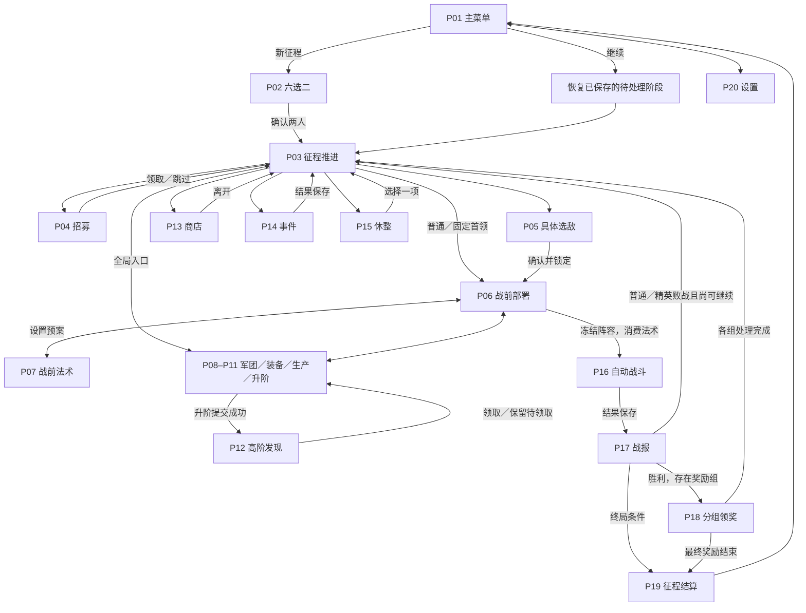

# 主流程交互约定

2026-10-01，Q25／UI15 的完整交互初稿。当前功能保留；以下布局与局部导航为 Agent 提案。与原实现不同的导航方式明确列在文末，不作为已采纳产品规则。

## 1. 范围与来源

纳入默认成长征程主入口及其全部玩家功能。排除旧 Alpha 开发入口、战斗实验室、体验切片、矩阵验证、特效／环境预览；正式战斗中的碰撞显示、单步、重置、返回配置也从主流程稿中排除。正式暂停、变速、敌情与单位检视保留。

依据：

- `src/App/GameFlowCoordinator.cs`：开局、继续恢复、节点、战报、分组奖励、设置和结算路由。
- `src/Run/RunApplication.cs`：部署、装备、生产、升阶、发现与法术命令。
- `src/UI/ArmyOverviewController.cs`、`RosterLoadoutView.cs`、`GrowthWorkbenchPanel.cs`：军团三页与现有编辑边界。
- `scenes/ui/` 正式页面、`RunOfferChoiceGrid.cs`、`RunOfferChoiceCard.cs`：原布局和尺寸问题。
- `gameplay-design/tower-autobattler-core.md` 的具体选敌／单场法术、独立奖励组；`system-design/tower-autobattler-architecture.md` 的 UI 组合和输入契约。
- R10 整局推进、D65 内容重设计与既有 UI／法术活动任务：当前稿不冻结临时节点内容。

## 2. 整体流转

“继续”实际优先恢复未完成开局、未领完奖励、待处理节点／战斗或终局记录，不能统一跳到一个新路线。图中的恢复节点是逻辑说明，不新增一张产品页面。

## 3. 公共交互规则

**空间分配。** 参考画布 960×540；资源与全局入口在顶部，页面任务在中部，提交／返回和结果反馈在底部。三选一不出现整页滚动。较长库存、规则和成员列表允许局部滚动，确认按钮不随正文滚走。军团管理与法术页使用自己的工作区，避免羁绊常驻栏重复占用。

**读取与提交。** 查看能力、切换候选、检视敌军不执行领取／购买／开战。一次性领取选择后统一确认；连续购买保留商品自己的明确购买按钮。确认成功才反馈到账或落位。保存失败继续保留旧资源、候选与原状态，并在相同操作区域提示重试。

**返回与关闭。** 从军团、法术、敌情和规则返回原上下文；不回主菜单、不重新生成候选。详情遮罩覆盖内容，关闭或 Esc 恢复来源焦点。已进入的节点机会保留，返回征程后展示“继续当前机会”，不会免费换节点。未锁定选敌可以返回；确认选敌后只能继续该对手。

**频率与确认。** 不为每次浏览弹确认。放弃征程需要明确确认。新征程的既有“新开局”语义保留；继续恢复之前的未完成开局。

**键鼠。** 候选整卡点击切换选择，角部信息按钮单独查看；底部头像席位可直接取消，最终领取仍由统一确认按钮提交。部署和装备以拖放为主；拖到无效区域或取消时不改变状态。装备支持已有键盘穿入空槽；槽满时要求明确指定替换槽，不自动选一个丢弃。焦点与选中保留文字或形状标记。

**只读。** 正式战斗开始后，阵容、装备、生产、升阶和法术不能编辑；仍能查看。暂停与变速不解除这类锁定。稿件里表格／统计只读，不提供调试控制。

**表现。** 移除操作说明型常驻副文案，数量、选中与可用状态分别用席位、勾记／边框、按钮形态表达。详情与规则按需打开；技能效果、代价和失败风险仍是决策信息。审阅控制默认收起。选择、落位和资源变化的动作不改变业务提交时点；减弱动效与快速重复输入不留下残影。

## 4. 页面与状态清单

| 编号 | 页面与核心信息 | 主要交互与出口 | 必须保留的状态 |
| --- | --- | --- | --- |
| P01 | 主菜单：继续、新征程、设置、退出 | 新征程进入新六选二；继续恢复阶段 | 无存档、未完成开局、进行中的征程；退出为原型终点 |
| P02 | 六名开局英雄：身份、核心属性、能力入口、已选两人 | 点击选／取消，选满两人才能确认；详情不选择 | 0／1／2 人、候选稳定、保存失败、返回后继续；再点新征程换开局 |
| P03 | 当前进度、下一机会、资源、军团、遗物与羁绊 | 进入实际存在的节点；全局管理；放弃 | 单 Boss、已锁对手、待处理机会、待领取发现；不伪造三项 |
| P04 | 单位三选一：三卡同屏、属性与能力、容量、确认区 | 选中可换选，查看不招募；确认入队／跳过 | 正常、仅一名候选、满员禁领、保存失败、加入后备 |
| P05 | 具体选敌：每项敌阵、核心威胁、收益、失败代价 | 平行比较；查看阵容／站位／单体；确认进入备战 | 未选／已选、返回不重抽、保存失败、候选不足；固定 Boss不虚构备选 |
| P06 | 战场、当前部署、后备、敌情、法术预案、开战 | 点击检视；拖放布阵／交换／下场；装备／法术入口 | 无出战单位禁止开战、非法投放不提交、候选已锁；开战事务失败保持 |
| P07 | 法术列表、库存、费用、完整效果、目标、本场预案 | 兑换与配置分开；预设、换目标、取消；回备战 | 无库存、研究不足、无合法目标、已预设、目标变动、只读；预设不耗库存 |
| P08 | 左侧英雄选择；右侧核心／次要属性、能力、三装备槽与背包 | 穿戴、替换回包、转交、卸下；原上下文返回 | 空槽、空背包、满槽、同装备转移、只读、保存失败；重要属性常驻 |
| P09 | 军团总览：上阵／后备、遗物、资源、累计成长 | 查看英雄、遗物、培养；去对应管理页 | 空资产、成员状态、战斗只读；统计数字不用于虚构战力评分 |
| P10 | 生产者、产出方向、受益者、规则／累计收益 | 修改草案与预览，保存分配 | 无生产者、无可用方向、目标不合法、保存失败；不因点击预览发资源 |
| P11 | 英雄升阶：资格、成本、已有身份、独立战斗收益、发现机会 | 选择英雄、读规则、支付材料；进入发现 | 材料不足、已升阶、收益留白、已有待领取发现、保存失败；不得重复扣款 |
| P12 | 高阶英雄发现：三卡同屏，明确独立领取 | 查看、换选、确认加入；返回保留机会 | 候选冻结、满员、保存失败、只领取一次；普通继续不得跳过待处理发现 |
| P13 | 商店现货：图像区域、效果、价格、已售出 | 详情、明确购买、继续买、离开 | 金币不足、已买不补货、保存失败、可买多件；当前不增设无限刷新 |
| P14 | 事件情境、成功率、收益与失败代价 | 选择一种处理，展示结果并前进 | 成功／失败、保存失败；失败不私加扣血；事件具体配方后续重设计 |
| P15 | 当前全局生命、实际恢复量、金币选项 | 二选一；结算后前进 | 满血禁无效恢复、仅恢复实际缺口、保存失败；不混淆单位每战满血 |
| P16 | 正式自动战斗：场景主体、时间、单位状态、规则 | 暂停、继续、×1／×2／×4、单位／阵容查看 | 战斗／暂停、已消费法术、只读；不含碰撞、单步、重置与返回实验室 |
| P17 | 战报：胜／败／超时、后果、双方总览／输出／生存／治疗 | 切换维度与阵营、单体明细、继续 | 无有效治疗、保存失败重试、结果不重复结算；胜败与终局分流 |
| P18 | 独立奖励组：当前类别、已处理进度、候选与确认 | 每组单独选／跳过，处理后进入下一实际组 | 候选不足、空组不出现、中途继续不重抽、不重复到账、最后一组完成 |
| P19 | 征程结束：结果、抵达进度、阵容与回顾 | 再次登塔／回主菜单 | 通关、生命耗尽、首领失败、主动放弃；最终奖励先处理 |
| P20 | 设置：主音量、默认战斗速度、减弱动效 | 调整草案、保存或取消，返回原入口 | 保留修改前设置、保存失败、恢复默认焦点；不添加未存在的产品开关 |

## 5. 公共阅读层与操作反馈

| 层 | 内容与关闭行为 |
| --- | --- |
| 单位详情 | 完整属性、主被动规则与关键状态；返回当前卡、敌阵或战场，不提交选择 |
| 装备／遗物规则 | 取得或穿戴条件、完整规则；已有与候选措辞区分 |
| 羁绊详情 | 当前贡献、成员、后备未计入、各档门槛／效果与下一档差值 |
| 敌情与地形 | 实际组成、初始位置、楼层规则；可继续进入单体详情，再回敌阵 |
| 生产／成长说明 | 节点触发条件、实际受益者、本局累计收益；不把预览记为已到账 |
| 征程菜单 | 返回、设置、保存后的主菜单出口、放弃；退出与放弃语义分开 |
| 保存失败 | 相同位置明确提示“原状态保留”，重试原动作；不播放成功反馈 |
| 结果反馈 | 已穿戴／替换回包／已购买／已领取等，使用短句指出资产去向 |

## 6. 与现有界面的设计差异

这些差异是交互提案，不是新增玩法：

1. 从三个局部样板扩展为覆盖全部主流程的交互稿。实验室等仅排除，工程文件保留。
2. 单位与敌人候选优先同屏比较；选中与确认分开，详细规则放公共阅读层。
3. 工坊长列拆成生产、升阶、法术三项工作区；保留所有功能与统一军团导航。战前入口直达法术，不再要求在长列里寻找。
4. 军团、装备、法术等返回触发它们的页面；设置也提出返回来源，而非所有来源保存后回主菜单。
5. 全局资源保持简洁。管理页面使用完整工作区，选择与战斗页面仍有羁绊、遗物入口；常驻栏的精确宽度与陈列形式待视觉样板。
6. 现有路线仅承载交互流转，不将每页三张同框升级为所有抉择的永久结构。商店有限主动刷新、事件内容和新推进形式等已讨论但尚未接入的设计，回到各自议题处理，不以本轮擅自补数值。

## 7. 原型演示深度与后续接入

已实现本地连续选择、确定／返回、开局续行、候选换选、背包／装备拖放、部署拖放与交换、法术库存／预案／开战消费、升阶与发现、商店购买、领奖组切换和正常／资源不足／满员／保存失败／单候选的审阅快照。

静态占位部分包括角色立绘、战场环境与空间几何、真实战斗、完整发布能力正文、羁绊实时求值、全部生产者规则、战报具体统计、自然随机供给与存档 I/O。它们在稿中有布局、入口和返回关系，不宣称功能引擎已复制。同名装备在原型中以独立实例后缀区分，普通遗物候选排除已持有项；完整合法池与冻结供给仍由现有运行系统负责，不复制原型示例池到运行时。

后续 Godot 接入必须绑定现有命令／查询与预制组件，不重新实现领域规则。先确认页面职责、完整主流程和三个最突出问题的布局，再做美术；固定 960×540 隔离真实输入验证只覆盖改动风险，不自动开展全塔／全分辨率回归。最后由用户确认阅读、手感和观感。
