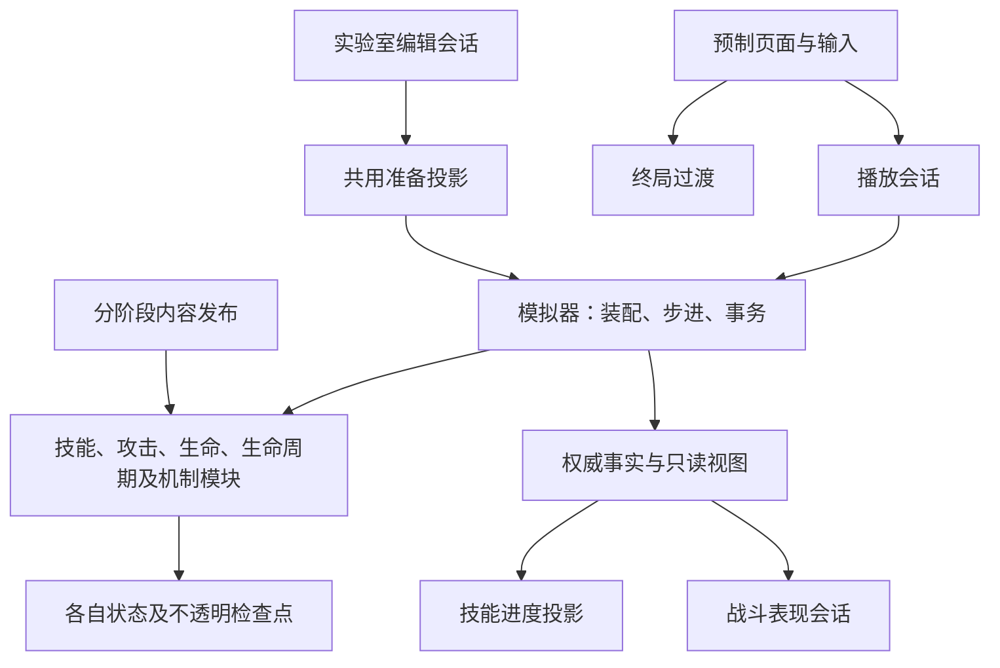

# 战斗运行时职责拆分

状态：2026-10-01，已按架构治理授权实施。设计不修改玩法、数值、技能时序、目标顺序或存档；验证及关闭记录见 [活动任务](../work-items/archive/architecture-hardening.md) 最后一节。

## 责任与依赖

拆分按状态所有者、规则所有者和事务边界验收。新模块是独立类型；没有把旧 partial 整体改名为另一巨型根，也没有把 `BattleSimulation` 或统一 Context 传入规则模块。适配器仍属于模拟器，负责接入明确命令、查询和跨系统事务，计入根类体量。

| 模块 | 规则与状态所有权 | 协作边界 |
|---|---|---|
| BattleAbilityExecutor / EffectOperations / Summons | 技能准备、提交复检、执行次序；通用效果与状态；召唤预留、上限和奖励顺序 | 只读施法快照、效果权威、概率源、召唤命令及整体事务端口 |
| BattleTargetingPolicy / BattleAttackScope | 自动技能和普攻目标优先级；普攻声明、命中、暴击、吸血、成长、箭序列与前摇 | 目标选择调用移动服务；伤害经 Vitality；飞行经 Projectile；计数经 ValueLedger |
| BattleUnitFactory / BattleVitalityScope / BattleStatistics | 单位构造及初始数值；伤害、治疗、护盾、死亡资格；统计与冻结报告 | 可变状态保留在战斗拥有的单位和模块中；不写作者 Resource |
| BattleTraitBindings / BattleTraitReactionScope | 固定开战成员与规则；羁绊反应、计次、死亡产物和排队 | 只读单位及查询、命令、事务三个端口；不拥有元素或限时护盾账本 |
| BattleElementStatusScope / BattleSupportEffectScope | 毒、寒意、余烬与死亡冻结事实；限时护盾余额、破盾事实和延后回蓝 | 与 Status、生命结算、羁绊分别协作；每个账本有归属检查的不透明检查点 |
| BattleMatrixQueries / ReactionScope / AbilityScope | 目标条件；订阅、反应与去重；操作执行、延迟任务、临时增益、召唤寿命、动作倍率与到达效果 | 查询使用只读单位；操作通过明确效果命令和具体模块；反应与操作状态不再共用根的私有字典 |
| BattleEnemyActionScope / BattleTechniqueScope / BattleUnitActionQueueScope | 敌人分段动作与产物；决斗、怒劲、钩索、蓄力拳与每战资格；待释放原因和恢复时间 | 技能进度只读阶段与资格查询；动作失败恢复资格、计数与队列 |
| BattleDisplacementScope / BattleChargedLineScope / BattleTrampleScope / BattleProjectileScope | 位移轨迹、预留与安全落地；直线蓄力与释放；冲锋扫掠、推开与恢复；投射物飞行与碰撞 | 位移由正式命令写入；后撤不再从敌人适配器直接写位移字典；空间与实际命中顺序不变 |
| BattleValueLedger / BattleValueOperations / BattleLifecycleScope / BattlePermanentGrowthScope | 计数和属性贡献；公式及资源操作；复活、尸体资格、阵营租约；永久成长资格与结果 | 属性句柄索引与 AttributeSet 共同回滚；复活保留单位身份；永久收益只随成功结果交付 |
| BattleSkillProgressProjection | 技能条和被动说明、终局冻结快照 | 只读 `BattleUnitView` 与阶段查询，不访问机制字典，不修改权威状态 |

`BattleSimulation` 保留单位登记、系统装配、固定步进与动作协调、跨模块初始化／清理、整体检查点、效果兼容端口和事实发布。`Act` 表达各动作相互排斥及推进次序；具体选目标、攻击、技能机制、生命与统计规则已委托各模块。根仍是大型协调对象，不能表述为“只剩几十行装配”。未来添加规则应进入对应模块，不重新堆入适配器。

权威内部的 Attack、Vitality、Lifecycle、位移等模块可以接收需修改的 `BattleUnitState`。表现层、进度投影、羁绊／矩阵反应及公开读取入口仍使用只读视图。项目目前是单程序集，internal 是代码边界，不是物理程序集隔离。

## 事务与确定性契约

1. 准备阶段只查询并产生不可变计划与预留，不扣资源、不抽随机、不发布事件。同一技能计划的召唤共享预留。
2. 提交先建立整体检查点，再进入原有权威事实事务。不同机制原来使用的“整体事务”“仅检查点”“逐命中事实事务”保持各自嵌套次序，不强行统一。
3. 法力与恢复锁在效果前设置。前序操作已经造成的死亡保留，后续非生命周期操作跳过死目标；没有把一次成功击杀误判成整次技能失败。
4. 各模块只导出不透明、校验所有者的检查点。整体回滚恢复 Status、属性、机制、单位、移动、效果和事实状态；回滚失败显式上抛。当前调用栈上的 drain 重入保护不随账本回滚。
5. 周期收据核对完整调用身份，只消费一次；世界失败可以恢复其消费资格。反应订阅延迟到整体事务成功才真正移除，失败时清理新增订阅。
6. 限时护盾到期只扣尚未消耗的余额；回蓝锁期间保留延后回蓝。元素死亡事实在活体状态清理后仍可用于死亡反应。
7. 复活保留原单位身份，阵营改变撤销有关租约和广播投影；尸体不得重复消费。跨单位属性投影的索引与 AttributeSet 一起恢复。
8. 统计仍在原结算时点记录；终局清理前冻结战报和技能进度。永久成长不写回共享定义，世界失败恢复数值和领取资格。
9. 保留目标遍历、稳定 ID 排序、随机调用及事件顺序。固定真实内容指纹与提取前比较，不以构建成功代替行为兼容。

## 表现、实验室和发布

| 入口 | 拆分后的职责 |
|---|---|
| BattleScreenController | 绑定预制场景、输入和页面信号。PlaybackSession 拥有模拟生命周期与固定时钟；PresentationSession 拥有角色实例、事件游标、空间样本、音效和浮字接入；EndTransition 拥有一次终局停留／淡出与取消。 |
| BattleLabScreenController | 页面布局、导航、控件命令接线。EditorSession 拥有有界撤销、预设身份和准备查询缓存；DragController 拥有一次拖放及成功后的视觉反馈；LibraryView 拥有预制卡片、搜索筛选和订阅；UnitInspector 绑定详情。已有装备与预设面板继续使用。 |
| BattleStatusScope | 保留聚合、时钟与批次协调；ModifierProjectionScope 拥有属性投影，ReactiveSubscriptionScope 拥有订阅及清理，PeriodicReceiptLedger 拥有周期收据，StatusRuntimeInstance 拥有实例及来源贡献。 |
| ContentValidator | 保留公开兼容入口。PublicationPipeline 编排发现、目录／场景检查、引用收集、能力／状态、物品、羁绊与战术编译；任一核心错误阻止编译图发布。各阶段维持原排序、资源持有期与 Ready 检查。 |

## 验证标准

### 详细统计的边界（2026-10-06）

`BattleConfig.CaptureDetailedStatistics` 默认关闭，由能力实验、保留技能样板和战斗实验室显式开启。实验室经 `BattlePreparationRequest.CaptureDetailedStatistics` 传入共享组装器；正常征程不传该开关，仍采用紧凑统计。既有战报及结算口径保留。`BattleStatistics` 在权威生命结算与成功发布事实边界累计细分数值，硬控在 `Act` 内推进状态到期前采样；不由特效、画面或有界事件历史反推。

每单位的伤害、治疗和控制来源表各最多64项，超出汇入明确的溢出项；不保存逐次命中日志。键使用稳定来源而非每次施法实例，检查点对来源字典采用写时复制，标量、复活生命区间、来源归属和终局缓存均支持嵌套回滚。来源覆盖与硬控总计口径不同，旧动作锁定不得归为敌方硬控。

原追加攻击仍保留 `Unit/BasicAttack` 的战斗事实与触发语义。`BattleDamageStatisticsAttribution` 从已知的羁绊／技能发起点，经追加命中显式传至生命结算，仅覆盖统计来源与统计分类；不改伤害计算请求、事件来源、动作ID、暴击／吸血或随机顺序。射手追加、雷爪连锁和林牙扑击据此分开显示。攻击／生命等属性增益不做假设性的额外贡献拆分。

`BattleScreenController` 只在统计面板打开时生成只读快照，实时刷新间隔250毫秒且同tick跳过；打开、单步与终局强制同步。单位来源名缓存到本场结束；预制 `BattleInspectorDock` 复用统计行，当前选中单位才格式化明细。导出由显式按钮一次性序列化值数据，不自动写日志或征程存档。实验终局保留冻结报表，正常征程转场不变。

详细口径与使用入口见[能力实验规则](../gameplay-design/ability-prototype.md#战斗统计与分析)，专项证据归[测试用例](../docs/testcases/ability-prototype.md)。

### 既有模块验证标准

- 独立模块测试不构造模拟器，检查状态资格、检查点归属、失败恢复和明确端口；集成测试检查命中、空间、状态、矩阵和永久收益。
- 隔离 `960×540` 实际输入覆盖实验室编辑、战斗暂停／重置／终局返回、征程结果保存失败及重试；不移动桌面鼠标。
- 优化 C# 固定战斗指纹对照，记录累计分配及耗时样本；不据两次测量宣称稳定性能收益。测量后恢复 Debug。
- 界面重构保持既有资源和动效。已记录的小窗口裁切不因结构治理而变为视觉验收通过，用户最终观感、手感和平衡仍由用户确认。

## D76 能力原型扩展（2026-10-04）

`AbilityPrototypeContent` 仅组装发布后的配置与原始复制档案，`AbilityPrototypePanel` 只编辑双方六个槽位；不创建 Run 或存档服务。每个原型仍由独立内容场景、静态定义与技能资源构成。

新增事件机制保存在 `BattleTraitReactionScope` 的不可变状态中（复制来源、伤害系数、使用记录），通过明确命令端口访问随机数、属性与追加命中。`UnitTransformed` 为成功改变形态后的事实；换形生命在羁绊模块结算。复制体用不可变 `UnitSnapshot.AllowTemporaryMana` 明确选择完整法力技能，不解除其他临时单位的原有限制。

Matrix 的形态、限时原始攻击反应、可打断蓄势及同源持续效果沿用现有状态检查点；施法盾的同源刷新台账属于 `BattleSupportEffectScope`。所有新增状态随已有世界事务回滚。直线技能可用法强与满蓝入口，飞行、首个碰撞与伤害仍由原有弹道模块负责；追加命中复用攻击命中结算，不产生第二次攻击动作或回蓝。

强化与换形的禁回蓝使用独立最大法力属性覆盖；不得将长时间禁回蓝写入兼管动作恢复的 `ManaLockedUntilTick`。雷爪8秒后撤销覆盖，换形覆盖保留至本战结束；两者均允许普攻与移动继续。对应检查直接要求强化期追加攻击与变形后普攻真正发生。
